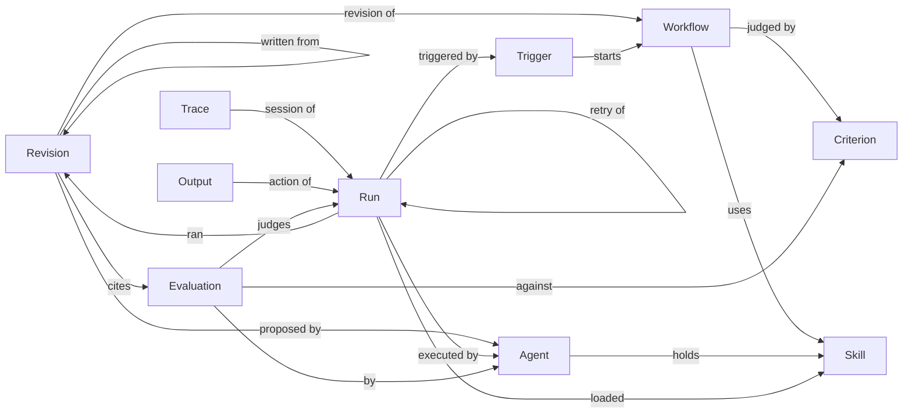

# Agent operations: workflows, runs and the instructions that improve

Build a living record of agent operations, and the agent workflows around it.
It keeps each workflow's instructions, triggers and criteria linked to every
run, the trace and outputs it left, and the judgments made of it. A run records
the revision of the instructions it ran, so whether a prompt change helped is
read from the runs each time you ask. Agents run the work, judge it and propose
better instructions; a person reviews each change on a branch before agents run
it.

Today a team's prompts sit in code, schedules in a cron file, traces in a
tracing tool and feedback in a spreadsheet, and nothing connects a change of
instructions to the runs that came after it. This cookbook sets Omnigraph up as
the one place where agents read what to run and write down what happened.

- **Instructions with a history.** Every revision of a workflow's instructions
  is kept, with why it was written, the runs that showed the problem and the
  person who approved it.
- **Evaluation tied to the change.** Judgments by people, models and rules sit
  on the run they judge, so a scorecard compares revisions on their own runs.
- **A loop that improves itself.** One agent judges runs, another proposes new
  instructions from the failures, and nothing reaches the agents until a person
  merges it.

> If you are an agent: the commands, roles and workflows are in
> [AGENTS.md](AGENTS.md). Read that file before running anything.

## The data model



| Area | Types | Holds |
|---|---|---|
| Who and how | `Agent`, `Skill` | The agents that run, judge and tune work, and the procedures they load |
| The job | `Workflow`, `Revision`, `Trigger`, `Criterion` | What a job is for, its instructions over time, what makes it due and what a good run does |
| What happened | `Run`, `Trace`, `Output`, `Evaluation` | Each attempt, its agent sessions, what it did in other tools and how it was judged |

- **The goal is the workflow; the prompt is the revision.** A `Workflow` holds
  what the job is for and what it delivers. Its instructions live on a
  `Revision`, and exactly one revision is active. Changing the goal makes a new
  workflow; changing how it is done makes a new revision.
- **A run names its revision.** A run reaches its workflow through the revision
  it ran, so the two cannot disagree, and every comparison of prompts is a read
  over runs.
- **The tracing tool keeps the spans.** A `Trace` is one agent session: its
  link in Claude Code, LangSmith or Langfuse and the totals runs are compared
  on, such as tokens and cost. Spans and tool calls stay in the tool that
  recorded them.
- **Records are written once.** Starting a run for an occurrence that already
  has one, proposing a revision number that exists or judging a run twice
  against the same criterion is refused and changes nothing. The run's slug
  names the occurrence, so two dispatchers cannot both start it.
- **Skills and rules are held once.** A workflow names the skills it uses and
  the criteria it is judged by, so a change to a skill reaches every workflow
  and every agent that loads it.

## Branching and merging

Agents read the instructions on `main`. A change to them is made on a branch,
and agents run it once a person merges.

- **A proposed revision is a branch.** The tuning agent writes a new revision
  and the judgments it answers on its own branch. A person reads the change
  beside the instructions it replaces, activates or rejects it there, and
  merges. A rejected revision is merged too, so its reason stays on record and
  the same idea is not proposed again.
- **Judgments wait for review.** The judging agent writes evaluations on a
  branch as well, so a person can check a batch before it counts.
- **Runs go straight to `main`.** Starting a run claims an occurrence, and the
  next dispatcher has to see that claim at once. The executor role writes runs,
  traces and outputs on `main`; it cannot merge a branch.
- **`main` keeps moving while a proposal waits.** Runs land on `main` the whole
  time a branch is open. The merge is three-way, so it brings in the new
  revision without losing the runs recorded since the branch began.

## Agents and workflows

Agents run, judge and tune the work; people decide which instructions agents
run.

| Kind | Workflow | What it does | Stored queries |
|---|---|---|---|
| Capture | Record a run | The executor claims an occurrence, then records its result, the window it read and what it did in other tools | `start_run`, `finish_run`, `record_output` |
| Capture | Attach traces | Links each agent session from Claude Code, Codex, LangSmith or Langfuse to its run, with tokens and cost | `attach_trace`, `record_loaded_skill`, `runs_without_trace` |
| Capture | Human feedback | A person judges a run against a criterion, as in an annotation queue | `record_human_evaluation`, `run_evaluations` |
| Maintain | Judge runs | Reads each finished run's trace and outputs and records a verdict for every criterion | `runs_to_judge`, `workflow_criteria`, `run_traces`, `record_evaluation` |
| Maintain | Propose a revision | Reads the failures no revision answers and what was rejected before, and proposes new instructions citing them | `failures_to_answer`, `revision_history`, `propose_revision`, `cite_evaluation` |
| Maintain | Check a change | Compares revisions on their own runs and costs, and proposes going back when a change made things worse | `revision_scorecard`, `revision_cost`, `criterion_failures` |
| Maintain | Close stuck runs | Finds runs whose agent stopped without closing them and marks them unknown | `stuck_runs`, `finish_run` |
| Maintain | Check the instructions | Finds a workflow with no active revision, or with two | `workflows_without_active_revision`, `workflows_with_several_active_revisions` |
| Act | Dispatch due work | Picks the workflows a schedule makes due, loads their instructions and skills, and runs them | `due_workflows`, `active_revision`, `workflow_skills`, `start_run` |
| Act | Review queue | Tells the owner which proposed revisions wait for a decision, with their evidence | `proposed_revisions`, `revision_evidence`, `revision_instructions` |
| Act | Failure alert | Posts the runs that failed or ended unknown since the last alert | `failed_runs`, `last_covered`, `record_output` |
| Act | Weekly report | Posts runs by outcome, failures and cost by revision to the team's channel | `workflow_scorecard`, `revision_cost`, `record_output` |

Every workflow follows the same loop:

1. A trigger makes it due, an event arrives, or a person asks.
2. The agent reads the active revision, the skills it names and its criteria.
3. It claims the occurrence with `start_run`, does the work and records each
   action outside the record as an `Output` as soon as it is taken.
4. It closes the run with what it did and, for a stream, the window it read.
   The next run starts where that window ends.
5. Judging and tuning agents write to a branch, and a person merges.

- **An agent cannot change what agents run.** The tuning and judging agent
  writes only on branches and cannot merge. Activating a revision is a
  person's step on the branch before the merge.
- **The record does not hold back what a run does outside it.** A review
  comment, a message or a pull request is sent by the agent's own tools, and
  the policy cannot stop it. Keep those workflows to commenting and notifying.
  An `Output` with the link shows the action was taken, and `output_at` finds
  it before the same thing is done twice.
- **The executor's reach is a practice.** The executor role writes `main` so
  that its claims count at once. Nothing in the policy limits it to runs;
  every commit records its actor, and a workflow or revision change by the
  executor is a defect to look for.
- **Bring your own agent.** Claude Code, Codex or a LangGraph service connects
  through the CLI or `omnigraph mcp`, with its own target per role. The
  cookbook ships no skill of its own; the workflows' skills live in the record.

## Data sources

The record connects the tools a team already runs agents with; each tool stays
the authority for its own data.

| Source | Examples | Feeds |
|---|---|---|
| Agent harnesses | Claude Code, Codex, Cursor | `Trace`, `Run` |
| Tracing and evaluation tools | LangSmith, Langfuse, Braintrust, Arize Phoenix | `Trace`, `Evaluation` |
| Agent frameworks | LangGraph, OpenAI Agents SDK, Claude Agent SDK | `Run`, `Trace` |
| Code hosting | GitHub, GitLab | `Trigger`, `Output` |
| Chat and help desks | Slack, Zendesk, Intercom | `Trigger`, `Output` |
| Skill libraries | Agent Skills folders in a repository | `Skill` |

The cookbook has no connectors. The executor writes runs, traces and outputs
through the stored writes as it works, and an import of traces from a tracing
tool uses the same `attach_trace`.

## Questions you can ask

Nobody keeps a scorecard by hand for these; each is read from the runs.

| Question | Stored query |
|---|---|
| Did the last change to its instructions make a workflow better? | `revision_scorecard` |
| Which criteria does each workflow fail under its current instructions? | `criterion_failures` |
| What has each revision of each workflow cost to run? | `revision_cost` |
| Which workflows are due to run? | `due_workflows` |
| Which finished runs has nobody judged yet? | `runs_to_judge` |

## Sample data

Harbor Labs, an invented engineering team, runs four agents on six workflows:
pull request review, bug reproduction, hourly support triage, daily judging,
weekly tuning and a weekly report. The seed holds 27 runs from 20 October to
23 November 2026, with 25 traces, 21 outputs and 31 evaluations. Revision 2 of
the pull request review came from the tuning agent; revision 2 of the bug
reproduction was rejected. On a fresh load, the questions above return:

- Pull request review, revision 1: 5 failing and 7 passing judgments over 6
  runs. Revision 2: 1 failing and 7 passing over 4 runs.
- Four criteria fail under the active revisions, once each: no style nits
  (pull request review), the failing script and the version (bug
  reproduction), and routing to the owner (support triage).
- Revision 1 of the review cost $2.38 over 6 runs; revision 2 cost $2.57 over
  5. Judging cost $3.16 over 2 runs, the most of any workflow.
- At 12:00 on 23 November, support triage (due 10:00) and judging (due 06:00)
  are due.
- Two runs wait to be judged: pull request 414 and the 09:00 support triage.

[seed.md](seed.md) describes it and what each stored read returns on it.

## Run it

Paste this prompt into a coding agent such as Claude Code or Codex:

```text
Read https://www.omnigraph.dev/onboarding.md and set up Omnigraph for me with the agent-ops cookbook: https://github.com/ModernRelay/omnigraph-cookbooks/tree/main/agent-ops
```

To do it by hand, follow the shared [local setup](../docs/local-setup.md)
using folder `agent-ops` and Graph ID `agents`. [AGENTS.md](AGENTS.md) has the
exact command for each question and workflow on this page.
