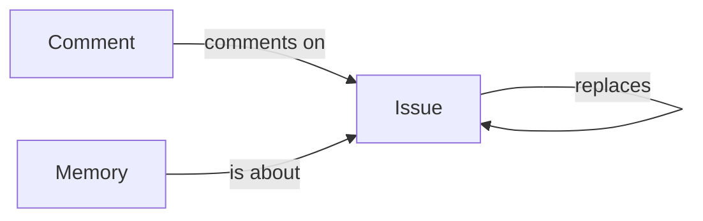

# Agent work queue: issues that coding agents share

Build a living work queue for coding agents, and the agent workflows around it. It keeps issues, what waits on what, claims, comments and project memories linked, so every agent works from one current picture. Whether an issue is ready or blocked is worked out from its links on every read, and a claim goes to exactly one agent. Agents file, claim and close work, and plans go on branches an admin reviews before they reach the main queue.

Coding agents usually plan in private to-do lists and markdown files, or in a tracker built for people. Two agents pick up the same task, one starts work whose prerequisite is still open, and the claim of an agent that crashed sits there until someone notices. This cookbook sets OmniGraph up as the one place the queue is held, in the style of [beads](https://github.com/gastownhall/beads) (`bd`).

- **Ready work, not a status field.** An agent asks what it can start and gets issues that are open, not deferred and not waiting on anything unfinished.
- **One agent per issue.** A claim is a single conditional write, so of several agents racing for an issue exactly one gets it.
- **A trail of who did what.** Every change is a commit with its actor, so the history of an issue is the audit trail.

> If you are an agent: the commands, roles and workflows are in
> [AGENTS.md](AGENTS.md). Read that file before running anything.

## The data model



| Area | Types | Holds |
|---|---|---|
| Work | `Issue` | A unit of work: kind, status, priority, labels, who holds it and until when, deferral, due date and an external reference |
| Ordering and hierarchy | `BlockedBy`, `ChildOf` | What must close first, and the epic or parent an issue belongs to |
| Annotations | `RelatesTo`, `DiscoveredFrom`, `Duplicates`, `Supersedes` | Links that explain an issue and never affect readiness |
| Conversation | `Comment`, `CommentOn` | What agents and people say about one issue |
| Project knowledge | `Memory`, `MemoryAbout` | A lasting fact about the project, optionally about an issue, that every new agent session is given |

- **Readiness is computed, never stored.** There is no `blocked` status. An issue is ready when it is open, its deferral has passed, nothing unfinished blocks it, and no unfinished parent passes a block down to it. A flag could disagree with the links; a query cannot.
- **Blocks pass down the hierarchy.** When an epic waits on outside work, its children wait too. A closed parent passes nothing down.
- **The claim lives on the issue.** The assignee and the lease expiry are on the issue itself, so one conditional write can check and take it.
- **One parent, any number of links.** An issue has at most one parent. A link added twice is added once.
- **History comes from commits.** There is no event table. Each commit records its actor, and OmniGraph keeps every earlier version.
- **Yours to change.** The model is one file, [`schema.pg`](schema.pg), with 3 node types and 8 edge types. Add a field or a kind of issue your team uses.

## Branching and merging

A change is made on a branch, which is a version of the whole queue. The main queue moves when a branch is merged.

- **Claims and closes go straight to the main queue.** Agents must see each other's claims at once, so they write to `main`. This cookbook has no agent role that is held to branches; the roles are admin, writer and reader.
- **Plans.** A planner files an epic, its tasks and their links on a branch. Anyone can read what is ready and blocked on that branch, and an admin merges it into `main` when the plan is right.
- **Bulk imports.** Load issues from another tracker on a branch, read the result, and merge it when it looks right.
- **Experiments with priority.** Reshuffle priorities or links on a branch to see what it would release, then drop the branch.

## Agents and workflows

Agents file work, keep the queue consistent and tell people what needs them. People set direction and merge plans.

| Kind | Workflow | What it does | Stored queries |
|---|---|---|---|
| Capture | Discovered work | An agent that finds a bug or a gap while working files it and links it to the issue it was working on | `link_discovered_from`, `link_blocks`, `link_parent` |
| Capture | Notes and memories | Records progress as a comment and a lasting fact as a memory about the issue | `comment`, `remember_about`, `remember` |
| Maintain | Claim and finish | Takes the top ready issue, holds it under a lease, renews it, and closes it with a reason, which releases what waited on it | `ready`, `claim`, `renew`, `release`, `close` |
| Maintain | Lease reclaim | Reopens every claim whose lease has run out, so a crashed agent does not hold work for ever | `expired_leases`, `reclaim_expired` |
| Maintain | Close guard | Refuses to close an issue that has an open child or an open blocker, unless they close together | `open_children_of`, `open_blockers_of`, `close` |
| Maintain | Link hygiene | Refuses a link that would make an issue wait on its own ancestor or descendant, or that closes a loop | `reaches`, `lineage`, `subtree` |
| Maintain | Duplicate triage | Searches before filing, links an issue to the one it duplicates or replaces, and closes the duplicate | `search`, `similar`, `link_duplicates`, `link_supersedes` |
| Maintain | Memory curation | Finds a memory the code has outgrown and replaces or deletes it | `recall`, `memories_about`, `remember`, `forget` |
| Act | Stalled claim alert | Tells the agent or person holding an issue whose lease has lapsed | `expired_leases`, `assigned` |
| Act | Unblock request | For each blocked issue, tells whoever owns the open blocker what is waiting on it | `blocked`, `blocked_by_ancestor` |
| Act | Queue digest | Posts counts by status and what is ready, for a stand-up or a channel | `stats`, `ready_count`, `ready` |

Every workflow has the same parts:

1. Something starts it: an agent finishing a task, a lease running out, or a schedule.
2. The agent reads the state it needs through stored queries.
3. It acts. It writes to the queue, or it tells someone outside it: a message, a ticket, a report.
4. A person decides. An admin merges a plan, or the person told acts on it.

- **Agents cannot merge, and cannot be told apart by the queue alone.** A writer can create and delete branches and write any branch, `main` included, but only an admin merges one. The queue does not check that the actor an agent names as `assignee` is the one its token belongs to; the commit history records the token's actor.
- **Outside actions are not held back by the record.** A message or a ticket goes out through the agent's own tools, and nothing here reviews it first. Keep the alert, request and digest workflows to telling and drafting, and give the agent only the outside access it needs. The cookbook includes no integrations for them.
- **Repeats are avoided with a comment.** The schema has no field for "alert sent". An agent that tells someone writes a comment on the issue with `comment` and reads the comments first with `comments`, so the next run sees it.
- **Bring your own agent.** Any agent that can run a command connects through the `ob` client or plain `omnigraph` commands. `ob onboard` prints the instructions to paste into its AGENTS.md, and `ob prime` gives a new session its work, what is ready and the memories.

## Data sources

The queue holds the work and the links between it. Each tool stays the authority for its own data.

| Source | Examples | Feeds |
|---|---|---|
| Other trackers | beads (`bd`), GitHub Issues, Linear, Jira | `Issue`, `BlockedBy`, `ChildOf` |
| Plans and specs | Markdown plans, design docs | `Issue`, `ChildOf` |
| Coding agents | Claude Code, Codex, Cursor | `Issue`, `Comment`, `Memory` |
| CI and monitoring | GitHub Actions, Sentry | `Issue`, `DiscoveredFrom` |

The cookbook has one connector: `ob import` reads a beads JSONL export, and `ob export` writes one. For the other tools a script or an agent reads from the tool and files issues through `ob create`, keeping its id in the issue's external reference.

## Questions you can ask

Nobody maintains a blocked flag or a ready list for these.

| Question | Stored query |
|---|---|
| What can an agent claim now? | `ready` |
| What is blocked, and by what? | `blocked` |
| Which blocks does an issue inherit from its parents? | `ancestor_blockers` |
| What depends on this issue, directly or not? | `downstream` |

The cookbook has 35 stored reads and 26 stored writes. AGENTS.md lists them.

## Sample data

The cookbook comes with Larkspur, a made-up note-taking app whose offline sync, shared notebooks and 0.9 release are being built by three agents: 22 issues, 5 blocking links, 9 parent links, 2 comments and 2 memories. On a fresh load, the questions above return:

- Eight issues are ready, led by the sync epic, a crash bug and the access-control task.
- Five issues are blocked. Three wait on open work directly, and the two sharing tasks wait because their parent does.
- The invite endpoint inherits a block from the sharing epic, which waits on the open access-control task.
- Two issues wait on the sync queue task: the conflict feature directly and the sync docs through it.

[seed.md](seed.md) describes it and lists what every stored read returns.

## Run it

Paste this prompt into a coding agent such as Claude Code or Codex:

```text
Read https://www.omnigraph.dev/onboarding.md and set up Omnigraph for me with the beads cookbook: https://github.com/ModernRelay/omnigraph-cookbooks/tree/main/beads
```

The agent installs OmniGraph if needed, creates the graph, loads Larkspur and runs the questions above.

To do it by hand, follow the shared [local setup](../README.md#local-setup)
using folder `beads` and Graph ID `beads`. [AGENTS.md](AGENTS.md) has the
exact command for each question and workflow on this page.
