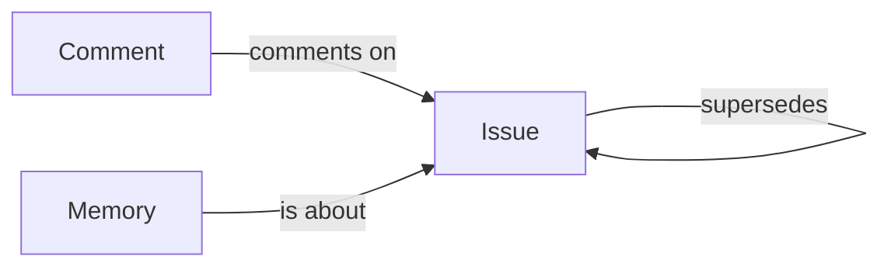

# Agent work queue: one plan that several coding agents share

A work queue for coding agents, where each agent asks what is ready, claims it
so no other agent can, and closes it when done. Issues, what waits on what,
parent and child work, comments and project memories are linked, and readiness
is worked out from those links on every read. Agents file and re-plan work, and
a person reviews the plans they put on a branch.

When several coding agents work on one codebase, the plan usually lives in
markdown files or a tracker built for people. Agents lose track of what is
blocked, two of them pick up the same task, and nobody can say who changed
what. This cookbook sets Omnigraph up as the one place the plan is held, in the
style of [beads](https://github.com/gastownhall/beads) (`bd`).

- **Ready work on every read.** An agent asks what it can claim and gets issues
  that are open, not deferred, and not waiting on anything unfinished.
- **No double claims.** Of several agents racing for one issue, exactly one
  gets it.
- **A history of every change.** Each command is one commit that records which
  actor made it.

> If you are an agent: the commands, roles and workflows are in
> [AGENTS.md](AGENTS.md). Read that file before running anything.

## The data model



| Area | Types | Holds |
|---|---|---|
| Work | `Issue` | A bug, feature, task, epic, decision, spike or milestone, with its status, priority, labels and the actor holding it |
| Ordering | `BlockedBy`, `ChildOf` | What must close before an issue can start, and the epic or parent an issue belongs to |
| Annotations | `RelatesTo`, `DiscoveredFrom`, `Duplicates`, `Supersedes` | How issues otherwise connect; none of them affects what is ready |
| Discussion | `Comment`, `Memory`, `CommentOn`, `MemoryAbout` | Notes on one issue, and durable project facts every new agent session reads |

- **Blocked is derived, never stored.** There is no `blocked` status. An issue
  is blocked when an open issue blocks it, or when an open parent passes down a
  block from outside its own subtree, so the status cannot disagree with the
  links.
- **A parent waits for its children.** The link alone says so: closing a parent
  with an open child is refused unless they close together.
- **The claim is on the issue.** The assignee and an optional lease sit on the
  issue itself, so claiming is one conditional update that only one agent wins.
- **A lease, not a heartbeat.** A claim can expire. Reclaiming reopens every
  expired claim in one commit, so a crashed agent does not hold work forever.
- **Yours to change.** The model is one file, [`schema.pg`](schema.pg), with 3
  node types and 8 edge types. Add components, owners or whatever your
  project tracks.

## Branching and merging

A change is made on a branch, which is a version of the whole queue. `main`
moves when the branch is merged.

- **Plans.** A planning agent files an epic and its tasks on a branch. A person
  reads the diff and an admin merges it, so agents see the plan only once it is
  approved.
- **Trial re-plans.** Re-link what waits on what on a branch and read
  `ready` there to see the order that results, before it reaches `main`.
- **Claims and closes on `main`.** Claiming and closing are the everyday
  writes, and they go straight to `main`. The cookbook does not hold them for
  review.

## Agents and workflows

Agents do the work and keep the queue consistent, and people set direction and
approve plans.

| Kind | Workflow | What it does | Stored queries |
|---|---|---|---|
| Capture | Discovered work | An agent that finds a bug while working files it as a new issue and links it to the issue it was working on | `link_discovered_from`, `show` |
| Capture | Progress notes | When CI finishes or a pull request opens, records the outcome as a comment on the issue | `comment`, `comments` |
| Capture | Project memory | Keeps a durable fact, such as a decision or a command to run before pushing, for every later session | `remember`, `remember_about`, `recall`, `memories` |
| Capture | Merge closes work | When a pull request merges, closes its issue with the reason, which releases what waited on it | `close`, `comment` |
| Maintain | Claim and work | An agent takes the top ready issue, works it, then closes it or gives it back | `ready`, `claim`, `close`, `release` |
| Maintain | Lease reclaim | Reopens issues whose claim has lapsed, so another agent can take them | `expired_leases`, `reclaim_expired` |
| Maintain | Duplicate sweep | Finds issues that say the same thing and links the newer to the one that stays | `search`, `similar`, `link_duplicates`, `link_supersedes` |
| Maintain | Re-plan | On a branch, changes what waits on what and reads the resulting ready set | `link_blocks`, `link_parent`, `unlink_blocks`, `ready` |
| Maintain | Unblock the most | Works out which open issue holds up the most work, so it is picked first | `blocked`, `downstream`, `upstream` |
| Act | Ready-work dispatch | When work is ready, starts or messages an agent to take it | `ready_filtered`, `ready_count` |
| Act | Stalled-work notice | Tells the owner of a blocking issue, in their chat or tracker, that work waits on them | `blocked`, `blocked_by_ancestor`, `assigned` |
| Act | Queue report | Posts the counts and the blocked list to the team on a schedule | `stats`, `ready_count`, `blocked` |

Every workflow has the same parts:

1. Something starts it: an agent finishing a task, a change in a tool such as
   CI or GitHub, or a schedule.
2. The agent reads the state it needs through stored queries.
3. It acts. It writes to the record, or it tells someone outside the record: a
   message, a ticket, a report.
4. A person decides where it matters: they review and merge a plan branch, or
   act on what they were told.

- **Writers can change `main`, and review of an agent's work is a practice.**
  An agent that runs as a writer can claim, close and link on `main`, and the
  access policy does not stop it. Only an admin can merge a branch. To get
  review, have agents file plans on a branch and give only people the admin
  role.
- **Outside actions are not held back by the record.** A message or a ticket
  goes out through the agent's own tools, and nothing here reviews it first.
  Keep those workflows to telling and drafting, and give the agent only the
  outside access they need. The cookbook includes no integrations for them.
- **A repeat is a practice too.** The record has no field for "notified". An
  agent can leave a comment after telling someone and read the issue's comments
  before telling again. Nothing enforces it.
- **Filing is a gap.** There is no stored write for creating an issue. The
  `ob` client files one, with its links, as a strict load that refuses an
  existing id, and the stored writes handle everything after that.
- **Bring your own agent.** `ob` is a command-line client with the `bd`
  command set, which any agent that runs shell commands can use. It adds the
  retry that many agents writing at once need. `ob onboard` prints the
  instructions to give an agent.

## Data sources

The record holds the plan that connects your tools. Each tool stays the
authority for its own data.

| Source | Examples | Feeds |
|---|---|---|
| Issue trackers | Linear, Jira, GitHub Issues, GitLab | `Issue`, `BlockedBy`, `ChildOf` |
| Code review | GitHub pull requests, GitLab merge requests | `Comment`, `Issue` status |
| CI | GitHub Actions, Buildkite, CircleCI | `Comment`, new `Issue` records for failures |
| Chat | Slack, Discord | `Memory`, `Comment` |
| Beads | `bd`, through its JSONL export | `Issue` and its links |

The cookbook includes one connector: `ob import` reads a `bd` export and
`ob export` writes one. For the others, a sync is a script, or an agent, that
reads from the tool and files issues with `ob create` or writes through the
stored mutations.

## Questions you can ask

Nobody maintains a status column or a board for these.

| Question | Stored query |
|---|---|
| What can an agent claim now? | `ready` |
| What is blocked, and by what? | `blocked` |
| Which blocks does an issue inherit from its parents? | `ancestor_blockers` |
| What depends on this issue, directly or not? | `downstream` |

The cookbook has 35 stored reads and 26 stored writes. AGENTS.md names them.

## Sample data

The cookbook comes with Larkspur, a made-up note-taking app whose offline sync,
shared notebooks and 0.9 release are being built by three agents: 22 issues, 9
parent links, 5 blocking links, 2 comments and 2 memories. On a fresh load, the
questions above return:

- Eight issues are ready, led by the epic for offline sync and a P0 crash on
  opening an empty notebook.
- Three issues wait directly on open work: conflict handling, the sync docs
  and shared notebooks. Two more, the sharing endpoint and dialog, are blocked
  through their parent.
- The sharing endpoint inherits its block from the shared-notebooks epic, which
  waits on the access control task.
- The queue task blocks conflict handling directly and the sync docs through
  it.

[seed.md](seed.md) describes the project and the ready and blocked sets.

## Run it

Paste this prompt into a coding agent such as Claude Code or Codex:

```text
Read https://www.omnigraph.dev/onboarding.md and set up Omnigraph for me with the beads cookbook: https://github.com/ModernRelay/omnigraph-cookbooks/tree/main/beads
```

To do it by hand, follow the shared [local setup](../docs/local-setup.md)
using folder `beads` and Graph ID `beads`. [AGENTS.md](AGENTS.md) has the
exact command for each question and workflow on this page.
