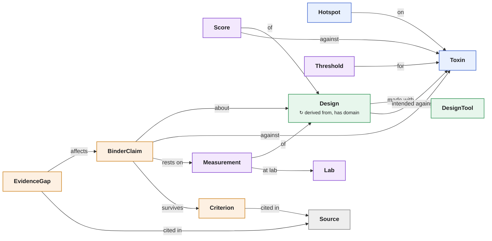

# Binder campaign: a protein design run, and whether its results hold up

Some venoms carry proteins — *toxins* — that jam one precise part of a nerve
cell, which is what makes a sting dangerous. A *binder* is a small protein
designed to latch onto a chosen spot on another protein; one that covers the
damaging face of a toxin can block it, which is roughly what an antivenom
does. Designing a binder *de novo* means generating it in software rather than
harvesting it from an immunised animal. A *campaign* is one run of that:
choose the targets, generate candidates by the hundred thousand, score them
computationally, send a couple of hundred to a lab, and find out which ones
actually stick. This graph holds one such campaign, end to end. Graph ID
`binders`.

The point is not recording which designs bound. A results sheet, a scoring
notebook and a lab notebook each hold one slice of a campaign, and "bound" is
a definition rather than a measurement: the campaign seeded here tested 211
designs and reported **17** binders, while its own report re-counts them under
a dozen other rules and gets anything from **7 to 18**. The questions that
decide whether to believe that number — which claims survive a stricter rule,
which rest on evidence nobody wrote down, what a design was derived from,
which bar a score cleared — fall between those slices. So a `BinderClaim` is a
node here: it links to the measurements it rests on, to every `Criterion` it
survives, and to any `EvidenceGap` recorded against it. Tightening the
definition is a traversal, not a re-analysis.

The seed is **real**, where the other cookbooks' seeds are fictional:
Anthropic's scorpion-toxin binder campaign of October 2026, whose designs,
scores and both labs' assay results are public under CC BY 4.0. The campaign
process and the criteria come from its technical report, transcribed and
cited. See [seed.md](seed.md) and [References](#references).

Sibling cookbook: [pharma-intel](../pharma-intel/) is the business around a
drug program — compounds, trials, deals, and the sponsor's own assumptions.
This one sits a rung lower, at a single experimental campaign and the evidence
beneath its claims.

## Quick start

Use the shared [local setup](../README.md#local-setup) with folder
`binder-campaign` and graph `binders`, then load `seed.jsonl`. With the server
and gateway up:

```bash
omnigraph query binder_claims --target local-reader --graph binders
omnigraph query claims_by_toxin --target local-reader --graph binders
omnigraph query criteria_all --target local-reader --graph binders
omnigraph query claims_lost_under --target local-reader --graph binders \
  --params '{"criterion":"crit:aahi-mature-mass"}'
omnigraph query evidence_gaps --target local-reader --graph binders
```

`binder_claims` lists the 17, and `claims_by_toxin` splits them: Cn2 7,
AaH II 4, AaH I 4, LqhIII 2, and none at all against Ts1. `criteria_all` is
the interesting one — ten different rules for calling a design a binder, each
with the count the report gives it, from 18 down to 11. (The report's table
reaches 7 under several rules at once, but it does not say which designs those
drop, so they are not seeded.)

`claims_lost_under` then shows what a rule costs. Scored at AaH I's documented
mature mass it drops `AaHI-B1` through `AaHI-B4`, because the construct
actually used in the assay was never written down — which is also the first
row `evidence_gaps` returns. Four of seventeen claims rest on a protein
nobody recorded.

Merge the `aliases:` of
[`omnigraph-config.example.yaml`](omnigraph-config.example.yaml) into
`$OMNIGRAPH_HOME/config.yaml` for a short name per read, such as
`omnigraph alias claims` or
`omnigraph alias lost-under --params '{"criterion":"crit:no-ovalbumin"}'`.

## Why not a notebook?

For one campaign, analysed once, by one person: use a notebook. The released
CSVs load into a dataframe in a line, and the sensitivity analysis above is a
dozen lines of filtering. A graph is overhead you do not need, and it is
better to say so than to pretend otherwise.

Four things change that answer.

- **The question goes more than one hop.** Design lineage is a redesign of a
  redesign, or a fusion of two domains that were themselves selected. Asked of
  tables, that is a join against itself, as many times as the chain is long,
  rewritten whenever the question changes. Here it is `derivedFrom{1,3}`.
- **A claim is not a column.** In a results sheet, "is a binder" is a column
  somebody computed, and when the rule changes the column is overwritten.
  There is nowhere to put who decided, under which rule, and on what evidence.
  Separate the three and changing the rule adds a row instead of destroying
  one.
- **A gap has no column either.** "The construct used in this assay was never
  written down" is not a value that fits in a results sheet. It ends up in a
  footnote in a PDF, which is where it was. As a node it links to the four
  claims it undermines, and a query finds them.
- **More than one writer.** A notebook has one author. When several people and
  agents propose changes, you want a schema enforced on every write, each
  author on a branch, and a person merging. That is the part a dataframe has
  no answer for.

None of this argues for a graph database over any other. If that is the
question rather than whether, see
[open source graph databases compared](https://www.omnigraph.dev/guide/open-source-graph-databases)
and [graph databases and agent memory](https://www.omnigraph.dev/graph-databases).
What this cookbook leans on specifically is a typed schema checked on every
write, branches reviewed before they merge, and history that can be read back
as it stood when a claim was made.

## Model

[`schema.pg`](schema.pg) has 20 node types and 32 edge types in four layers,
plus the campaign's own process. The spine:



Blue is what the campaign aimed at, green what it made, purple what it
measured, orange what anyone concluded from that, grey where a transcribed
fact came from. Each arrow is an edge type in its schema direction; a `↻` line
in a box is an edge between two nodes of that type.

| Layer | Types | Holds |
|---|---|---|
| Targets | `Toxin`, `Hotspot` | The five toxins, and the five residues per toxin the agent chose for designs to contact |
| Designs | `Design`, `DesignTool`, `BackboneFamily`, `SequenceMethod` | Every tested design, the tool that drew its backbone, the design it was redesigned from, the two domains a fusion joins |
| Evidence | `Score`, `Threshold`, `Predictor`, `Measurement`, `Lab`, `SpecificityCheck`, `Control` | What selected a design before any lab saw it, and what each lab then measured, including binding to things it was never meant to bind |
| Claims | `BinderClaim`, `Criterion`, `EvidenceGap` | Somebody's reading of the measurements, the rule it holds under, and what the record does not contain |
| Process | `CampaignWindow`, `SelectionRule`, `AgentRole`, `Source` | How the run itself was organised, and where each transcribed fact comes from |

Three rules keep the claims layer honest, and the cookbook's
[`CLAUDE.md`](CLAUDE.md) spells them out for agents:

- **A claim never carries its own evidence.** Binding values live on
  `Measurement`. A value copied onto the claim would disagree with the lab the
  first time anyone refits it.
- **A criterion is a node, never a `where` clause.** Written into a query, the
  definition moves somewhere no reader can see it.
- **A gap is a fact, not an omission.** Where the record is silent there is an
  `EvidenceGap` citing the source that says so — never a plausible value.

## Reading it

61 stored queries, 43 of them reads, in six files. `omnigraph queries list`
names them all with their parameters.

| File | Answers |
|---|---|
| [`claims.gq`](queries/claims.gq) | Which designs are claimed to bind; what each claim rests on; who survives a rule; what a rule drops; where the evidence has holes |
| [`designs.gq`](queries/designs.gq) | How a design was made; what it was derived from; which domains a fusion joins; which tools produced binders |
| [`scores.gq`](queries/scores.gq) | Every bar, fixed before scoring; what one design scored; the score behind a claim; what cleared every threshold and still did not bind |
| [`assays.gq`](queries/assays.gq) | What each lab measured; where the two disagree; which values are only upper limits; off-target binding; whether the controls worked |
| [`campaign.gq`](queries/campaign.gq) | The windows the run passed through, the rules that changed between them, and the duties the agents were held to |
| [`mutations.gq`](queries/mutations.gq) | The writes below |

`cleared_but_did_not_bind` with `{"toxin":"toxin:ts1"}` is worth running on
its own. Every threshold cleared, and nothing bound — the report finds the
same thing, that the final score tracked success across design sets but did
not pick out binders within one.

## Writing to it

The campaign's record is history and does not change. What people add is the
editorial layer: a rule to count under, a gap someone notices, a claim
withdrawn when the evidence beneath it moves. Those writes run on a branch:

```bash
omnigraph branch create review/ova-rule --from main --target local-writer --graph binders
omnigraph mutate add_criterion --target local-writer --graph binders --branch review/ova-rule \
  --params '{"slug":"crit:strict","name":"Strict","rule":"No signal against any unrelated protein.","applied":false,"binders_under_rule":9,"recorded_at":"2026-11-19T00:00:00.000Z"}'
omnigraph branch merge review/ova-rule --into main --target local-writer --graph binders
```

Evidence comes before the claim that rests on it: `assert_binder_claim`
records a reading of the results with a name and a date, and `ground_claim`
ties it to a `Measurement` already in the graph. Retire a claim with
`withdraw_claim`, which sets `asserted` to false, rather than deleting it — a
claim that was once made is part of the record.

## What it does not hold

- **No neutralisation data.** Binding is shown; stopping the toxin is not.
  The campaign tested none, in cells or in animals, so neither does this.
- **No untested designs.** 318,484 were generated; the 211 that reached a lab
  are here.
- **No per-design campaign window.** The report gives the three windows and
  the selection rules that changed between them, but not which window chose
  each design. The windows are campaign-level facts; no design links to one.
- **No raw instrument traces.** The release holds the sensorgrams; the graph
  holds the fitted values and the flags on them.

## References

| What | Where |
|---|---|
| Designs, scores, assay results, controls | [Scorpion toxin binder design: data release](https://huggingface.co/datasets/Anthropic/scorpion-toxin-binder-design) — Anthropic, 20 October 2026, CC BY 4.0 |
| Campaign process, criteria, evidence gaps | [De novo design of protein binders against scorpion toxins with Claude](https://assets.claude.com/31ac578806cffd8b3d92d8affe6edc4c04d502e1.pdf) — technical report, 20 October 2026 |
| What the seed holds, and how it was built | [seed.md](seed.md) |
| Domain model and the rules for adding to it | [CLAUDE.md](CLAUDE.md) |
| Setup, roles, tokens, upgrades | [root README](../README.md) |

Both sources are in the graph as `Source` nodes with the day they were read,
so `omnigraph query sources` answers this table from the data. Every fact
transcribed from the report carries an edge to it.
