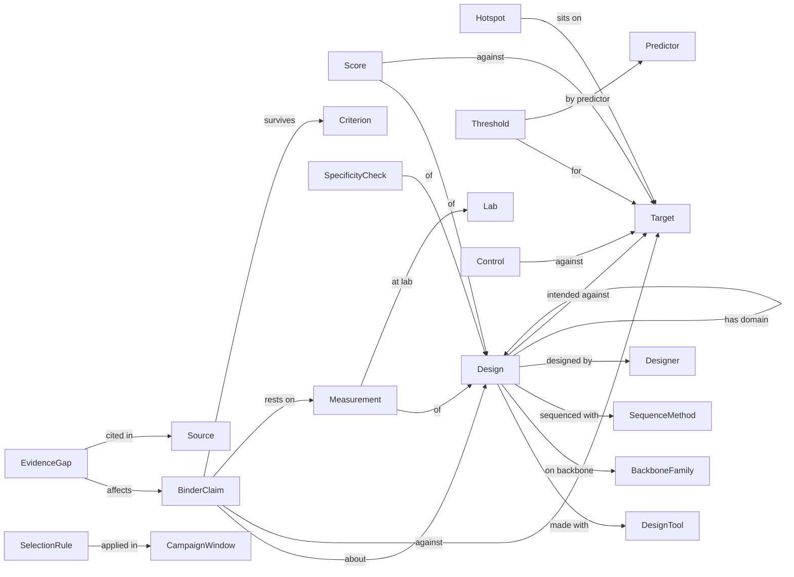

# Protein binder design campaign: designs, evidence, and the claims they carry

Build a living record of a protein binder design campaign, and the agent
workflows around it. It keeps the targets, every design and how it was made,
the scores that selected it, what each lab measured, and the claim that a
design binds a target — with the rule that claim holds under and the evidence
it rests on. Whether a design counts as a binder is worked out from the
measurements under the rule you name, so tightening the definition re-reads
the record instead of re-analysing it. Agents propose every change on a branch
a scientist reviews.

A campaign leaves its designs in one tool, its scores in a notebook, its
assay results in a contract lab's spreadsheet and its verdict in a slide, and
the rule behind that verdict in nobody's hands at all. Six months later the
rule has been forgotten, so the list of binders cannot be re-derived or
argued with. This cookbook sets OmniGraph up as the one place the designs,
the evidence and the claims are held together.

- **A claim names its rule.** "This design binds this target" is recorded
  with the criterion it holds under and the measurements beneath it.
- **Re-counting is a read.** Add a rule and ask who survives it; the old
  answer is still there, because nothing was overwritten.
- **A gap is a fact.** What the record does not hold is written down and
  linked to the claims nobody can check because of it.

> If you are an agent: the commands, roles and workflows are in
> [AGENTS.md](AGENTS.md). Read that file before running anything.

## The data model



| Area | Types | Holds |
|---|---|---|
| Targets | `Target`, `Hotspot` | What the campaign designs against, and the residues on each that designs were aimed at contacting |
| Designs | `Design`, `Designer`, `DesignTool`, `BackboneFamily`, `SequenceMethod` | Every design that reached a lab, who made it, the model that drew its backbone, the method that chose its sequence, the design it was redesigned from and the domains a fusion joins |
| Evidence | `Score`, `Threshold`, `Predictor`, `Measurement`, `Lab`, `SpecificityCheck`, `Control` | What selected a design before any lab saw it, and what each lab then measured: kinetic constants, the model fitted to them, binding to proteins it was never meant to bind, and whether the run's controls worked |
| Claims | `BinderClaim`, `Criterion`, `EvidenceGap` | Somebody's verdict on the measurements, every rule it holds under, and what the record does not contain |
| Process | `CampaignWindow`, `SelectionRule`, `AgentRole`, `Source` | How the run was organised, which rules selected designs in which stretch of it, which duties were kept apart, and where each transcribed fact came from |

- **A claim is a node, not a column.** In a results sheet "is a binder" is a
  column somebody computed, and changing the rule overwrites it. Here the
  verdict, the rule and the evidence are three things, so a new rule adds
  rows and the old answer survives.
- **A criterion is a node, never a filter in a query.** Written into a query,
  the definition of a binder moves somewhere no reader can see it. Each rule
  is recorded in words precise enough to apply by hand, with the count its
  source reports, so the graph's own count can be compared with it.
- **A threshold is recorded as set before scoring.** The bar each predictor
  had to clear was fixed from decoys and negative controls first, which is
  why a claim can name the bar it cleared rather than assert one existed. A
  bar set afterwards is recorded as such, because that is a finding.
- **A gap is a fact, not an omission.** Where the record is silent there is
  an `EvidenceGap` citing the source that says so, linked to the claims,
  designs and targets it reaches. Never a plausible value in place of one.
- **An absent result is not a negative result.** A design nobody measured
  against a target has no row; a design measured and found not to bind has
  one. Collapsing the two would turn a missing experiment into evidence.
- **Yours to change.** The model is one file, [`schema.pg`](schema.pg), with
  21 node types and 33 edge types.

## Branching and merging

A change is made on a branch, which is a version of the whole record, and the
baseline moves only when someone merges it.

- **A round of the campaign.** An agent registers the bars, records the
  designs a generation run produced and the readings a predictor returned,
  all on one branch, so a scientist reads the shortlist and its provenance
  before any of it becomes the baseline.
- **A re-count under a new rule.** Add a criterion on a branch, record which
  claims survive it, and read the counts as they would be before anyone else
  sees them.
- **A lab's results.** Load a run's measurements on a branch, read them
  against the claims they touch, and merge once a scientist has checked them
  against the lab's own report.
- **Two reviewers at once.** Each works on their own branch against the same
  base, and both merge, because adding a rule and recording a gap do not
  collide. Two branches that change the same row do, and the second merge
  reports it instead of silently winning.
- **A write-up's evidence, as it stood.** Every commit is readable, so the
  claims and gaps behind a paper can be read back as they were on the day it
  was submitted.

Review here is a practice, not a rule the graph enforces.
[`policies/graph.policy.yaml`](policies/graph.policy.yaml) gives readers,
writers and admins: a writer may write `main` and merge into it, and only an
admin may change the schema. There is no actor confined to branches, so an
agent given a writer's token can reach `main` — give agents their own actor
and keep them to branches if you need that enforced.

## Agents and workflows

Agents run the campaign: they choose what to aim at, generate designs, operate
the predictors, order the synthesis and the assays, and bring every result
back. The record is what they read from and write to. The verdicts stay with
people.

| Kind | Workflow | What it does | Stored queries |
|---|---|---|---|
| Capture | Target and bar registration | Records a target, the epitope residues to aim at, and the bar each predictor has to clear, before anything is scored | `add_target`, `add_hotspot`, `set_threshold`, `hotspots` |
| Capture | Design intake from a generation run | Runs a design tool and a sequence method, then records each design with its tool, backbone family, designer and intended targets, a redesign with its parent, and a fusion with its two domains | `add_design`, `derive_design_from`, `add_fusion_domain`, `intend_design_against` |
| Capture | Co-folding and scoring run | Takes a design's sequence and a target's structure, co-folds them with each predictor, and records the interface scores and whether they cleared the registered bar | `get_design`, `thresholds_all`, `record_scores`, `design_scores` |
| Capture | Assay result intake | Records what a lab returned: each measurement with its design, target and lab, the controls that ran beside it, and the checks against proteins the design was never aimed at | `add_measurement`, `add_control`, `record_specificity_check`, `measurements_for_design` |
| Maintain | Verdict from the evidence | Reads the measurements for a design and target, records the claim, and ties it to the rows it rests on | `assert_binder_claim`, `ground_claim`, `claim_evidence` |
| Maintain | Re-count under a rule | Adds a rule for calling a design a binder, records which claims survive it, and compares the count with the one its source reports | `add_criterion`, `claim_survives_criterion`, `criterion_survivor_counts`, `claims_lost_under` |
| Maintain | Score-to-bar audit | Finds scores computed after selection had happened, and designs whose recorded verdict no longer matches the bars now standing | `scores_from_rerun`, `cleared_against`, `design_scores`, `thresholds_all` |
| Maintain | Claim and evidence sweep | Finds claims resting on nothing recorded and either grounds them, withdraws them, or writes down what the evidence does not hold | `claims_with_gaps`, `ground_claim`, `withdraw_claim`, `record_gap` |
| Act | Shortlist and synthesis order | Turns the designs that cleared their bars into an order a vendor can make, under the campaign's own selection rules, and queues the assay with the controls to run beside it | `cleared_against`, `top_scores`, `selection_rules` |
| Act | Next redesign round | Takes the designs that cleared every bar and bound nothing, and starts a round from those parents with the tools that have produced binders | `cleared_but_did_not_bind`, `design_provenance`, `tools_behind_binders` |
| Act | Confirmatory run request | For a claim resting on one lab, an upper limit, a run whose control failed, or a design that bound something it was never aimed at, asks the lab for the run that would settle it | `claims_with_gaps`, `upper_limit_only`, `failed_controls`, `off_target_hits` |
| Act | Pre-publication gap report | Before a write-up goes out, sends the authors every gap that blocks a check, the claims it reaches, and the claims that rest on nothing | `evidence_gaps`, `gap_reach`, `claims_fully_evidenced` |

Every workflow has the same four parts:

1. Something starts it: a generation or scoring run finishes, a lab returns a
   result, a claim or rule changes in the record, or a write-up is due.
2. The agent reads the state it needs through stored queries.
3. It acts. It operates a tool, writes to the record on its own branch, or
   asks someone outside for something.
4. A scientist decides. They review the branch and merge it, or approve the
   order, the run or the message.

- **An agent does not reach a verdict alone.** Asserting that a design binds
  a target, and withdrawing that assertion, are recorded with a name and a
  day, and they belong to a person. An agent proposes them on a branch.
- **A tool is a row, so bringing one in is not a schema change.** A new
  backbone generator, sequence method, structure predictor, lab or designer
  is written with `add_design_tool`, `add_sequence_method`, `add_predictor`,
  `add_lab` or `add_designer`, and a design or a bar can name it the same day.
  An agent is a `Designer` whose kind is `agent`, so the designs it generates
  carry it.
- **A score still names its predictors in columns.** `Threshold` reaches a
  `Predictor` through an edge, so a bar can be set for any predictor you
  register. `Score` instead holds one column per predictor for the three this
  campaign ran, so a reading from a fourth cannot be recorded, however the
  bar is set. Until that is a row per predictor, scoring is the one step of
  the loop a new tool cannot join.
- **Outside actions are not held back by the record.** An order, a run
  request or a message goes out through the agent's own tools, and nothing
  here reviews it first. Keep those workflows to drafting and asking unless a
  scientist approves the action, and give the agent only the outside access
  it needs.
- **A repeat is not prevented.** The schema has nowhere to note that an order
  was placed or a lab was asked, so an agent that acts outside has to keep
  that outside the record, or the same request goes twice. A design, a score,
  a gap or a criterion is different: writing one under a slug that exists is
  refused, so recording the same result twice changes nothing.
- **Bring your own agent.** It connects through OmniGraph's MCP server from
  Claude Code, Codex, Cursor or another MCP client, and each stored read is a
  tool call. The cookbook ships no skill of its own;
  [AGENTS.md](AGENTS.md) is what an agent reads first.

## Data sources

The record holds the designs, the evidence and the claims that connect your
tools. Each tool stays the authority for its own data.

| Source | Examples | Feeds |
|---|---|---|
| Design models | RFdiffusion, BoltzDesign1, BoltzGen, FreeBindCraft, Genie 3, PXDesign, ProteinMPNN | `DesignTool`, `BackboneFamily`, `SequenceMethod`, `Design` |
| Structure predictors and scoring | ESMFold, Protenix, Boltz, AlphaFold, Chai-1, in-house scoring pipelines | `Predictor`, `Threshold`, `Score` |
| Contract and in-house labs | Adaptyv Bio, Twist Bioscience, Charles River | `Lab`, `Measurement`, `Control` |
| Binding instruments | Carterra for SPR, Gator Bio for BLI, Biacore, Octet | `Measurement`, `SpecificityCheck` |
| Electronic lab notebooks and LIMS | Benchling, Dotmatics, PipeBio | `Design`, `Measurement` |
| Public design releases and benchmarks | ProteinBase, Hugging Face datasets, PDB, UniProt | `Design`, `Measurement`, `Target`, `Source` |
| Reports, preprints and papers | a campaign's own technical report, bioRxiv | `Source`, `Criterion`, `EvidenceGap`, `AgentRole` |

The cookbook includes no connectors. A sync is a script, or an agent, that
reads from the tool and writes through the stored mutations; a lab's whole run
goes in as a merge load. A design that arrives with its tool, backbone and
parent keeps that lineage, because provenance is edges rather than a column of
notes.

## Questions you can ask

Nobody keeps a binder list, a sensitivity table or a caveats section up to
date for these.

| Question | Stored query |
|---|---|
| Which binder claims survive a stricter rule? | `claims_under_criterion` |
| Which claims rest on evidence nobody can check? | `claims_with_gaps` |
| How was a design made, and what did it come from? | `design_provenance` |
| Which score selected a design, and against which bar? | `score_behind_claim` |

The cookbook has 49 stored reads and 29 stored writes.
[AGENTS.md](AGENTS.md) lists them.

## Sample data

The seed is a real campaign, not an invented one: Anthropic's scorpion-toxin
binder design of October 2026, in which Claude generated 318,484 designs and
selected 180, to which the authors added 31 more with its help. The designs,
scores, assay results and
controls come from the
[data release on Hugging Face](https://huggingface.co/datasets/Anthropic/scorpion-toxin-binder-design)
(CC BY 4.0). The epitope residues, the criteria for calling a design a binder,
the selection rules and the recorded gaps are transcribed from the technical
report,
[De novo design of protein binders against scorpion toxins with Claude](https://assets.claude.com/31ac578806cffd8b3d92d8affe6edc4c04d502e1.pdf),
and each one carries an edge to it in the graph. Both are by Claude Science,
Nathaniel Horwitz, James van Geelen, Kat Kajderowicz and Amir Shanehsazzadeh,
20 October 2026; Anthropic's write-up is
[Claude's scorpion toxin binder design](https://www.anthropic.com/research/claude-scorpion-toxin-binder-design).
It holds 5 targets, 211 designs that reached a lab, 665 scores, 1,477
measurements at 2 labs, 523 specificity checks, 70 controls, 21 claims, 10
rules for calling a design a binder, and 8 recorded gaps. On a fresh load, the
questions above return:

- Under the rule that both labs resolve a value and agree within a factor of
  ten, 11 of the 17 asserted claims survive; the rule the campaign applied
  admits 15, the two LqhIII claims having been measured at one lab only.
- 7 claims carry a recorded gap. Four against AaH I rest on a construct
  nobody documented, two against LqhIII were assessed at one lab only, and
  Cn2-B1's value is an upper limit at both labs.
- Cn2-B1 came off an RFdiffusion3 backbone in family F02, sequenced with
  SolubleMPNN, after six rounds of redesign.
- The score behind the claim on Cn2-B1 is 0.9222, and it cleared all three
  predictors: ESMFold2 and ESMFold2-Fast at an ipSAE bar of 0.15, Protenix v2
  at 0.54, each with a scDockQ bar of 0.23.

[seed.md](seed.md) describes the release, row type by row type, says which
two facts came from the report rather than the data, and names the counts that
surprise people.

## Run it

Paste this prompt into a coding agent such as Claude Code or Codex:

```text
Read https://www.omnigraph.dev/onboarding.md and set up Omnigraph for me with the protein binder design campaign cookbook: https://github.com/ModernRelay/omnigraph-cookbooks/tree/main/binder-campaign
```

The agent installs OmniGraph if needed, creates the graph, loads the campaign
and runs the questions above.

To do it by hand, follow the shared [local setup](../docs/local-setup.md)
using folder `binder-campaign` and Graph ID `binders`.
[AGENTS.md](AGENTS.md) has the exact command for each question and workflow on
this page.
