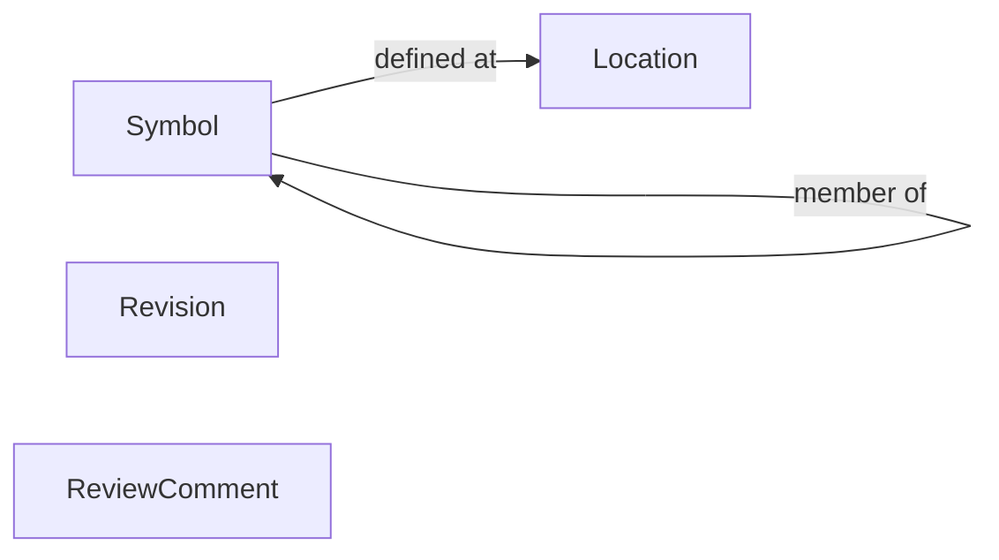

# Code graph: callers, implementations and impact, per commit

Build a living code graph of a repository, and the agent workflows around it. It
keeps every definition and the references between them, resolved by the
TypeScript compiler, so callers, implementations and the impact of a change are
exact rather than guessed from names. CI indexes each pull request onto a branch
of its own, so the graph follows the code commit by commit. Coding agents read
it while they work and post what a change does to the call graph, and a person
merges each branch.

Coding agents and review tools usually find a function's callers by searching
for its name. That misses calls through an interface, finds unrelated
functions that share the name, and says nothing about what a pull request
changed in the call graph, which a reviewer then works out from the diff by
hand. This cookbook sets OmniGraph up as the one place a repository's resolved
references are held, for every commit.

- **Precise references.** Find references and find implementations come from
  the compiler through a SCIP index, not from text search, so a namesake is
  never a caller.
- **Impact before the change.** An agent sees everything that reaches a
  function, including calls through an interface, before it edits it.
- **Each pull request as a diff of the call graph.** The functions a change
  adds, removes and rewrites, and the references it adds and removes, on the
  pull request's own branch.

> If you are an agent: the commands, roles and workflows are in
> [AGENTS.md](AGENTS.md). Read that file before running anything.

## The data model



| Area | Types | Holds |
|---|---|---|
| Code | `Symbol`, `Location` | Every named definition, from modules, classes and interfaces to functions, methods, constants and members, and the lines each one spans |
| Links | `References`, `ImplementedBy`, `MemberOf`, `DefinedAt` | Code that names another definition, with whether it calls it; the members that implement an interface or override a base member; where each definition is declared and sits |
| Provenance | `Revision` | The commit a graph state was indexed from, and the indexer and version that read it |
| Review | `ReviewComment` | The call-graph reviews posted to pull requests, one per indexed commit |

- **A definition keeps its identity across commits.** A `Symbol` is keyed by
  its SCIP symbol without the package version, so the same function has the
  same key in every commit while it keeps its name and file.
- **A move is not a change.** Line numbers live on `Location`. A `Symbol`
  changes only when its own code or declared type does, which it records as a
  digest of its definition text, so a diff separates the functions a pull
  request rewrote from the ones it only pushed down the file.
- **References, not only calls.** A `References` edge covers calls, type uses,
  imports and value uses, which is what "what breaks if I change this" needs,
  and says whether one of them is a call. A call through an interface names
  the interface member, so `ImplementedBy` leads on to each implementation, the
  way the call goes.
- **One definition type.** Every kind of definition is a `Symbol`, so an impact
  read follows references and implementations through functions, methods and
  classes alike, up to sixteen hops.
- **Generated, never edited.** Every row but a `ReviewComment` comes from the
  indexer. A new commit replaces the graph state on its branch, so a deleted
  function leaves the graph with the commit that deleted it.

## Branching and merging

Each pull request gets a branch of the graph holding its head commit. The
graph's `main` moves only when a person merges that branch, as the pull
request merges.

- **Review a change by its effect.** The branch diff of a pull request lists
  the functions it added, removed and changed and the references it added and
  removed. `cg diff` sets apart the definitions that only moved.
- **Ask questions of the change before it lands.** Every read works on the
  pull request's branch, so an agent can ask who would call a new function
  once the change is in.
- **The indexer stays on branches.** The indexing role can open a branch and
  load a commit onto it, but it cannot write `main`, merge or delete a branch.
- **Any earlier commit stays readable.** Each load is one graph commit, so a
  read at the commit `main` had at the last release answers as the code stood
  then.

## Agents and workflows

Agents index the code, keep the review current and answer questions about the
code while they work. People merge.

| Kind | Workflow | What it does | Stored queries |
|---|---|---|---|
| Capture | Pull request indexing | On every push to a pull request, CI indexes the head commit with the compiler and loads it onto the pull request's branch, replacing the previous push | `revision` |
| Capture | Repository onboarding | Indexes the default branch once and loads it onto `main` with the writer role, then builds the read indexes; after that, `main` moves by merging pull request branches | `revision` |
| Maintain | Unused code review | Lists the functions and methods nothing in the repository refers to, without the ones reached through an interface, for a person to confirm | `unreferenced_callables`, `implementers` |
| Maintain | Load-bearing code | Lists the definitions most code depends on, so a change to one of them gets a closer review | `most_referenced`, `callers` |
| Act | Call-graph review comment | Posts the branch diff to the pull request as a comment, once per pushed commit, with the callers of each changed function | `review_comment`, `record_review_comment`, `callers` |
| Act | Impact check before an edit | Before an agent changes a function, it reads everything that reaches it and every implementation behind an interface it touches, and plans the change with them | `symbols_named`, `impact`, `implementers` |
| Act | Code context for an agent | While an agent works, it asks what a function calls, who calls it and what a class or file declares, on `main` or on its own branch | `callers`, `callees`, `members`, `file_symbols` |
| Act | Release comparison | Answers who called a function at the last release and who calls it now, by reading at the graph commit `main` had then | `callers`, `revision` |

Every workflow has the same parts:

1. Something starts it: a push or a merge on the Git host, or an agent about
   to change code.
2. The agent reads the state it needs through stored queries, on `main` or on
   a pull request's branch.
3. It acts: it loads a commit onto a branch, posts a comment, or changes code
   with what it read.
4. A person decides: they merge the pull request and its branch, or act on the
   review.

- **Agents cannot reach `main` alone.** The access policy lets the indexing
  agent write only on branches other than `main`, and it cannot merge.
- **Outside actions are not held back by the record.** A comment goes out
  through the agent's own tools, such as the GitHub CLI, and nothing here
  reviews it first. The record notes each posted review on the pull request's
  branch, so a rerun of CI does not post it twice.
- **Bring your own agent.** It reads the graph through OmniGraph's CLI or MCP
  server from Claude Code, Codex, Cursor or another MCP client. The `cg` client
  in `client/` wraps the reads, the indexing and the review in one command
  each.
- **Measured with agents.** Claude Code agents answering code-structure
  questions with the graph spent 0.52 to 0.84 times what the same questions
  cost without it, on hono and on VS Code, and the graph holds 89% of the
  calls hono's test suite makes. [bench/README.md](bench/README.md) has the
  methods and every result.

## Data sources

The graph holds what the compiler resolved. The Git host stays the record for
the code itself.

| Source | Examples | Feeds |
|---|---|---|
| Code host | GitHub, GitLab, Bitbucket | `Revision`, and the checkout the indexer reads |
| CI | GitHub Actions, GitLab CI, Buildkite, CircleCI | Runs the indexer on each push and loads the result |
| SCIP indexer | scip-typescript from Sourcegraph, on the TypeScript compiler | `Symbol`, `Location`, `References`, `ImplementedBy`, `MemberOf`, `DefinedAt` |
| Pull request comments | GitHub pull requests, GitLab merge requests | `ReviewComment`, recorded when a review is posted |

The cookbook includes the converter from a SCIP index to graph rows and the
`cg` client, which indexes a checkout, converts it and loads it in one step.
The converter has been checked against scip-typescript only; SCIP indexers
also exist for Java, Python, Rust, C and C++, Ruby and C#. There are no hosted
connectors: CI runs the client, and a load replaces the branch's graph state
with the new commit.

## Questions you can ask

Nobody keeps a call graph or a dependency map by hand for these.

| Question | Stored query |
|---|---|
| Who calls this function? | `callers` |
| What breaks if I change it? | `impact` |
| Which classes implement this interface method? | `implementers` |
| What does everything else depend on? | `most_referenced` |

The cookbook has 12 stored reads and one stored write. AGENTS.md lists them.

## Sample data

The seed is real code: the router of [hono](https://github.com/honojs/hono)
(MIT) at the parent of [PR #5267](https://github.com/honojs/hono/pull/5267),
with 132 definitions, 292 references and 24 implementations, and the PR's own
commit as a second revision to load onto a branch. On a fresh load, the
questions above return:

- The `match` function in the RegExp router's matcher is named by four
  definitions: both RegExp routers' `match`, which call it, and their two
  modules, which import it.
- Changing the `Router` interface's `add` reaches 8 definitions, among them
  `SmartRouter`'s `match`, which calls `add` on every router it holds.
- The six routers implement `Router`'s `add`.
- `Router` itself is what the most code depends on: 19 definitions refer to it.

Loaded onto its branch, the PR adds 2 definitions and 18 references and
changes 5 methods; 53 more definitions only move. [seed.md](seed.md) describes the
seed and lists what every stored read returns.

## Run it

Paste this prompt into a coding agent such as Claude Code or Codex:

```text
Read https://www.omnigraph.dev/onboarding.md and set up Omnigraph for me with the code graph cookbook: https://github.com/ModernRelay/omnigraph-cookbooks/tree/main/code-graph
```

The agent installs OmniGraph if needed, creates the graph, loads hono's router
and runs the questions above.

To do it by hand, follow the shared [local setup](../docs/local-setup.md)
using folder `code-graph` and Graph ID `code`. [AGENTS.md](AGENTS.md) has the
exact command for each question and workflow on this page, and how to index
your own repository.
