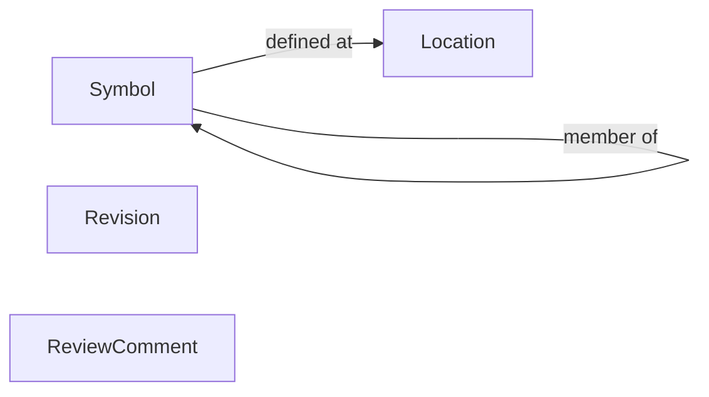

# Code graph: callers, implementations and impact, per commit

Build a living code graph of a repository, and the agent workflows around it. It
keeps every definition and the references between them, resolved by the
TypeScript compiler, so callers, implementations and the impact of a change are
exact rather than guessed from names. CI indexes each pull request onto a branch
of its own, so the graph follows the code commit by commit. Coding agents read
it while they work and post what a change does to the call graph, and a person
merges each branch.

Coding agents and review tools usually find a function's callers by searching
for its name. That misses calls through an interface, finds unrelated
functions that share the name, and says nothing about what a pull request
changed in the call graph, which a reviewer then works out from the diff by
hand. This cookbook sets OmniGraph up as the one place a repository's resolved
references are held, for every commit.

- **Precise references.** Find references and find implementations come from
  the compiler through a SCIP index, not from text search, so a namesake is
  never a caller.
- **Impact before the change.** An agent sees everything that reaches a
  function, including calls through an interface, before it edits it.
- **Each pull request as a diff of the call graph.** The functions a change
  adds, removes and rewrites, and the references it adds and removes, on the
  pull request's own branch.

> If you are an agent: the commands, roles and workflows are in
> [AGENTS.md](AGENTS.md). Read that file before running anything.

## The data model



| Area | Types | Holds |
|---|---|---|
| Code | `Symbol`, `Location` | Every named definition, from modules, classes and interfaces to functions, methods, constants and members, and the lines each one spans |
| Links | `References`, `Calls`, `ImplementedBy`, `MemberOf`, `DefinedAt` | Code that names another definition, and the code among it that calls one; the members that implement an interface or override a base member; where each definition is declared and sits |
| Provenance | `Revision` | The commit a graph state was indexed from, and the indexer and version that read it |
| Review | `ReviewComment` | The call-graph reviews posted to pull requests, one per indexed commit |

- **A definition keeps its identity across commits.** A `Symbol` is keyed by
  its SCIP symbol without the package version, so the same function has the
  same key in every commit while it keeps its name and file.
- **A move is not a change.** Line numbers live on `Location`. A `Symbol`
  changes only when its own code or declared type does, which it records as a
  digest of its definition text, so a diff separates the functions a pull
  request rewrote from the ones it only pushed down the file.
- **References, and the calls among them.** A `References` edge covers calls,
  type uses, imports and value uses, which is what "what breaks if I change
  this" needs. The ones that call, including a construction with `new`, are
  also a `Calls` edge, so a read of callers or of a chain of calls leaves the
  type uses and imports out. A call through an interface names the interface
  member, so `ImplementedBy` leads on to each implementation, the way the call
  goes.
- **One definition type.** Every kind of definition is a `Symbol`, so an impact
  read follows references and implementations through functions, methods and
  classes alike, up to sixteen hops.
- **Generated, never edited.** Every row but a `ReviewComment` comes from the
  indexer. A new commit replaces the graph state on its branch, so a deleted
  function leaves the graph with the commit that deleted it.

## Branching and merging

Each pull request gets a branch of the graph holding its head commit. The
graph's `main` moves only when a person merges that branch, as the pull
request merges.

- **Review a change by its effect.** The branch diff of a pull request lists
  the functions it added, removed and changed and the references it added and
  removed. `cg diff` sets apart the definitions that only moved.
- **Ask questions of the change before it lands.** Every read works on the
  pull request's branch, so an agent can ask who would call a new function
  once the change is in.
- **The indexer stays on branches.** The indexing role can open a branch and
  load a commit onto it, but it cannot write `main`, merge or delete a branch.
- **Any earlier commit stays readable.** Each load is one graph commit, so a
  read at the commit `main` had at the last release answers as the code stood
  then.

## Agents and workflows

Agents index the code, keep the review current and answer questions about the
code while they work. People merge.

| Kind | Workflow | What it does | Stored queries |
|---|---|---|---|
| Capture | Pull request indexing | On every push to a pull request, CI indexes the head commit with the compiler and loads it onto the pull request's branch, replacing the previous push | `revision` |
| Capture | Repository onboarding | Indexes the default branch once and loads it onto `main` with the writer role, then builds the read indexes; after that, `main` moves by merging pull request branches | `revision` |
| Maintain | Unused code review | Lists the functions and methods nothing in the repository refers to, without the ones reached through an interface, for a person to confirm | `unreferenced_callables`, `implementers` |
| Maintain | Load-bearing code | Lists the definitions most code depends on, so a change to one of them gets a closer review | `most_referenced`, `referrers` |
| Act | Call-graph review comment | Posts the branch diff to the pull request as a comment, once per pushed commit, with the callers of each changed function | `review_comment`, `record_review_comment`, `callers` |
| Act | Impact check before an edit | Before an agent changes a function, it reads everything that reaches it, the code whose calls can run it, and every implementation behind an interface it touches, and plans the change with them | `symbols_named`, `impact`, `transitive_callers`, `implementers` |
| Act | Code context for an agent | While an agent works, it asks what a function calls, who calls it and what a class or file declares, on `main` or on its own branch | `callers`, `callees`, `members`, `file_symbols` |
| Act | Release comparison | Answers who called a function at the last release and who calls it now, by reading at the graph commit `main` had then | `callers`, `revision` |

Every workflow has the same parts:

1. Something starts it: a push or a merge on the Git host, or an agent about
   to change code.
2. The agent reads the state it needs through stored queries, on `main` or on
   a pull request's branch.
3. It acts: it loads a commit onto a branch, posts a comment, or changes code
   with what it read.
4. A person decides: they merge the pull request and its branch, or act on the
   review.

- **Agents cannot reach `main` alone.** The access policy lets the indexing
  agent write only on branches other than `main`, and it cannot merge.
- **Outside actions are not held back by the record.** A comment goes out
  through the agent's own tools, such as the GitHub CLI, and nothing here
  reviews it first. The record notes each posted review on the pull request's
  branch, so a rerun of CI does not post it twice.
- **Bring your own agent.** It reads the graph through OmniGraph's CLI or MCP
  server from Claude Code, Codex, Cursor or another MCP client. The `cg` client
  in `client/` wraps the reads, the indexing and the review in one command
  each.

## Data sources

The graph holds what the compiler resolved. The Git host stays the record for
the code itself.

| Source | Examples | Feeds |
|---|---|---|
| Code host | GitHub, GitLab, Bitbucket | `Revision`, and the checkout the indexer reads |
| CI | GitHub Actions, GitLab CI, Buildkite, CircleCI | Runs the indexer on each push and loads the result |
| SCIP indexer | scip-typescript from Sourcegraph, on the TypeScript compiler | `Symbol`, `Location`, `References`, `Calls`, `ImplementedBy`, `MemberOf`, `DefinedAt` |
| Pull request comments | GitHub pull requests, GitLab merge requests | `ReviewComment`, recorded when a review is posted |

The cookbook includes the converter from a SCIP index to graph rows and the
`cg` client, which indexes a checkout, converts it and loads it in one step.
The converter has been checked against scip-typescript only; SCIP indexers
also exist for Java, Python, Rust, C and C++, Ruby and C#. There are no hosted
connectors: CI runs the client, and a load replaces the branch's graph state
with the new commit.

## Questions you can ask

Nobody keeps a call graph or a dependency map by hand for these.

| Question | Stored query |
|---|---|
| Who calls this function? | `callers` |
| What reaches it through a chain of calls? | `transitive_callers` |
| What breaks if I change it? | `impact` |
| Which classes implement this interface method? | `implementers` |
| What does everything else depend on? | `most_referenced` |

The cookbook has 14 stored reads and one stored write. AGENTS.md lists them.

## Sample data

The seed is real code: the router of [hono](https://github.com/honojs/hono)
(MIT) at the parent of [PR #5267](https://github.com/honojs/hono/pull/5267),
with 132 definitions, 292 references and 24 implementations, and the PR's own
commit as a second revision to load onto a branch. On a fresh load, the
questions above return:

- The `match` function in the RegExp router's matcher is called by both
  RegExp routers' `match`; their two modules import it, which `referrers`
  adds.
- Through a chain of calls, `SmartRouter`'s `match` reaches it too: it calls
  `match` on each router it holds.
- Changing the `Router` interface's `add` reaches 8 definitions, among them
  `SmartRouter`'s `match`, which calls `add` on every router it holds.
- The six routers implement `Router`'s `add`.
- `Router` itself is what the most code depends on: 19 definitions refer to it.

Loaded onto its branch, the PR adds 2 definitions and 18 references, 10 of
them calls, and changes 5 methods; 53 more definitions only move. [seed.md](seed.md) describes the
seed and lists what every stored read returns.

## Benchmarks

Measured on hono, and the agent benchmark again on VS Code, by the scripts in
[`bench/`](bench/README.md), which has the methods, the adjudication of every
miss and the limits. They run by hand, not in CI.

**Pull request diffs.** The 40 most recent hono pull requests before
2026-11-01 that change `src/`, each loaded as its base and merge commit and
reviewed with `cg diff`. Scored against the difference of the converted files
(mechanics) and against two reference graphs built with the TypeScript
compiler API (accuracy):

| | Exact pull requests | Added | Removed | Changed | References added | References removed |
|---|---|---|---|---|---|---|
| Mechanics | 40 of 40 | 19 of 19 | 9 of 9 | 48 of 48 | 91 of 91 | 40 of 40 |
| Accuracy, precision | 37 of 40 | 1.000 | 0.667 | 0.938 | 1.000 | 0.875 |
| Accuracy, recall | | 1.000 | 1.000 | 1.000 | 1.000 | 0.972 |

**Execution recall against other code-graph tools.** hono's test suite, run
on an instrumented copy, made 917 distinct calls between definitions. Recall
is the share of them each graph contains:

| Graph | All 917 | Functions and methods (768) | Class-member calls (199) |
|---|---|---|---|
| Omnigraph | 0.893 | 0.882 | 0.774 |
| codegraph 1.6.2 | 0.686 | 0.758 | 0.487 |
| Graphify 0.9.102 | 0.677 | 0.749 | 0.372 |
| GitNexus 1.6.12 | 0.632 | 0.694 | 0.322 |
| codebase-memory-mcp 0.12.1 | 0.627 | 0.690 | 0.221 |
| code-review-graph 2.3.9 | 0.604 | 0.721 | 0.387 |

Omnigraph's row counts every reference, which is what `callers` returns.
Counting only the references it marks as calls, as the other tools' call
graphs do, it holds 0.778, so about half of its lead over the tools comes
from recording references: a getter runs when a property is read, and a
function passed as a value runs when the code it was passed to calls it. The
rest is resolution.
On calls to top-level functions and uniquely named ones, the name-matching
tools come within two to four points of Omnigraph's call edges; they fall
behind on method calls and on names several definitions share, which need the
receiver's type. The benchmark measures recall only, on one repository.

**Agent cost.** Claude Code with Sonnet 5.5 answered eight code-structure
questions about hono three times in each of seven arms: no code graph,
Omnigraph through `cg`, and the five tools above, each set up by its own
Claude Code installer. Medians per session, and the cost paired with no code
graph question by question:

| Arm | Exact answers | Cost | Output tokens | Turns | Cost against no graph |
|---|---|---|---|---|---|
| No code graph | 24 of 24 | $0.100 | 1,926 | 6 | |
| Omnigraph | 24 of 24 | $0.069 | 1,198 | 5 | 0.84×, lower on 5 of 8 |
| codegraph | 24 of 24 | $0.094 | 1,766 | 6 | 1.01× |
| Graphify | 21 of 24 | $0.100 | 1,866 | 6 | 1.01× |
| GitNexus | 22 of 24 | $0.102 | 1,368 | 5 | 0.97× |
| codebase-memory-mcp | 24 of 24 | $0.114 | 2,016 | 6 | 1.14× |
| code-review-graph | 24 of 24 | $0.107 | 1,931 | 6 | 1.33× |

hono is small enough that a text search usually answers in a few turns, so
the saving shows only where it takes several: the users of
`HonoRequest.path` cost $0.040 with Omnigraph against $0.094 (5 turns against
11), the callers through a chain of calls to the cookie `parse` $0.071
against $0.129, and the callers of `HonoRequest.header`, a name several
definitions share, $0.135 against $0.161. Where one search answers, as for
the classes implementing `Router`, the graph's extra step costs more ($0.028
against $0.019). Omnigraph's agents used their graph for 48% of their tool
calls, the others for 0 to 17%, so the run says little about those tools.
Indexing hono takes Omnigraph 2.3 s, the tools 2.0 to 21.3 s.

**Agent cost at scale.** The same benchmark on VS Code 1.146.0, 89 times
hono's size: 23 scored questions in six families, picked by rule from a
compiler reference and asked five times each
([design and corrections](bench/scale-design.md)). Each arm ran beside a
no-graph arm in the same window and is compared with it question by question
(geometric mean of the ratio of medians, 95% bootstrap interval):

| Arm | Exact answers | No graph, same window | Cost against no graph | Wall time against no graph |
|---|---|---|---|---|
| Omnigraph | 80 of 115 | 69 of 115 | 0.52× [0.39, 0.69], lower on 17 of 23 | 0.70× [0.57, 0.87] |
| codegraph | 73 of 115 | 73 of 115 | 0.91× [0.83, 1.01], lower on 16 of 23 | 1.88× [1.65, 2.13] |
| Graphify | 68 of 115 | 73 of 115 | 1.12× [1.02, 1.22], lower on 5 of 23 | 1.10× [1.02, 1.17] |

A no-graph session cost a median $0.09 and took 23 s; an Omnigraph session
$0.05 and 14 s. By family, Omnigraph against no graph:

| Family | Exact, no graph | Exact, Omnigraph | Cost | Median turns |
|---|---|---|---|---|
| Release changes | 11 of 20 | 18 of 20 | 0.30× | 9 → 5 |
| Callers through a chain of calls | 0 of 15 | 0 of 15 | 0.17× | 15 → 3 |
| Callers of a uniquely named function | 18 of 20 | 20 of 20 | 0.36× | 5 → 2 |
| Implementations a call can reach | 19 of 20 | 20 of 20 | 0.80× | 5.5 → 6 |
| Constructions of a class | 9 of 20 | 13 of 20 | 1.06× | 18 → 16.5 |
| Callers of a method whose name is shared | 12 of 20 | 9 of 20 | 1.03× | 8.5 → 11 |

The graph saves most where one `cg` read is the answer. A text search finds
lines, and the agent still has to work out which definition each line belongs
to, so even for a uniquely named function a no-graph session takes five turns to
the graph's two. On release changes `cg` reads both releases, where the other
agents diff text: when 1.146.0 moved a call to `moveEditors` into a new method,
`doMergeGroup`, only Omnigraph's sessions named it. It saves nothing where the
graph lacks the relation the question asks for, and the agent reads the code as
a no-graph agent does: a construction through dependency injection, where
`createInstance(C)` names `C` without calling it; and the callers of a shared
method name, where the agents searched the code to check the graph's answer, and
where the graph the run used had no static members, such as `Color`'s static
`equals`. On chains of calls its answers were close (F1 0.90) but never exact,
because `impact` follows every reference, not only calls. codegraph's and
Graphify's agents called their tools for 0.3% and 5% of their tool calls.

## Run it

Paste this prompt into a coding agent such as Claude Code or Codex:

```text
Read https://www.omnigraph.dev/onboarding.md and set up Omnigraph for me with the code graph cookbook: https://github.com/ModernRelay/omnigraph-cookbooks/tree/main/code-graph
```

The agent installs OmniGraph if needed, creates the graph, loads hono's router
and runs the questions above.

To do it by hand, follow the shared [local setup](../docs/local-setup.md)
using folder `code-graph` and Graph ID `code`. [AGENTS.md](AGENTS.md) has the
exact command for each question and workflow on this page, and how to index
your own repository.
