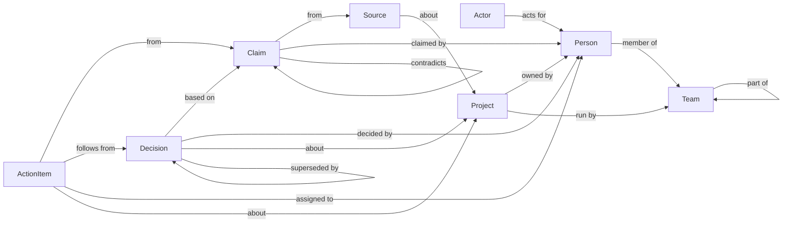

# Company brain: shared context for a company's people and agents

Build a living company brain, and the agent workflows around it. It is one
shared record of what a company knows: who is on which team, what each project
is, what was said, what was decided and who owes what. Every claim carries the
exact quote it rests on, so people and agents read the same account and can
check it. Agents propose changes on their own branches, and a person reviews
and merges them.

Today that knowledge is spread over meeting notes, chat threads, documents and
tickets, and the summaries of them drift apart. An agent that reads them
answers from whichever one it found. This cookbook sets OmniGraph up as the one
record they all read and write.

- **Every fact has its source.** A decision rests on claims, and each claim
  quotes the exact words and says where they are.
- **Contradictions come to the surface.** A new claim that disputes an older
  one is linked to it, and the decisions resting on the older one are listed.
- **Agents propose, people decide.** An agent records and proposes on a branch.
  A person verifies, accepts and merges.

> If you are an agent: the commands, roles and workflows are in
> [AGENTS.md](AGENTS.md). Read that file before running anything.

## The data model



| Area | Types | Holds |
|---|---|---|
| People and org | `Person`, `Actor`, `Team`, `Project` | Everyone in the company, the logins and agents that act for them, teams and who is on them, projects and who owns them |
| Evidence | `Source` | A meeting, thread, document, email or ticket the brain learned from |
| What was said | `Claim` | One statement someone made in a source, with the exact quote, where it is, and whether a person has verified it |
| What follows | `Decision`, `ActionItem` | What was decided and on which claims, and who owes what by when |

- **Extracting is not deciding.** What someone said is recorded as an
  unverified claim. Verifying it and promoting it to a decision or an action
  item are separate steps, usually by a different person or agent.
- **Everything points at the exact words.** A reviewer checks the quote against
  the source and does not have to trust a summary.
- **Contradictions are data.** A newer claim is linked to the older one it
  disputes, and both stay until a person rejects one.
- **Decisions are never edited.** A changed decision is a new decision that
  supersedes the old one, with a reason and the claim it rests on.
- **People are not logins.** A person exists whether or not they ever touch
  the record. Each login or agent acts for a person, so every change has
  someone who answers for it.
- **Yours to change.** The model is one file, [`schema.pg`](schema.pg), with 8
  node types and 18 edge types. AGENTS.md lists extensions such as goals,
  customers and open questions.

## Branching and merging

Agents write on branches, and the shared record moves only when a person merges
one.

- **Proposals.** A new claim, a contradiction and a proposed decision arrive
  together on one branch, so the reviewer sees the whole change and the quotes
  it rests on.
- **Competing proposals.** If two agents propose different replacements for
  the same decision, the second merge reports a conflict and writes nothing. A
  person decides which is right.
- **Checks before a merge.** Reads such as "decisions with no supporting
  claim" run on the branch and should return nothing before it merges.
- **History.** Every change records who made it, a person or a named agent, so
  you can see which agent wrote what and who answers for it.

## Agents and workflows

Agents bring what was said into the record, keep it consistent and tell people
what needs them. People verify what was recorded and accept what was proposed.

| Kind | Workflow | What it does | Stored queries |
|---|---|---|---|
| Capture | Meeting and thread capture | Records a meeting, thread or document and each claim made in it, with its quote, speaker and position | `record_source`, `record_claim` |
| Capture | Commitment capture | Turns a commitment someone made into an action item with an owner and a due date | `add_action_item` |
| Maintain | Contradiction check | Compares a new claim with what current decisions rest on, links the dispute and lists the decisions it puts in question | `decision_evidence`, `mark_contradiction`, `contested_claims`, `decisions_at_risk` |
| Maintain | Decision proposal | Promotes a claim to a decision, or proposes a replacement for a decision that a new claim disputes | `promote_claim`, `propose_successor` |
| Maintain | Record hygiene | Finds decisions with no supporting claim, accepted decisions resting on unverified claims and action items with no owner | `unsupported_decisions`, `accepted_on_unverified`, `unowned_actions` |
| Act | Meeting follow-up | After a meeting is captured, sends out the decisions and action items that came out of it | `decisions_from_source`, `actions_from_source` |
| Act | Overdue reminders | Reminds the owner of each overdue action item, on the handle the record holds for them | `overdue_actions`, `person_handles` |
| Act | Decision at risk alert | When a new claim disputes one a current decision rests on, tells the people who made that decision | `decisions_at_risk`, `decision_deciders` |
| Act | Review digest | Sends reviewers the claims waiting to be verified and the decisions waiting to be accepted | `unverified_claims`, `proposed_decisions` |
| Act | Quiet project check-in | Asks the owner of a project that has had no new source for a while whether it is still active | `quiet_projects`, `project_owner` |

Every workflow has the same parts:

1. Something starts it: a meeting or thread in a source tool, a change in the
   record, or a date such as a due date passing.
2. The agent reads the state it needs through stored queries.
3. It acts. It writes to the record on its own branch, or it tells someone
   outside the record: a message, a reminder, a digest.
4. A person decides. They review the branch and merge it, then verify and
   accept, or they act on what they were told.

- **Agents cannot reach the shared record alone.** The access policy lets an
  agent write only on branches other than `main`, and it cannot merge.
- **Outside actions are not held back by the record.** A reminder or a digest
  goes out through the agent's own tools, and nothing here reviews it first.
  Keep those workflows to telling and drafting, and give the agent only the
  outside access they need. The cookbook includes no integrations for them,
  and the record does not note that a message was sent, so the agent has to
  keep track of that itself.
- **Each agent has a name and an owner.** Every agent has its own identity and
  a person who answers for it.
- **Bring your own agent.** It connects through OmniGraph's MCP server from
  Claude Code, Codex, Cursor or another MCP client.

## Data sources

The record holds what was said and decided, with a link back to where. The
source text stays in the tool it came from.

| Source | Examples | Feeds |
|---|---|---|
| Meeting notes and transcripts | Granola, Fireflies, Otter, Zoom, Google Meet | `Source`, `Claim` |
| Chat | Slack, Microsoft Teams | `Source`, `Claim` |
| Documents and wikis | Notion, Google Docs, Confluence | `Source`, `Claim` |
| Tickets and issues | Linear, Jira, Asana, GitHub | `Source`, `Claim`, `ActionItem` |
| Email | Gmail, Outlook | `Source`, `Claim` |
| People directory | Google Workspace, Slack, GitHub | `Person` and their handles |

The cookbook does not include connectors for these. An agent, or a script,
reads from the tool and writes to the record through the stored mutations. A
source is keyed by its system and its id there, so capturing the same meeting
twice does not duplicate it.

## Questions you can ask

Nobody maintains a decision log or a status page for these.

| Question | Stored query |
|---|---|
| Which decisions are current, project by project? | `current_decisions` |
| Which claims dispute each other? | `contested_claims` |
| What does this decision rest on, and in whose words? | `decision_evidence` |
| What did this meeting commit people to? | `actions_from_source` |

The cookbook has 41 stored reads and 28 stored writes. AGENTS.md lists them.

## Sample data

The cookbook comes with Lanternworks, a made-up software company that ships a
shopping app: 6 people, 5 teams, 4 projects, 8 sources, 18 claims, 6 decisions
and 5 action items. On a fresh load, the questions above return:

- Four current decisions, among them launching Checkout v2 on November 13 and
  keeping search in-house.
- One disputed pair of claims, about whether the later onboarding steps are
  needed.
- The decision to keep search in-house rests on three claims, among them a
  vendor quote at three times the budget.
- The search review committed people to two actions: cancel the hosted search
  trial and ship the in-house prototype to staging.

[seed.md](seed.md) describes the company and lists what every stored read
returns.

## Run it

Paste this prompt into a coding agent such as Claude Code or Codex:

```text
Read https://www.omnigraph.dev/onboarding.md and set up Omnigraph for me with the company brain cookbook: https://github.com/ModernRelay/omnigraph-cookbooks/tree/main/company-brain
```

The agent installs OmniGraph if needed, creates the graph, loads Lanternworks
and runs the questions above.

To do it by hand, follow the shared [local setup](../README.md#local-setup)
using folder `company-brain` and Graph ID `company`. [AGENTS.md](AGENTS.md)
has the exact command for each question and workflow on this page.
