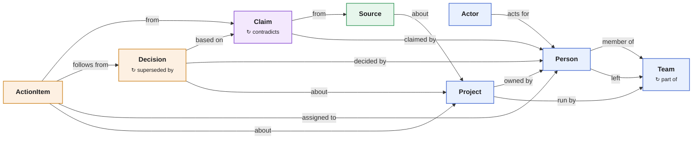

# Company brain: shared context for a company's people and agents

A company's working memory of record: who is on which team, what each project
is, what people said, what was decided, who owes what, and the exact words
each of those rests on. People and agents both read it. Agents propose changes
on their own branches; a person reviews and merges them. Graph ID `company`.

The point is not search over Slack. It is a model of the company that stays
coherent as it grows. Agents record what was said as **claims**, each with the
exact quote and where it is in the source. A separate step checks new claims
against what main already holds, so a contradiction comes to the surface
instead of being averaged away. Decisions rest on claims; a changed decision
is a new decision with a reason, and two agents that disagree meet a merge
conflict instead of overwriting each other. The seed is a fictional company,
"Lanternworks"; all names are made up.

Sibling cookbooks: [second-brain](../second-brain/) is one person's life;
[dev-graph](../dev-graph/) is an engineering team's issues, specs and
releases; [vc-os](../vc-os/) is one industry's operating system. This one is
the cross-functional core a company shares: people, teams, projects, claims,
decisions and commitments.

## Quick start

Use the shared [local setup](../README.md#local-setup) with folder
`company-brain` and graph `company`, then load `seed.jsonl` (described in
[seed.md](seed.md)). With the server up:

```bash
omnigraph query current_decisions --server http://127.0.0.1:8080 --graph company
omnigraph query decision_evidence --server http://127.0.0.1:8080 --graph company \
  --params '{"decision":"search-in-house"}'
omnigraph query why_superseded --server http://127.0.0.1:8080 --graph company \
  --params '{"decision":"search-vendor-buy"}'
omnigraph query contested_claims --server http://127.0.0.1:8080 --graph company
omnigraph query overdue_actions --server http://127.0.0.1:8080 --graph company \
  --params '{"as_of":"2026-10-14"}'
```

## Model

[`schema.pg`](schema.pg) has eight node types and eighteen edge types in four
layers.



Blue is people and org, green the evidence, purple what people said in it,
orange the facts promoted from that. Each arrow is an edge type, drawn in its
schema direction; a `↻` line in a box is an edge between two nodes of that
type.

| Type | Holds |
|---|---|
| `Person` | Someone in the real world, one node per human: title, `active` flag, and `email`, `slack`, `github` handles. Being a Person grants nothing |
| `Actor` | Someone who reads or writes the graph: a person's own login or an agent (`kind`), keyed by OmniGraph actor id, `ActsFor` the person behind it |
| `Team` | An organizational unit; teams nest with `PartOf`. A person's stint is `MemberOf {role, since}`, keyed by its start, and `LeftTeam {since, until}` closes it |
| `Project` | A time-bound effort with a status, `OwnedBy` a person and `RunBy` a team |
| `Source` | The evidence: a meeting, thread, document, email or ticket (`kind`), `SourceAbout` a project |
| `Claim` | One statement someone made in a source: `kind` (fact, proposal, commitment, risk), the verbatim `quote`, a `locator`, a `status` (unverified, verified, rejected). `ClaimFrom` its source, `ClaimedBy` who said it, and it may `Contradict` an earlier claim |
| `Decision` | A commitment to a course of action: statement, rationale, status (`proposed`, `accepted`, `rejected`, `deprecated`), `BasedOn` claims, `DecidedBy` people, `DecisionAbout` a project |
| `ActionItem` | One person's commitment, promoted from a commitment claim (`ActionFrom`): status, due date, `AssignedTo` an owner, optionally `FollowsFrom` a decision |

The rules the shape encodes:

- **Extracting is not deciding.** An agent records what was said as an
  unverified claim. Checking it against the graph, verifying it, and
  promoting it to a decision or action item are separate steps, often by a
  different actor. Someone saying "let's double Chen's equity" is a claim;
  whether it is a decision depends on who said it, whether they could decide
  it, and what else is known.
- **Everything points at the exact words.** A decision rests on claims, and a
  claim quotes its source with a locator, so a reviewer can check the
  extraction against the text instead of trusting a summary. The same
  statement in two sources is two claims; corroboration is a decision resting
  on both.
- **Contradictions are data.** `Contradicts` links a newer claim to the older
  one it disputes. Both stay until a person rejects one. Contested claims and
  decisions at risk are derived on every read.
- **Decisions are never edited.** To change one, propose a successor:
  `Decision(old) -SupersededBy {reason}-> Decision(new)`. The one-line reason
  sits on the edge; the full why is in the nodes, because the successor
  rests on a claim that contradicts one behind the original. A decision is
  superseded at most once (`@card(0..1)`), so two agents proposing competing
  successors on two branches collide when the second merges. A decision
  stays replaced once its successor was accepted, even if that successor is
  deprecated later. A rejected successor replaces nothing, and
  `withdraw_successor` frees the slot for another.
- **People are not logins.** A Person exists whether or not they ever touch
  the graph. An Actor is an OmniGraph identity that can; it `ActsFor` a
  person. Agents resolve a handle with `person_by_handle` before creating
  anyone, so the same person does not appear three times. Someone who leaves
  is marked with `deactivate_person` and `end_membership`, never deleted, and
  `update_person` changes a name, title or handle without reactivating them.
- **Two kinds of time.** When something happened in the world is in the
  schema (`occurred_at`, `decided_at`, `due`, `since`, `until`). When the brain
  learned it is `recorded_at` on claims and facts, plus the commit history.
- **Creating never overwrites.** Inserting a keyed node replaces the whole
  row, so each create also writes one unkeyed edge capped at one
  (`ClaimFrom`, `DecisionAbout`, `AssignedTo`, `ActsFor`). Creating a claim,
  decision, action item or actor under a slug that already exists adds a
  second one, and the whole write is refused with a `@card` violation. An
  agent that ingests the same meeting twice is refused at the first claim it
  already recorded, and nothing a person verified, accepted, closed or
  retired is reset. A new person has no edge to guard with, so `add_person`
  relies on `person_by_handle` first. Every other edge is keyed, so
  re-running a link is a no-op, and a membership stint recorded again stays
  closed if `LeftTeam` closed it.

## Derived, not stored

| Question | Stored query |
|---|---|
| What is decided right now? | `current_decisions` |
| What is decided about this project, including proposals on a branch? | `project_decisions` |
| What does this decision rest on, in whose words? | `decision_evidence`, `decision_deciders` |
| Why was it replaced, and by what? | `why_superseded`, `superseding_contradictions`, `decision_lineage`, `decision_successor` |
| Which claims dispute each other? | `contested_claims` |
| Which current decisions do new claims put in question, or rest on a rejected one? | `decisions_at_risk`, `current_on_rejected` |
| What still needs a person to verify or accept? | `unverified_claims`, `proposed_decisions` |
| What came out of Tuesday's sync? | `claims_from_source`, `decisions_from_source`, `actions_from_source` |
| Which accepted decisions have no action following from them? | `unimplemented_decisions` |
| What is overdue, and who owns it? | `overdue_actions`, `person_actions` |
| Which projects went quiet? | `quiet_projects` |
| Who is this Slack user? Who answers for this agent? | `person_by_handle`, `actors` |
| Which claim said these words? | `search_quotes` |

Overdue and quiet take a fixed date or time as a parameter, so the seed's
answers do not change with the calendar.

## Agents extract, people decide

The policy gives every agent its own actor (`act-notes-bot`, `act-slack-bot`,
or the generic `act-agent`). Agents read everything, create branches and write
only on unprotected branches; they cannot write main, merge or delete a
branch. People (`act-alice`, `act-admin`, `act-writer`) review and merge, then
verify and accept on main, where no agent can write. Each commit records the
actor from the bearer token, so the history says which agent wrote what, and
`actors` says who answers for it.

Add the agent tokens when you start the server:

```bash
export OMNIGRAPH_SERVER_BEARER_TOKENS_JSON='{"act-admin":"local-admin-token","act-writer":"local-writer-token","act-reader":"local-reader-token","act-notes-bot":"local-notes-token","act-slack-bot":"local-slack-token"}'
```

The meeting notes agent hears in the Oct 14 Checkout sync that the payment
provider moved certification. Writing on main is refused (403), so it works on
a branch. First it records what was said, nothing more:

```bash
S=(--server http://127.0.0.1:8080 --graph company)
B=(--branch agent/notes-oct-14)
export OMNIGRAPH_BEARER_TOKEN=local-notes-token
omnigraph branch create agent/notes-oct-14 --from main "${S[@]}"
omnigraph mutate record_source "${S[@]}" "${B[@]}" --params \
  '{"slug":"meet:checkout-sync-2026-10-14","kind":"meeting","title":"Checkout sync","occurred_at":"2026-10-14T15:00:00.000Z","url":null,"summary":null}'
omnigraph mutate record_claim "${S[@]}" "${B[@]}" --params \
  '{"slug":"provider-certifies-nov-13","kind":"fact","statement":"The payment provider moved Checkout v2 certification to Nov 13.","quote":"The provider pushed our certification back a week, to November 13.","locator":"00:03:40","recorded_at":"2026-10-14T16:00:00.000Z","source":"meet:checkout-sync-2026-10-14","speaker":"alice"}'
```

Then it checks the claim against what main trusts. The Nov 13 launch rests on
a kickoff claim that the new one disputes:

```bash
omnigraph query decision_evidence "${S[@]}" --params '{"decision":"checkout-launch-nov-13"}'
#   launch-nov-13            | Alice Park | We go live for everyone on November 13.
#   provider-certifies-nov-6 | Chen Wei   | The provider confirmed certification by November 6, a week before launch.
omnigraph mutate mark_contradiction "${S[@]}" "${B[@]}" --params \
  '{"claim":"provider-certifies-nov-13","contradicts":"provider-certifies-nov-6"}'
omnigraph query decisions_at_risk "${S[@]}" "${B[@]}"
#   checkout-launch-nov-13 | The payment provider certifies … by Nov 6. | … moved … certification to Nov 13.
#   (on main: 0 rows)
```

It proposes a successor that rests on the new claim, with a one-line reason:

```bash
omnigraph mutate propose_successor "${S[@]}" "${B[@]}" --params \
  '{"previous":"checkout-launch-nov-13","claim":"provider-certifies-nov-13","reason":"The payment provider moved certification back a week.","slug":"checkout-launch-nov-20","title":"Launch Checkout v2 on Nov 20","statement":"Checkout v2 goes live for all customers on Nov 20.","rationale":"Launch stays a week after certification, which moved to Nov 13.","decided_at":"2026-10-14T15:20:00.000Z","recorded_at":"2026-10-14T16:00:00.000Z","project":"checkout"}'
omnigraph query project_decisions "${S[@]}" "${B[@]}" --params '{"project":"checkout"}'
#   Launch Checkout v2 on Nov 20 | proposed      (main still says Nov 13)
```

A person reviews the branch before merging it. The policy cannot tell one
agent's branch from another's, or which stored query an agent ran, so the
review checks the history: who wrote each of the branch's commits, and
whether any of them updated a claim, decision or action item. An agent only
creates those; a status change is a person's job on main. On a clean branch
the loop prints nothing (it uses `jq`):

```bash
export OMNIGRAPH_BEARER_TOKEN=local-admin-token
omnigraph commit list "${S[@]}" "${B[@]}"          # one line per commit, with its actor
for c in $(omnigraph commit list "${S[@]}" "${B[@]}" --json \
             | jq -r '.commits[] | select(.graph_branch == "agent/notes-oct-14") | .graph_commit_id'); do
  omnigraph commit changes "$c" "${S[@]}" --op update --type Claim --type Decision --type ActionItem --json \
    | jq -c '.cause.actor_id as $a | .changes[] | {actor: $a, type: .type.name, id}'
done
```

Then it runs the [hygiene](queries/hygiene.gq) reads on the branch, merges,
and settles the contradiction and the proposal on main:

```bash
for q in unsupported_decisions accepted_on_unverified current_on_rejected \
         decisions_without_project claims_without_source claims_without_speaker \
         unowned_actions unsupported_actions agents_without_owner; do
  omnigraph query "$q" "${S[@]}" "${B[@]}"         # each 0 rows
done
omnigraph branch merge agent/notes-oct-14 --into main "${S[@]}"
omnigraph branch delete agent/notes-oct-14 "${S[@]}" --yes
omnigraph mutate verify_claim "${S[@]}" --params '{"slug":"provider-certifies-nov-13"}'
omnigraph mutate reject_claim "${S[@]}" --params '{"slug":"provider-certifies-nov-6"}'
omnigraph mutate accept_decision "${S[@]}" --params '{"slug":"checkout-launch-nov-20"}'
omnigraph query accepted_on_unverified "${S[@]}"   # 0 rows
omnigraph query current_on_rejected "${S[@]}"      # 0 rows: Nov 13 is replaced
omnigraph query why_superseded "${S[@]}" --params '{"decision":"checkout-launch-nov-13"}'
#   checkout-launch-nov-20 | accepted | The payment provider moved certification back a week.
omnigraph query superseding_contradictions "${S[@]}" --params '{"decision":"checkout-launch-nov-13"}'
#   checkout-launch-nov-20 | The payment provider moved … certification to Nov 13. |
#     The payment provider certifies … by Nov 6.
```

Between `reject_claim` and `accept_decision`, `current_on_rejected` lists
`checkout-launch-nov-13`: a current decision resting on a claim a person just
rejected. Accepting the successor clears it.

Had the person rejected the proposal instead, `reject_decision` and then
`withdraw_successor {"previous":"checkout-launch-nov-13","successor":"checkout-launch-nov-20"}`
leave Nov 13 current and free to be replaced again.

If the Slack agent had heard "two weeks" and proposed Nov 27 as another
successor on its own branch, merging that branch now fails with
`merge conflicts: edge type 'SupersededBy' (cardinality_violation)`.
Nothing lands; a person decides which date is right.

Each [hygiene](queries/hygiene.gq) read returns zero rows on a healthy graph.
They exist because the schema cannot force an edge to exist when a node is
inserted: `@card(1..)` on `BasedOn` and `ClaimFrom` stops the last link from
being removed, and the stored mutations write the fact and what it rests on in
one commit. `accepted_on_unverified` enforces the two steps: verify the claims
before accepting the decision. Run them on a branch with `omnigraph query
<name> --branch …`, as above. The `lint-*` aliases in
[`omnigraph-config.example.yaml`](omnigraph-config.example.yaml) read main
only, because an alias cannot choose a branch.

## Extending

Each extension is a live, in-place schema change (see
[live updates](../README.md#live-updates)): add the type, its edges and its
queries, then `cluster plan`/`apply` through the running server. Add one when a
question you care about needs it, not before.

| Extension | Shape | Add it when |
|---|---|---|
| Spans | `Span { text, locator, embedding? }`, `SpanOf: Span -> Source`, `QuotedIn: Claim -> Span` | You chunk source text for semantic search, or one snippet backs many claims |
| Events | `Event { title, happened_at }`, `Triggered: Event -> Claim` | Things that happen outside any source (an outage, a funding round) explain why claims change |
| Goals | `Goal { title, quarter? }`, `Contributes: Project -> Goal` | The company runs goals or OKRs |
| Questions | `Question { text, status }`, `Answers: Decision -> Question` | Open questions need to be visible before anyone decides |
| Organizations | `Organization`, `WorksAt: Person -> Organization {since, until}` | Customers, vendors or partners are in scope |
| Semantic search | `embedding: Vector(N)? @embed("statement")` on `Claim` plus an embedding provider in `cluster.yaml` | Full-text search is not enough |

Keys, cardinalities and required properties are fixed when a type is created;
changing them later means a rebuild. New types, nullable properties, wider
enums and renames apply in place.

## Files

| Path | What |
|---|---|
| `schema.pg` | 8 node types, 18 edge types |
| `queries/claims.gq` | Claim reads: contested claims, decisions at risk, the review queue |
| `queries/decisions.gq` | Decision reads |
| `queries/people.gq` | People, teams, actors, projects and sources |
| `queries/actions.gq` | Action item reads |
| `queries/hygiene.gq` | Reads that return zero rows on a healthy graph |
| `queries/mutations.gq` | Stored writes; claims and facts are written with what they rest on in one commit |
| `policies/graph.policy.yaml` | Readers, writers, admins, and agents that write only on branches |
| `policies/server.policy.yaml` | Who lists graphs and manages configuration |
| `seed.jsonl`, `seed.md` | The Lanternworks seed and what each read returns on it |
| `omnigraph-config.example.yaml` | Read aliases and mutation examples |

## Limits

- **Access is per graph and branch, not per row.** Anything ingested is
  readable by everyone who can read the graph. Ingest only sources whose
  audience includes every reader, and use separate graphs for separate
  audiences.
- **Merges compare whole rows.** Two agents changing different fields of the
  same action item still conflict.
- **The policy keeps agents off main, not off each other.** Rules are per
  graph and per protected or unprotected branch, and `invoke_query` covers
  the whole catalog. Any agent can write on any unprotected branch, and run
  `verify_claim` or `accept_decision` there; the review step above catches
  both from the history before a merge.
- **Handles live on the person.** A handle nobody has claimed yet cannot wait
  in the graph on its own; the agent creates the person or leaves the claim
  for a human.
- **The graph does not hold source text.** A claim's quote is what the agent
  copied; checking it against the original means opening the source's `url`.
- **No activity data.** Views, reactions and "works with" inferences are
  high-volume and short-lived; keep them out.
- **No embeddings in the seed.** See *Extending*.
