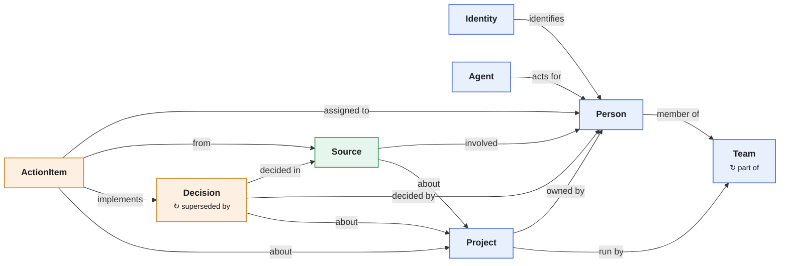

# Company brain: shared context for a company's people and agents

A company's working memory of record: who is on which team, what each project
is, what was decided, who owes what, and the meeting, thread or document each
of those came from. People and agents both read it. Agents propose changes on
their own branches; a person reviews and merges them. Graph ID `knowledge`.

The point is not search over Slack. It is a typed model of the company that
agents act on and keep current: every decision cites its source, a changed
decision is a new decision rather than an edit, and two agents that disagree
meet a merge conflict instead of overwriting each other. The seed is a
fictional company, "Lanternworks"; all names are made up.

Sibling cookbooks: [second-brain](../second-brain/) is one person's life;
[dev-graph](../dev-graph/) is an engineering team's issues, specs and
releases; [vc-os](../vc-os/) is one industry's operating system. This one is
the cross-functional core a company shares: people, teams, projects,
decisions and commitments.

## Quick start

Use the shared [local setup](../README.md#local-setup) with folder
`company-brain` and graph `knowledge`, then load `seed.jsonl` (described in
[seed.md](seed.md)). With the server up:

```bash
omnigraph query current_decisions --server http://127.0.0.1:8080 --graph knowledge
omnigraph query project_decisions --server http://127.0.0.1:8080 --graph knowledge \
  --params '{"project":"checkout"}'
omnigraph query decision_lineage --server http://127.0.0.1:8080 --graph knowledge \
  --params '{"decision":"search-in-house"}'
omnigraph query overdue_actions --server http://127.0.0.1:8080 --graph knowledge \
  --params '{"as_of":"2026-10-14"}'
omnigraph query person_by_identity --server http://127.0.0.1:8080 --graph knowledge \
  --params '{"identity":"slack:u01alice"}'
```

## Model

[`schema.pg`](schema.pg) has eight node types and sixteen edge types in three
layers.



Blue is people and org, green the evidence, orange the facts extracted from it.
Each arrow is an edge type, drawn in its schema direction; a `↻` line in a box
is an edge between two nodes of that type.

| Type | Holds |
|---|---|
| `Person` | A human, one node per human. Title and an `active` flag; no emails or handles |
| `Identity` | An identifier a tool uses for a person (`email:…`, `slack:…`, `github:…`), linked by `IdentifiesPerson` |
| `Agent` | A software agent keyed by its OmniGraph actor id, with the human it `ActsFor` |
| `Team` | An organizational unit; teams nest with `PartOf`, people join with `MemberOf {role, since, until}` |
| `Project` | A time-bound effort with a status, `OwnedBy` a person and `RunBy` a team |
| `Source` | The evidence: a meeting, thread, document, email or ticket (`kind`), with who was `Involved` and what it is `SourceAbout` |
| `Decision` | A commitment to a course of action: statement, rationale, status (`proposed`, `accepted`, `rejected`, `deprecated`), `DecidedIn` a source, `DecidedBy` people, `DecisionAbout` a project |
| `ActionItem` | One person's commitment: status, due date, `AssignedTo` an owner, `ActionFrom` a source, optionally `Implements` a decision |

The rules the shape encodes:

- **Facts cite evidence with typed edges.** A decision or action item points
  at the source it came from. There is no free-text `source` field.
- **Decisions are never edited.** To change one, propose a successor:
  `Decision(old) -SupersededBy-> Decision(new)`. Whether a decision is current
  is derived, never stored. A decision is superseded at most once
  (`@card(0..1)`), so two agents proposing competing successors on two
  branches collide when the second merges.
- **One person per human.** Tools see identifiers, not people. Agents resolve
  an identifier with `person_by_identity` before creating anyone, so the same
  person does not appear three times. An identifier can wait unresolved
  (`unresolved_identities`) until a person links it.
- **Two kinds of time.** When something happened in the world is in the
  schema (`occurred_at`, `decided_at`, `due`, `since`/`until`). When the brain
  learned it is the commit history, plus `recorded_at` on facts.
- **Every edge is keyed by its endpoints,** so an agent that ingests the same
  meeting twice changes nothing the second time.

## Derived, not stored

| Question | Stored query |
|---|---|
| What is decided right now? | `current_decisions` |
| What is decided about this project, including proposals on a branch? | `project_decisions` |
| Where was it decided, and by whom? | `decision_sources`, `decision_deciders` |
| What did this decision replace, and what replaced it? | `decision_lineage`, `decision_successor` |
| What came out of Tuesday's sync? | `decisions_from_source`, `actions_from_source` |
| Which accepted decisions have no action carrying them out? | `unimplemented_decisions` |
| What is waiting for a person to accept? | `proposed_decisions` |
| What is overdue, and who owns it? | `overdue_actions`, `person_actions` |
| Which projects went quiet? | `quiet_projects` |
| Who is this Slack user? Who is not resolved yet? | `person_by_identity`, `unresolved_identities` |
| Which human answers for this agent? | `agents` |

Overdue and quiet take a fixed date or time as a parameter, so the seed's
answers do not change with the calendar.

## Agents propose, people merge

The policy gives every agent its own actor (`act-notes-bot`, `act-slack-bot`,
or the generic `act-agent`). Agents read everything, write only on unprotected
branches and cannot merge; people (`act-alice`, `act-admin`, `act-writer`)
review and merge. Each commit records the actor from the bearer token, so the
history says which agent wrote what, and `agents` says who answers for it.

Add the agent tokens when you start the server:

```bash
export OMNIGRAPH_SERVER_BEARER_TOKENS_JSON='{"act-admin":"local-admin-token","act-writer":"local-writer-token","act-reader":"local-reader-token","act-notes-bot":"local-notes-token","act-slack-bot":"local-slack-token"}'
```

The meeting notes agent heard that Checkout v2 moved to Nov 20. On main it is
refused (403), so it proposes on a branch:

```bash
S=(--server http://127.0.0.1:8080 --graph knowledge)
export OMNIGRAPH_BEARER_TOKEN=local-notes-token
omnigraph branch create agent/notes-oct-14 --from main "${S[@]}"
omnigraph mutate record_source "${S[@]}" --branch agent/notes-oct-14 --params \
  '{"slug":"meet:checkout-sync-2026-10-14","kind":"meeting","title":"Checkout sync","occurred_at":"2026-10-14T15:00:00.000Z","url":null,"summary":null}'
omnigraph mutate propose_successor "${S[@]}" --branch agent/notes-oct-14 --params \
  '{"previous":"checkout-launch-nov-13","slug":"checkout-launch-nov-20","title":"Launch Checkout v2 on Nov 20","statement":"Checkout v2 goes live on Nov 20.","rationale":"The payment provider moved certification back a week.","decided_at":"2026-10-14T15:20:00.000Z","recorded_at":"2026-10-14T16:00:00.000Z","project":"checkout","source":"meet:checkout-sync-2026-10-14"}'
omnigraph query project_decisions "${S[@]}" --branch agent/notes-oct-14 --params '{"project":"checkout"}'
#   Launch Checkout v2 on Nov 20 | proposed      (main still says Nov 13)
omnigraph query uncited_decisions "${S[@]}" --branch agent/notes-oct-14     # 0 rows
```

A person reviews the branch (`omnigraph commit list --branch …` and
`omnigraph commit changes <commit>`), accepts and merges:

```bash
export OMNIGRAPH_BEARER_TOKEN=local-admin-token
omnigraph mutate accept_decision "${S[@]}" --branch agent/notes-oct-14 --params '{"slug":"checkout-launch-nov-20"}'
omnigraph branch merge agent/notes-oct-14 --into main "${S[@]}"
omnigraph query current_decisions "${S[@]}"
```

If the Slack agent had proposed Nov 27 for the same decision on its own
branch, merging it now fails with
`merge conflicts: edge type 'SupersededBy' (cardinality_violation)`.
Nothing lands; a person decides which date is right.

Run the [hygiene](queries/hygiene.gq) reads on an agent's branch before merging
it. Each returns zero rows on a healthy graph. They exist because the schema
cannot force an edge to exist when a node is inserted: `DecidedIn @card(1..)`
stops the last citation from being removed, and the stored mutations write the
fact and its citation in one commit.

## Extending

Each extension is a live, in-place schema change (see
[live updates](../README.md#live-updates)): add the type, its edges and its
queries, then `cluster plan`/`apply` through the running server. Add one when a
question you care about needs it, not before.

| Extension | Shape | Add it when |
|---|---|---|
| Goals | `Goal { title, quarter? }`, `Contributes: Project -> Goal` | The company runs goals or OKRs |
| Claims | `Claim { kind: enum(fact, risk, assumption, learning), text }` citing a `Source` | Facts that are neither decisions nor action items matter |
| Questions | `Question { text, status }`, `Answers: Decision -> Question` | Open questions need to be visible before anyone decides |
| Organizations | `Organization`, `WorksAt: Person -> Organization {since, until}` | Customers, vendors or partners are in scope |
| Semantic search | `embedding: Vector(N)? @embed("summary")` on `Source` plus an embedding provider in `cluster.yaml` | Full-text search is not enough |

Keys, cardinalities and required properties are fixed when a type is created;
changing them later means a rebuild. New types, nullable properties, wider
enums and renames apply in place.

## Files

| Path | What |
|---|---|
| `schema.pg` | 8 node types, 16 edge types |
| `queries/decisions.gq` | Decision reads |
| `queries/people.gq` | People, teams, identities, agents, projects and sources |
| `queries/actions.gq` | Action item reads |
| `queries/hygiene.gq` | Reads that return zero rows on a healthy graph |
| `queries/mutations.gq` | Stored writes; facts are written with their source in one commit |
| `policies/graph.policy.yaml` | Readers, writers, admins, and agents that write only on branches |
| `policies/server.policy.yaml` | Who lists graphs and manages configuration |
| `seed.jsonl`, `seed.md` | The Lanternworks seed and what each read returns on it |
| `omnigraph-config.example.yaml` | Read aliases and mutation examples |

## Limits

- **Access is per graph and branch, not per row.** Anything ingested is
  readable by everyone who can read the graph. Ingest only sources whose
  audience includes every reader, and use separate graphs for separate
  audiences.
- **Merges compare whole rows.** Two agents changing different fields of the
  same action item still conflict.
- **No activity data.** Views, reactions and "works with" inferences are
  high-volume and short-lived; keep them out.
- **No embeddings in the seed.** See *Extending*.
