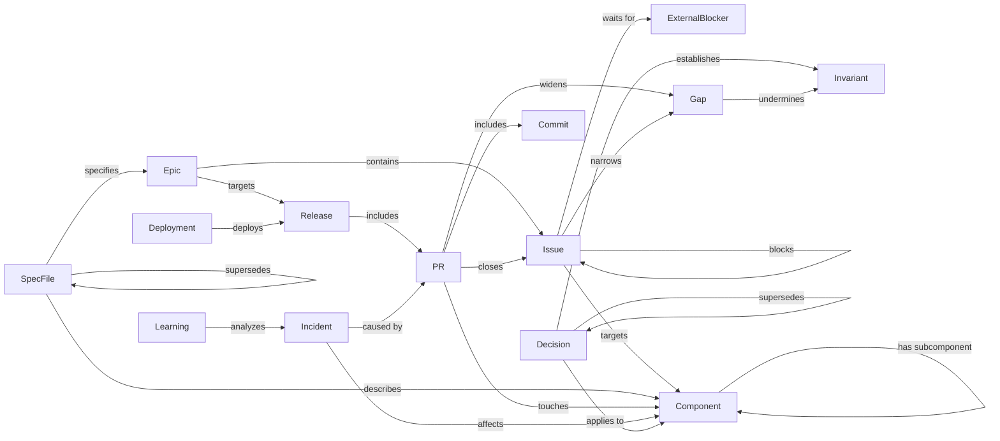

# Software development: from issue to incident

Build a living system of record for software development, and the agent workflows around it. It keeps issues, epics, specs, decisions, pull requests, releases and incidents linked to the components they touch and to the invariants and principles that constrain them. Whether work is ready, blocked or stale is worked out from those links on every read, so no status drifts. Agents triage, trace and report, writing on branches for a person to review.

The plan, the code and the postmortems live in different tools: issues in a tracker, specs in a wiki, decisions in old threads, releases and incidents in the Git host and the pager. The links between them are kept in people's heads, so a coding agent reviewing a pull request cannot see the decision it breaks, and nobody sees the issue stuck on an upstream fix. This cookbook sets OmniGraph up as the one place those links are held, and it takes the place of the issue tracker. The Git host stays the record for code.

- **One record of the work.** Engineers and coding agents read the same issues, specs and decisions, across repositories.
- **State from the links.** Ready, blocked and stale are answers to a question, never a field someone forgot to update.
- **Rules next to the work.** An invariant the system must hold, a principle a review checks and an upstream fix a feature waits on sit in the graph beside the issues they affect.

> If you are an agent: the commands, roles and workflows are in
> [AGENTS.md](AGENTS.md). Read that file before running anything.

## The data model



| Area | Types | Holds |
|---|---|---|
| Planning | `Epic`, `SpecFile`, `Decision` | Why the work exists: goals, specs with their review state, and architecture decisions |
| Work | `Issue`, `Comment` | The day-to-day work and its discussion |
| Code | `Repo`, `Component`, `PR`, `Commit` | Where the work lands, by reference to the Git host |
| Release | `Release`, `Deployment` | What shipped, and where it runs |
| Operations | `Incident`, `Learning` | What broke, its cause, and what the team learned |
| Governance | `Invariant`, `Principle`, `Gap`, `ExternalBlocker`, `Assumption`, `Capability` | The properties the system keeps, the rules reviews apply, known debt, upstream dependencies and product capabilities |
| People and tags | `Actor`, `Label`, `Gate` | Humans, agents and services; tags; approvals work waits on |

- **Decisions are never rewritten.** A decision, commit, deployment, learning or comment is only added. A correction is a new record that supersedes the old one, so the history of why stays readable.
- **State is derived.** "Ready", "blocked", "stale" and "in the next release" are worked out from links on each read. Blocking has its own link types: blocks, parent of, waits for a gate, waits for an upstream fix.
- **Invariants and principles differ.** Breaking an invariant is a bug. Breaking a principle is a rejected pull request, unless a recorded exception allows it. A gap is a known shortfall against an invariant, and a pull request can widen or narrow it.
- **The Git host keeps the code.** A pull request, commit or release carries its reference in the host, such as `meridian#205`. The graph holds how they connect to the plan, not the diff.
- **Yours to change.** The model is one file, [`schema.pg`](schema.pg), with 22 node types and 92 edge types. Drop the governance layer or add your own types.

## Branching and merging

A change is made on a branch, which is a version of the whole record. The baseline on `main` moves when the branch is merged.

- **Agent proposals.** A triage or intake agent writes its changes on its own branch. A person reads the branch diff, previews the merge and publishes it.
- **Planning what-ifs.** Re-plan an epic on a branch, moving issues and dependencies, and read what is ready or blocked as it would be. Drop the branch if the plan loses.
- **Bulk imports.** Load a tracker export on a branch and check it before it reaches `main`.
- **Past states.** Read the record as it stood at an earlier commit, for example to see what a release review saw.

## Agents and workflows

Agents bring the work of other tools into the record, keep it consistent and tell people what needs them. Engineers decide.

| Kind | Workflow | What it does | Stored queries |
|---|---|---|---|
| Capture | Pull request intake | When a pull request opens or merges in the Git host, records it, links the issues it closes and the components it touches, and moves its status | `create_pr`, `update_pr_status`, `link_pr_closes_issue`, `link_issue_implemented_by_pr` |
| Capture | Issue intake | When an issue is filed in a tracker, records it with its epic, component and owner | `create_issue`, `add_issue_to_epic`, `link_issue_targets_component`, `assign_issue_owner` |
| Capture | Deploy and incident log | When CI finishes a deploy, records it; when an incident closes, records the postmortem and the decision that followed | `record_deployment`, `resolve_incident`, `add_learning`, `record_decision` |
| Capture | Upstream release | When a library fix an issue waits on ships, records the version | `mark_blocker_shipped` |
| Maintain | Backlog triage | Lists what is ready, what is blocked and why, and what has gone stale; proposes status changes and missing dependencies | `ready`, `blocked`, `blocked_by_parent`, `blocked_by_epic`, `blocked_by_gate`, `blocked_by_wait`, `blocked_on_upstream`, `stale_candidates`, `update_issue_status`, `link_issue_blocks_issue` |
| Maintain | Governance audit | Finds violated invariants, gaps that undermine them and assumptions no test guards; proposes status changes | `unheld_invariants`, `gaps_undermining_invariants`, `assumptions`, `set_invariant_status`, `update_gap_state` |
| Maintain | Coverage audit | Finds components no spec describes and capabilities no component implements | `components_without_spec`, `capabilities_without_component` |
| Maintain | Decision upkeep | Retires a decision a newer one replaces, and lists the decisions that apply to a component | `supersede_decision`, `decisions_for_component` |
| Act | Review brief | Before a pull request review, hands the reviewer or a coding agent the decisions, specs, open issues and past pull requests for the components it touches | `decisions_for_component`, `prs_for_component`, `issues_for_component`, `epic_spec` |
| Act | Release notes | Drafts the notes for a release from its pull requests, and lists the open issues left in the epics it targets | `release_prs`, `epic_open_issues`, `issue_implementations` |
| Act | Unblock notice | When an upstream fix ships, tells the owners of the issues that waited on it | `blocked_on_upstream`, `issue_owner`, `add_comment_on_issue` |
| Act | Stale nudge | Reminds the owner of an issue that nobody has touched for a set time | `stale_candidates`, `issue_owner`, `add_comment_on_issue` |
| Act | Incident summary | Gives the on-call lead the cause, the components hit and the earlier lessons for an incident | `incident_root_cause`, `incident_components`, `learnings_for_incident` |

Every workflow has the same parts:

1. Something starts it: an event in the Git host, tracker or CI, a change in the record, or a date.
2. The agent reads the state it needs through stored queries.
3. It acts. It writes to the record on its own branch, or it tells someone outside the record: a message, a ticket, a report.
4. A person decides. They review and merge the branch, or act on what they were told.

- **Roles do not yet stop an agent merging.** This cookbook's access policy has admin, writer and reader roles only. A writer can merge into `main`, so keeping an agent on its own branch is a rule of the workflow, not enforced here. Adding an agent role that writes only on other branches is a change to the policy.
- **Outside actions are not held back by the record.** A message, a ticket or release notes go out through the agent's own tools, and nothing here reviews them first. Keep those workflows to telling and drafting, and give the agent only the outside access it needs. The cookbook has no integrations for them.
- **Repeats are tracked only on issues.** A notice about an issue is recorded as a comment on that issue, and the next run checks for it. Release notes and incident summaries have no place in the record to say they were sent.
- **Bring your own agent.** It connects through OmniGraph's MCP server from Claude Code, Codex, Cursor or another MCP client. The cookbook has no agent skill of its own.

## Data sources

The record connects the tools around the code. Each tool stays the authority for its own data.

| Source | Examples | Feeds |
|---|---|---|
| Git hosts | GitHub, GitLab | `PR`, `Commit`, `Release`, `Repo` |
| Issue trackers | Linear, Jira, GitHub Issues | `Issue`, `Epic`, `Comment` |
| Specs and decisions | Notion, Confluence, Markdown ADRs | `SpecFile`, `Decision` |
| CI and deployment | GitHub Actions, CircleCI, Argo CD | `Deployment`, `Release` |
| Incident management | PagerDuty, incident.io, Rootly | `Incident`, `Learning` |
| Upstream projects | GitHub releases of the libraries you depend on | `ExternalBlocker` |

The cookbook does not include connectors for these. A sync is a script, or an agent, that reads from the tool and writes to the record through the stored mutations or a merge load.

## Questions you can ask

Nobody maintains a status field, a dependency sheet or a release checklist for these.

| Question | Stored query |
|---|---|
| What is ready to pick up? | `ready` |
| Which issues are waiting on a fix upstream? | `blocked_on_upstream` |
| Which spec describes this epic? | `epic_spec` |
| Which pull requests shipped in this release? | `release_prs` |
| Which pull request caused this incident? | `incident_root_cause` |

The cookbook has 57 stored reads and 23 stored writes. AGENTS.md lists the commands.

## Sample data

The cookbook comes with Meridian, a made-up self-hosted collaborative document product built by a five-person team with a triage agent and a CI service: 102 records of 22 types, 18 issues, 7 pull requests and 3 releases. On a fresh load, the questions above return:

- Five issues are ready, led by MFA, a flaky sync test and a Safari login bug.
- The offline edit queue waits on a fix in the `automerge-rs` library, pinned at 0.5.9.
- The offline sync epic is described by an approved RFC, version 2.1.
- Release 1.4.0 shipped two pull requests, the tenant check and the presence speed-up.
- The presence memory-leak incident traces to the presence speed-up pull request and its commit `e5f6a7b`.

[seed.md](seed.md) describes it and lists the main reads it feeds.

## Run it

Paste this prompt into a coding agent such as Claude Code or Codex:

```text
Read https://www.omnigraph.dev/onboarding.md and set up Omnigraph for me with the dev-graph cookbook: https://github.com/ModernRelay/omnigraph-cookbooks/tree/main/dev-graph
```

To do it by hand, follow the shared [local setup](../README.md#local-setup)
using folder `dev-graph` and Graph ID `dev`. [AGENTS.md](AGENTS.md) has the
exact command for each question and workflow on this page.
