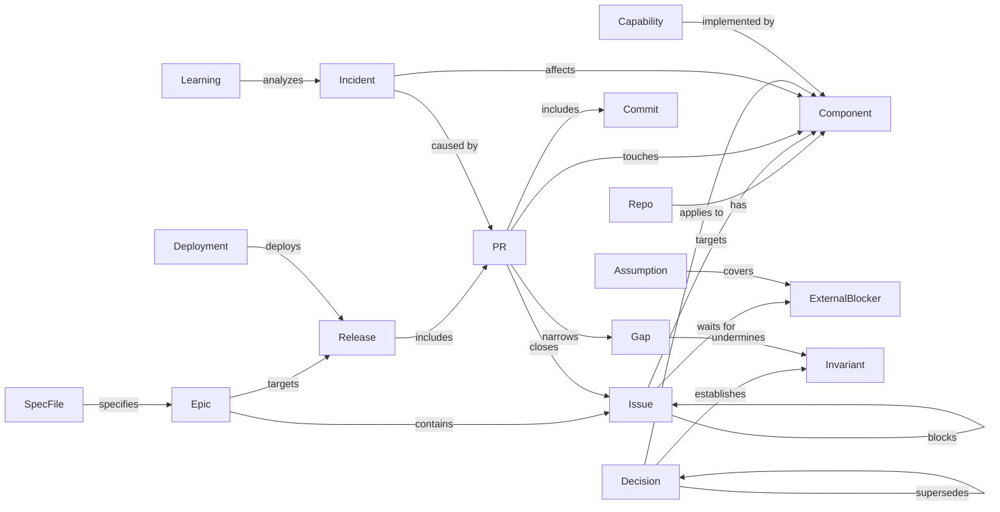

# Software development: issues to incidents

Build a living system of record for software development, and the agent
workflows around it. It keeps issues, epics, specs, decisions, pull requests,
releases and incidents linked, with the rules that constrain them, so a coding
agent sees the upstream decisions and cross-repository context that a diff
lacks. Whether work is ready or blocked is worked out from the links on every
read. Agents propose changes on branches that a person reviews. The Git host
stays the record for code.

Issues live in a tracker, code in a Git host, specs in a wiki, decisions in
old threads and incident notes in another tool. A coding agent, or a new
engineer, reviews a diff without the decision that shaped it, and the links
between these things are kept in people's heads. This cookbook sets OmniGraph
up as the one place those links are held.

- **Context for every change.** An agent or engineer reads the decisions,
  specs and open issues that touch a component before changing it.
- **Ready and blocked, worked out.** What can be picked up, and what waits on
  what, comes from the links on every read, so no status field goes stale.
- **Decisions that stay put.** A decision is never rewritten; a later one
  supersedes it, so the reasoning behind the code stays on record.

> If you are an agent: the commands, roles and workflows are in
> [AGENTS.md](AGENTS.md). Read that file before running anything.

## The data model



| Area | Types | Holds |
|---|---|---|
| Planning | `Epic`, `SpecFile`, `Decision` | Why the work exists: goals, specifications and the decisions behind them |
| Work | `Issue`, `Comment`, `Gate` | Day-to-day tasks and bugs, the discussion on them, and approvals that hold them |
| Code | `Repo`, `Component`, `PR`, `Commit` | Where the work lands, as pointers into the Git host |
| Release | `Release`, `Deployment` | What shipped, and where and when it was deployed |
| Operations | `Incident`, `Learning` | What broke, its cause, and what was learned |
| Governance | `Invariant`, `Principle`, `Gap`, `ExternalBlocker`, `Assumption`, `Capability` | Checkable properties, design rules, known debt, upstream dependencies, beliefs about outside systems and what the product can do |
| People | `Actor`, `Label` | Humans, agents and services that own or author work; tags |

- **The Git host stays the record for code.** A pull request, commit or
  release holds a reference to the host, and this record holds everything
  around it.
- **Nothing is overwritten that should be remembered.** Decisions, commits,
  deployments, learnings and comments are only added to. A correction is a
  new record that supersedes the old one.
- **State is never stored.** Ready, blocked and stale are worked out from the
  links, so they cannot drift from them.
- **Rules are separate from debt.** An invariant is a property that must hold,
  and breaking it is a bug. A principle is a design rule, and breaking it
  rejects a pull request. A gap is a known shortfall against an invariant.
- **An unguarded assumption is visible.** A belief about an outside system
  with no test pinning it shows up as a silent dependency.
- **Yours to change.** The model is one file, [`schema.pg`](schema.pg), with 22
  node types and 92 edge types. Add services, teams or whatever you track.

## Branching and merging

A change is made on a branch, which is a version of the whole record. The
baseline moves only when the branch is merged, and every earlier version stays
readable.

- **Agent changes.** A triage or sync agent writes on its own branch. A person
  reads the diff and merges it, or discards the branch.
- **Bulk imports.** Load a tracker export or a backfill on a branch, check it
  against the questions below, then merge.
- **Reorganising work.** Re-plan an epic, or split and merge issues, on a
  branch, and read what is ready and blocked as it would be afterwards.
- **History.** Read the record as it stood at any earlier commit, such as when
  a release was cut, to see what was known and decided then.

## Agents and workflows

Agents bring changes into the record, keep it consistent and tell people what
needs them. Engineers decide.

| Kind | Workflow | What it does | Stored queries |
|---|---|---|---|
| Capture | Pull request sync | Records a pull request when it opens or merges and links it to the issues it closes | `create_pr`, `update_pr_status`, `link_pr_closes_issue` |
| Capture | Issue intake | Turns a bug report or alert into an issue under its epic, aimed at a component and given an owner | `create_issue`, `add_issue_to_epic`, `link_issue_targets_component`, `assign_issue_owner` |
| Capture | Deployment log | Records each deployment of a release with its environment and outcome | `record_deployment` |
| Capture | Incident close-out | Resolves an incident, records the decision that came out of it and adds the post-mortem | `resolve_incident`, `record_decision`, `add_learning` |
| Maintain | Backlog triage | Finds issues that have not moved, then sets their status or priority | `stale_candidates`, `update_issue_status`, `set_issue_priority` |
| Maintain | Upstream watch | When an upstream fix ships, marks the blocker shipped and checks the assumptions that covered it | `blocked_on_upstream`, `assumptions_for_blocker`, `mark_blocker_shipped` |
| Maintain | Invariant check | Lists violated invariants and the gaps behind them, and updates their status | `unheld_invariants`, `gaps_undermining_invariants`, `set_invariant_status`, `update_gap_state` |
| Maintain | Decision upkeep | Records the decision that replaces one that no longer holds and links the two; a person changes the old one's status | `decisions_for_component`, `record_decision`, `supersede_decision` |
| Maintain | Coverage audit | Finds components with no spec, capabilities nothing implements and assumptions with no guard | `components_without_spec`, `capabilities_without_component`, `assumptions` |
| Act | Review context | Before an agent reviews or changes a component, hands it the decisions, open issues and recent pull requests | `decisions_for_component`, `issues_for_component`, `prs_for_component` |
| Act | Unblock notice | When a blocker ships, tells the owners of the issues that waited on it | `blocked_on_upstream`, `issue_owner` |
| Act | Release and incident brief | Writes release notes from the pull requests in a release, or a brief on an incident's cause, reach and post-mortem | `release_prs`, `incident_root_cause`, `incident_components`, `learnings_for_incident` |

Every workflow has the same parts:

1. Something starts it: an event in a source tool, a change in the record, or
   a date such as a release being cut.
2. The agent reads the state it needs through stored queries.
3. It acts. It writes to the record on its own branch, or it tells someone
   outside the record: a message, a ticket, a report.
4. A person decides. An engineer reviews the branch and merges it, or acts on
   what they were told.

- **Nothing here keeps an agent on a branch.** The shipped roles let a writer
  change and merge the baseline, and there is no agent role. Review of an
  agent's work is a practice: give the agent a token that cannot write the
  baseline, or have it branch every time.
- **Some writes are missing.** No stored write creates an incident, a release,
  a commit, an invariant, a gap or an assumption, so those are added by a
  merge load. The workflows above only update or read them.
- **Outside actions are not held back by the record.** A message or ticket
  goes out through the agent's own tools, and nothing here reviews it first.
  Keep those workflows to telling and drafting, and give the agent only the
  outside access it needs. The cookbook includes no integrations, and an issue
  comment is the only place to note that a message was sent, so a repeat has
  to be avoided by the agent checking that comment first.
- **Bring your own agent.** It connects through OmniGraph's MCP server from
  Claude Code, Codex, Cursor or another MCP client. The cookbook has no skill
  of its own; [AGENTS.md](AGENTS.md) is what it reads.

## Data sources

The record holds the links between your tools. Each tool stays the authority
for its own data.

| Source | Examples | Feeds |
|---|---|---|
| Issue trackers | Linear, Jira, GitHub Issues | `Issue`, `Epic`, `Comment` |
| Code hosts | GitHub, GitLab | `Repo`, `PR`, `Commit`, `Release` |
| CI and deployment | GitHub Actions, GitLab CI, Argo CD | `Deployment`, `Gate` |
| Errors and monitoring | Sentry, Datadog | `Incident`, `Issue` |
| Incident management | PagerDuty, incident.io | `Incident`, `Learning` |
| Docs and specs | Notion, Confluence, Google Docs | `SpecFile`, `Decision` |
| Coding agents | Claude Code, Codex, Cursor, GitHub Copilot | `Actor`, `Comment` |

The cookbook does not include connectors for these. A sync is a script, or an
agent, that reads from the tool and writes to the record through the stored
mutations or a merge load. Specs and chat threads stay where they are and are
linked by URL.

## Questions you can ask

Nobody maintains a status field or a triage board for these.

| Question | Stored query |
|---|---|
| What is ready to pick up? | `ready` |
| Which issues are waiting on a fix upstream? | `blocked_on_upstream` |
| Which spec describes this epic? | `epic_spec` |
| Which pull requests shipped in this release? | `release_prs` |

The cookbook has 80 stored queries, 57 reads and 23 writes. AGENTS.md
describes how to run them.

## Sample data

The cookbook comes with Meridian, a made-up real-time collaborative-document
product with a five-person team, a triage agent and a CI service: 102 records
across all 22 types and 239 links. On a fresh load, the questions above return:

- Five issues are ready, led by TOTP sign-in, a flaky CI test and a Safari
  login bug.
- One issue, the offline edit queue, waits on a fix in the CRDT library
  automerge-rs.
- The offline-sync epic is specified by an approved RFC, version 2.1.
- Release 1.4.0 shipped two pull requests, one of which caused the presence
  leak incident.

[seed.md](seed.md) describes the product and the records. It does not list
what every stored read returns.

## Run it

Paste this prompt into a coding agent such as Claude Code or Codex:

```text
Read https://www.omnigraph.dev/onboarding.md and set up Omnigraph for me with the development graph cookbook: https://github.com/ModernRelay/omnigraph-cookbooks/tree/main/dev-graph
```

The agent installs OmniGraph if needed, creates the graph, loads Meridian and
runs the questions above.

To do it by hand, follow the shared [local setup](../docs/local-setup.md)
using folder `dev-graph` and Graph ID `dev`. [AGENTS.md](AGENTS.md) has the
exact command for each question and workflow on this page.
