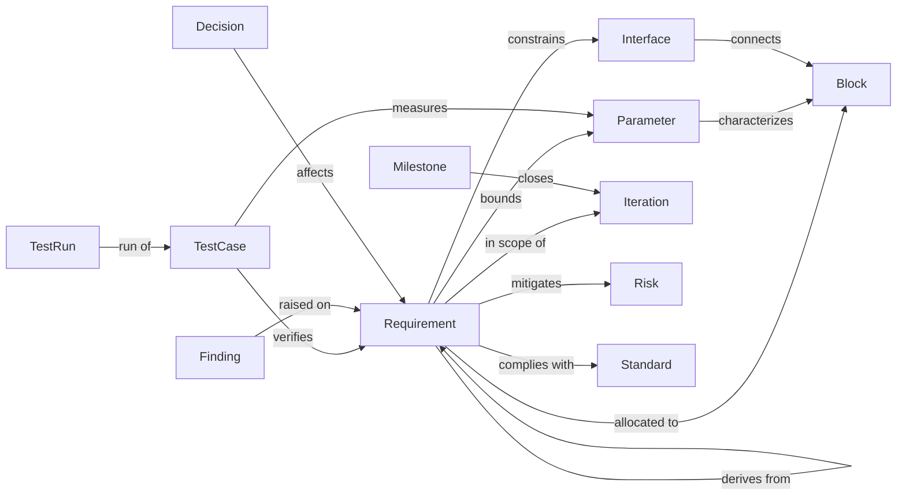

# Hardware program: requirements to verification

Build a living system of record for a hardware program, and the agent workflows
around it. It keeps requirements, the architecture they are allocated to,
design values, budgets and test evidence linked, so they stay aligned as the
design changes. Whether a requirement is verified or a budget closes is worked
out from the current data each time you ask, so no status drifts from the
evidence. Agents re-check the program on every change, on branches an engineer
reviews before anything reaches the baseline.

On most programs the requirements, budgets, CAD model and test results live in
different tools, and the links between them are kept by hand. What gets missed
turns up at integration or on the test stand. This cookbook sets OmniGraph up
as the one place those links are held.

- **One source of truth.** Engineers and agents read the same current record of
  the program.
- **Impact before the change.** You see which requirements, tests and
  interfaces a change reaches before you make it.
- **Review before the baseline.** Every change, from a person or an agent, is
  made on a branch that an engineer reviews.

> If you are an agent: the commands, roles and workflows are in
> [AGENTS.md](AGENTS.md). Read that file before running anything.

## The data model

The ontology is a hardware program's own: requirements, the architecture they
are allocated to, design values, tests, reviews and risks, and the links
between them.



| Area | Types | Holds |
|---|---|---|
| Requirements | `Requirement`, `Assumption`, `Standard` | Mission goals, system requirements and design criteria; the assumptions they rest on; external standards |
| Architecture | `Block`, `Interface`, `Parameter`, `Variant` | The system, subsystem and component tree, contracts between blocks, design values such as mass and power, product configurations |
| Verification | `TestCase`, `TestRun`, `Iteration`, `Milestone` | Verification activities and each run's evidence, design-build-test loops, design reviews and what each one baselined |
| Program | `Risk`, `Decision`, `Finding`, `Engineer` | Failure modes, trade decisions, check results, and the people and agents who own work |

- **Status is computed, never stored.** "Verified" and "over budget" are worked
  out from the test runs and design values on every read, so they cannot drift
  from the evidence.
- **A requirement reads its design value live.** It points at the value it
  limits, so a budget or limit check always uses the current number.
- **Rules are enforced on write.** An interface joins exactly two blocks, a
  design value belongs to a block, and a test run belongs to a test case.
- **Evidence stays in the record.** Each test run keeps its measured value and
  its report file, and every earlier version is kept. OmniGraph stores it all
  as files in object storage or a local folder, so there is no database server
  to size.
- **Yours to change.** The model is one file, [`schema.pg`](schema.pg), with 15
  node types and 27 edge types. Add suppliers, part numbers or whatever your
  program tracks.

## Branching and merging

A change is made on a branch, which is a version of the whole program. The
baseline moves only when the branch is merged.

- **Change requests.** Revise a requirement on a branch and read the budgets
  and review checks as they would be after the change. The reviewer sees the
  diff field by field and can preview the merge.
- **Trade studies.** Give each option its own branch and compare their budgets.
  Two options that change the same value cannot both merge unnoticed.
- **Stale results.** A test that passed before its requirement changed is
  listed as stale until someone runs it again.
- **Design review baselines.** Record the commit a PDR or CDR reviewed, and ask
  any question of the program as the review saw it.

## Agents and workflows

Agents bring changes into the record, keep it consistent and tell people what
needs them. Engineers make the decisions. These are the workflows the cookbook
supports, each backed by stored queries:

| Kind | Workflow | What it does | Stored queries |
|---|---|---|---|
| Capture | Design value sync | Writes a mass, power or other value from CAD or analysis, with whether it is estimated, calculated or measured | `set_parameter` |
| Capture | Test result intake | Records a test run with its measured value and report, and updates the test's status in the same change | `record_test_run` |
| Maintain | Budget watch | Re-adds every budget when a design value changes; flags totals over their allocation and values past their limit | `budget_rollup`, `limit_check` |
| Maintain | Verification coverage | Finds requirements with no test, failed tests, stale passes and tests that measure the wrong value | `unverified_requirements`, `failing_requirements`, `stale_verification`, `measurement_mismatch` |
| Maintain | Traceability audit | Finds requirements with no parent or owner, components no requirement asks for, and frozen work resting on weak assumptions | `untraced_requirements`, `unowned_requirements`, `unexplained_components`, `assumptions_under_frozen_work` |
| Maintain | Requirement review | Raises a finding where a requirement has no quantity or limit a test could verify, and lists what waits for a person | `raise_finding`, `awaiting_review`, `open_findings` |
| Act | Change impact notice | When a change request is opened, tells the owners of the requirements it reaches, with the tests and interfaces affected | `impacted_requirements`, `impacted_tests`, `impacted_interfaces` |
| Act | Retest requests | For each pass that predates a requirement change, asks for the test to be run again | `stale_verification` |
| Act | Design review pack | Before a PDR or CDR, sends the board what in its scope is unverified, failing, stale or not frozen | `gate_unverified`, `gate_not_passing`, `gate_stale_verification`, `gate_unfrozen_interfaces` |
| Act | Compliance report | Produces each requirement's stance on the clauses of a standard, with its justification, for an audit | `compliance_matrix` |

Every workflow has the same parts:

1. Something starts it: a change in a source tool, a change in the record, or
   a date such as a review coming up.
2. The agent reads the state it needs through stored queries.
3. It acts. It writes to the record on its own branch, or it tells someone
   outside the record: a message, a ticket, a report.
4. A person decides. An engineer reviews the branch and merges it, or acts on
   what they were told.

- **Agents cannot reach the baseline alone.** The access policy lets an agent
  write only on branches other than `main`, and it cannot merge.
- **Outside actions are not held back by the record.** A message or a ticket
  goes out through the agent's own tools, and nothing here reviews it first.
  Keep those workflows to telling and drafting, and give the agent only the
  outside access they need. The cookbook includes no integrations for them,
  and the record does not note that a message was sent, so the agent has to
  keep track of that itself.
- **Drafts are marked.** A requirement an agent drafted is labelled as
  agent-generated until a person reviews it.
- **Bring your own agent.** It connects through OmniGraph's MCP server from
  Claude Code, Codex, Cursor or another MCP client.
  [`skill/SKILL.md`](skill/SKILL.md) is a ready skill for it.

## Data sources

The record holds the values and links that connect your tools. Each tool stays
the authority for its own data.

| Source | Examples | Feeds |
|---|---|---|
| Requirements | Jama Connect, IBM DOORS, Flow, Excel, Google Sheets | `Requirement`, `Standard` |
| Mechanical CAD | Onshape, SolidWorks, Fusion 360, Siemens NX | `Block`, and `Parameter` values such as mass |
| Electronics CAD | Altium 365, KiCad | `Block`, `Interface` |
| PLM and BOM | Siemens Teamcenter, Duro, Windchill | `Block`, `Variant` |
| Simulation and analysis | SimScale, Ansys, MATLAB and Simulink, Python | `Parameter` values, `TestRun` |
| Test and manufacturing | Epsilon3, First Resonance ION, Qase | `TestCase`, `TestRun` and its report |
| Reliability | Relyence FMEA | `Risk` |
| Issues and code | Jira, Linear, GitHub, GitLab | `Finding`, `Decision` |

The cookbook does not include connectors for these. A sync is a script, or an
agent, that reads from the tool and writes to the record through the stored
mutations or a merge load.

## Questions you can ask

Each is answered from the current data by a stored query. Nobody maintains a
status field, a roll-up sheet or a matrix for it.

| Question | Stored query |
|---|---|
| Does each budget still close? | `budget_rollup` |
| If this requirement changes, which test results no longer hold? | `impacted_tests` |
| Which mission goals does this requirement serve? | `trace_up` |
| Which requirements has no test verified? | `unverified_requirements` |
| What stands between the program and its design review? | `gate_not_passing` |

The cookbook has 39 stored reads and 21 stored writes. AGENTS.md lists them.

## Sample data

The cookbook comes with Petrel, a made-up 150 kg Earth-observation satellite
partway through its engineering-model build: 23 requirements, 28 blocks, 34
design values and 13 test cases. On a fresh load, the questions above return:

- The launch mass closes at 142.6 kg of 150. The payload, at 30.8 kg, is over
  its 28 kg allocation.
- Changing the launch mass requirement reaches the structure weighing test.
- The jitter criterion serves the pointing requirement and, above it, the
  imaging goal.
- Seven requirements have no test.
- Three requirements block the critical design review: one failed thermal
  vacuum test and two tests not yet run.

[seed.md](seed.md) describes the program and lists what every stored read
returns.

## Run it

Paste this prompt into a coding agent such as Claude Code or Codex:

```text
Read https://www.omnigraph.dev/onboarding.md and set up Omnigraph for me with the hardware program cookbook: https://github.com/ModernRelay/omnigraph-cookbooks/tree/main/hardware-program
```

The agent installs OmniGraph if needed, creates the graph, loads Petrel and
runs the questions above.

To do it by hand, follow the shared [local setup](../README.md#local-setup)
using folder `hardware-program` and Graph ID `program`. [AGENTS.md](AGENTS.md)
has the exact command for each question and workflow on this page.
