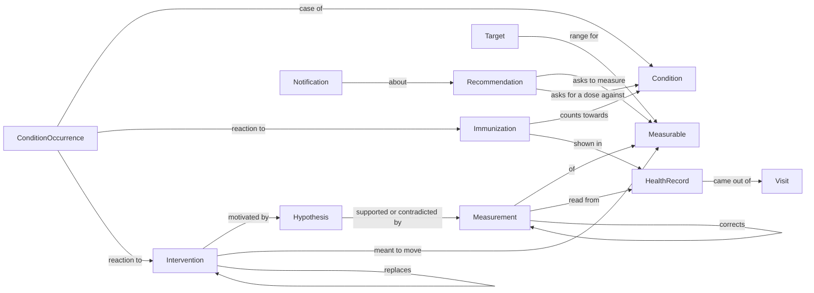

# Health record: results, targets and vaccinations

Build a living health record for one person, and the agent workflows around it.
It keeps lab results, device readings, targets, hypotheses, what you take and
the vaccine doses you were given linked to the documents they came from.
Whether a result is off target, a retest is overdue or a vaccine series is
incomplete is worked out from the current data each time you ask. Agents read
your reports and tell you what is due, on branches you review before anything
reaches the record.

Most people's health data sits in lab PDFs, a patient portal, a wearable's app
and a paper vaccination card. Nobody connects a result to the target it was
meant to reach, or a dose to the series it belongs to. This cookbook sets
OmniGraph up as the one place those links are held, on your own machine.

- **One record.** You and your agents read the same current picture: every
  result, with the document and the printed line it came from.
- **What is due, not only what happened.** Targets, retests and vaccine doses
  are in the record, so "overdue" and "off target" are answers, not a search.
- **Review before the record.** An agent's reading of a report waits on a
  branch until you have checked it against the file.

It keeps and surfaces facts. It does not diagnose and does not replace a
clinician.

> If you are an agent: the commands, roles and workflows are in
> [AGENTS.md](AGENTS.md). Read that file before running anything.

## The data model



| Area | Types | Holds |
|---|---|---|
| Who and where | `Person`, `Organization`, `Visit` | The person the record is about, their clinicians, the laboratories and clinics, and each appointment |
| Evidence | `HealthRecord`, `Measurable`, `Measurement`, `ExternalCode` | The documents received, the markers that can be measured, each value as reported, and standard codes such as LOINC |
| Judgement | `Target`, `Hypothesis`, `Condition`, `ConditionOccurrence` | The range you want a marker in, possible explanations with the results for and against them, diseases as concepts, and your own cases and reactions |
| Action | `Intervention`, `Immunization`, `Recommendation`, `Notification` | What you take or do, each vaccine dose, what is due by when and who said so, and what you were told |

- **Status is computed, never stored.** "Latest", "out of range", "off
  target", "overdue" and "incomplete" are worked out on every read, so they
  cannot drift from the results.
- **A reported value is never overwritten.** A laboratory's correction is a
  new result that replaces the old one, and the old one stays. A result filed
  by mistake is marked as entered in error and stops counting.
- **Each value keeps the line it was read from.** The name, the unit, the
  range and the whole printed line are kept as the document gave them, so a
  reviewer can check a value without guessing.
- **A dose counts per disease.** One combined vaccine can be the sixth
  tetanus dose and the fifth pertussis dose. The dose number sits on the link
  between the dose and each disease.
- **A recommendation names its authority.** The record stores what a
  clinician or a schedule said is due. It does not work a schedule out:
  schedules differ by country, age and history.
- **A hypothesis is a person's.** Its verdict is yours or your clinician's.
  One an agent proposes is marked as such until you review it.
- **Daily summaries, not raw samples.** A wearable contributes one value a
  night or a day per marker, with the period it covers. The raw samples stay
  in its app.
- **The files stay with the record.** A document's file is stored in the
  graph, on your own disk or your own bucket. The schema has no embeddings,
  so no health text is sent to a provider.
- **Yours to change.** The model is one file, [`schema.pg`](schema.pg), with
  15 node types and 39 edge types.

## Branching and merging

A change is made on a branch, which is a version of the whole record. The
record moves only when the branch is merged.

- **Report intake.** An agent reads a lab report on a branch. You see each
  value beside its printed line, compare it with the file and merge.
- **Trying a target.** Change a target on a branch and read what would be off
  target before you adopt it.
- **Corrections.** An amended report goes in on a branch like any other. The
  merge keeps both the old value and the new one.
- **What the clinician saw.** Record the commit at a visit, and ask any
  question of the record as it stood that day.

## Agents and workflows

Agents bring documents and readings into the record, keep it consistent and
tell you what needs you. You and your clinician make the decisions.

| Kind | Workflow | What it does | Stored queries |
|---|---|---|---|
| Capture | Report intake | Files a lab report and records each result as printed, with the line it was read from | `file_record`, `record_result`, `mark_extracted` |
| Capture | Reading sync | Writes one daily summary per marker from a wearable or a home monitor | `record_reading` |
| Capture | Vaccination record intake | Records each dose from a card or a registry extract, with the diseases it counts towards | `record_dose`, `add_dose_disease`, `link_dose_record` |
| Capture | Visit follow-up | After a visit, records the targets, the changes and the retests the clinician set | `set_target`, `start_intervention`, `recommend_retest`, `complete_visit` |
| Maintain | Corrections and units | Records a laboratory's corrected result, and converts values printed in another unit | `correct_result`, `unconverted_results`, `set_canonical_value`, `preliminary_results` |
| Maintain | Evidence linking | Links each new result to the hypotheses it supports or contradicts, and lists the ones now in doubt | `link_support`, `link_contradiction`, `contested_hypotheses`, `hypotheses_without_evidence` |
| Maintain | Follow-up check | Finds changes with no result since they started and targets with no retest planned, and proposes the retest | `interventions_without_followup`, `targets_without_retest`, `recommend_retest` |
| Maintain | Vaccination audit | Finds series left unfinished and doses that no document shows | `incomplete_series`, `undocumented_doses`, `doses_by_disease` |
| Act | Overdue reminder | Tells you once when a retest or a dose is past its date | `overdue_not_notified`, `raise_notification`, `mark_sent` |
| Act | Off-target notice | Tells you when a new result is outside your own target | `off_target`, `notification`, `raise_result_notification` |
| Act | Visit preparation | Before a visit, drafts your questions from what is off target, overdue and in doubt, and what you take | `upcoming_visits`, `off_target`, `overdue_recommendations`, `active_interventions` |
| Act | Lot recall check | Given a recalled vaccine lot, lists the doses you had from it | `doses_by_lot` |

Every workflow has the same parts:

1. Something starts it: a document arriving, a device syncing, a date passing
   or a visit coming up.
2. The agent reads the state it needs through stored queries.
3. It acts. It writes to the record on its own branch, or it tells you
   outside the record: a message, an email, a draft.
4. You decide. You review the branch and merge it, or act on what you were
   told.

- **Agents cannot reach the record alone.** The access policy lets an agent
  write only on branches other than `main`, and it cannot merge.
- **Outside actions are not held back by the record.** A message goes out
  through the agent's own tools, and nothing here reviews it first. Keep those
  workflows to telling and drafting. The cookbook includes no integrations
  for them.
- **A prompt is recorded.** Each one is a notification in the record, named
  for what it is about, with whether it was sent and acknowledged. An agent
  reads it before raising the same prompt again.
- **It does not diagnose.** An agent records what a document or you state. It
  may propose a hypothesis for your review; it does not set a condition or a
  verdict.
- **Bring your own agent.** It connects through OmniGraph's MCP server from
  Claude Code, Codex, Cursor or another MCP client.

## Data sources

The record holds the values and links that connect your sources. Each source
stays the authority for its own data.

| Source | Examples | Feeds |
|---|---|---|
| Lab reports | Quest Diagnostics, Labcorp, Function Health, InsideTracker, Synlab | `HealthRecord`, `Measurement` |
| Patient portals | Epic MyChart, Oracle Health, the NHS App | `HealthRecord`, `Measurement`, `ConditionOccurrence`, `Immunization` |
| Wearables | Apple Health, Oura, Whoop, Garmin, Fitbit | `Measurement` as daily summaries |
| Home devices | Withings scales, Omron blood pressure monitors | `Measurement` |
| Body composition | BodySpec and DexaFit DEXA scans | `HealthRecord`, `Measurement` |
| Vaccination records | Paper cards, national immunization registries, travel clinic printouts | `Immunization`, `Recommendation` |
| Medication lists | Pharmacy apps, Medisafe | `Intervention` |
| Calendars | Google Calendar, Apple Calendar | `Visit` |

The cookbook does not include connectors for these. Most arrive as a PDF or an
export file. A sync is an agent, or a script, that reads the file and writes
to the record through the stored mutations on a branch.

## Questions you can ask

Nobody keeps a spreadsheet, a reminder list or a vaccination booklet up to
date for these.

| Question | Stored query |
|---|---|
| Which results are outside my own targets? | `off_target` |
| Did this change move the marker it was meant to move? | `intervention_effect` |
| Which vaccine series did I never finish? | `incomplete_series` |
| What is overdue? | `overdue_recommendations` |
| Which of my hypotheses does a result contradict? | `contested_hypotheses` |

The cookbook has 44 stored reads and 51 stored writes. AGENTS.md lists them.

## Sample data

The cookbook comes with Noa Brandt, an invented person: 122 results of 26
markers from two years of blood panels, a body composition scan, home readings
and fourteen nights from a wrist tracker, with 12 documents, 19 vaccine doses
and 6 interventions. On a fresh load, the questions above return:

- Two results are off target: LDL cholesterol at 2.1 mmol/L against a target
  of 1.8 or less, and vitamin D at 71 nmol/L against 75 to 125.
- Rosuvastatin moved both markers it was meant to. ApoB was 1.15, 1.08 and
  1.02 g/L before it and 0.72 after; LDL cholesterol went from 3.4 to 2.1.
- Hepatitis B was never finished: two of three doses.
- Three things are overdue: the third hepatitis B dose, a TSH retest and the
  2026 influenza dose.
- Two hypotheses are contradicted. ApoB was still 1.02 after a year of diet
  change, and tiredness barely changed after ferritin recovered to 61.

[seed.md](seed.md) describes the person and lists what every stored read
returns.

## Run it

Paste this prompt into a coding agent such as Claude Code or Codex:

```text
Read https://www.omnigraph.dev/onboarding.md and set up Omnigraph for me with the health record cookbook: https://github.com/ModernRelay/omnigraph-cookbooks/tree/main/health-record
```

The agent installs OmniGraph if needed, creates the graph, loads Noa Brandt
and runs the questions above.

To do it by hand, follow the shared [local setup](../docs/local-setup.md)
using folder `health-record` and Graph ID `health`. [AGENTS.md](AGENTS.md)
has the exact command for each question and workflow on this page.
