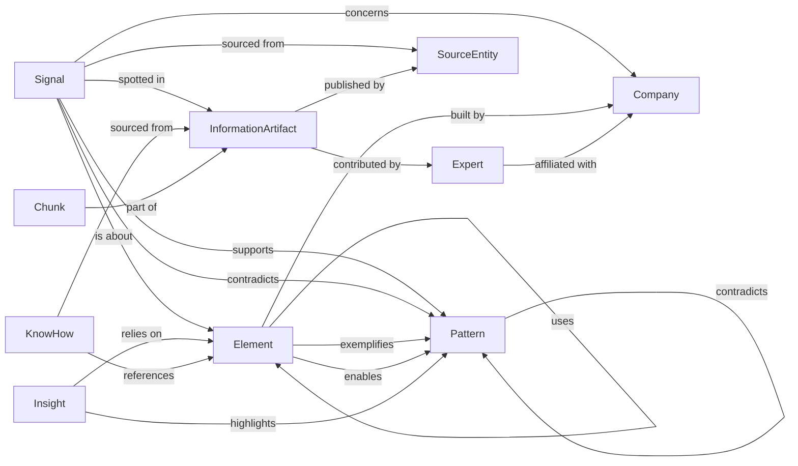

# Industry intelligence: signals, patterns and insights

Build a living record of an industry's signals and patterns, and the agent
workflows around it. It keeps each signal, the pattern it supports or
contradicts, the products and companies it concerns and the source it came
from linked, so a new signal shows which beliefs it weakens. Agents file
evidence and flag what is stale or contested, on branches for an analyst to
review.

Market intelligence usually lives in a feed reader, a folder of clippings and
the analyst's memory. The links between a claim, its source and the belief it
bears on are never written down, so a thesis keeps standing after the evidence
turns. This cookbook sets OmniGraph up as the one place those links are held.

- **Evidence on both sides.** A signal can support a pattern or contradict it,
  so a belief is never judged by its supporters alone.
- **Every claim has a source.** A signal points at the article and the
  publisher it came from, and the gaps are a query away.
- **A weekly review that runs itself.** Unfiled, stale, contested and
  unsourced items are worked out from the record each time you ask.

> If you are an agent: the commands, roles and workflows are in
> [AGENTS.md](AGENTS.md). Read that file before running anything.

## The data model



| Area | Types | Holds |
|---|---|---|
| Evidence | `Signal`, `InformationArtifact`, `SourceEntity`, `Chunk` | Dated claims, the articles, videos and papers they come from, their publishers, and the text of each source in searchable pieces |
| Beliefs | `Pattern`, `Insight` | The forces at work (a challenge, a disruption or a dynamic) and an analyst's reading of them |
| Landscape | `Element`, `Company`, `Expert` | Products, technologies, frameworks and concepts, who builds them, and the people who write about them |
| Practice | `KnowHow` | Playbooks grounded in the products and concepts they use |

- **Contradiction is a first-class link.** A pattern nothing argues with has
  not been tested yet, so a signal can contradict a pattern as easily as
  support it.
- **Patterns relate to each other.** One pattern can drive or rely on another,
  and two can contradict.
- **Domain is a property.** A signal or product carries its domain, such as
  inference, security or data engineering, so you filter without a new type.
- **Sources are kept apart from claims.** An artifact is one article or video;
  a source is its publisher. Many artifacts share a source.
- **Yours to change.** The model is one file, [`schema.pg`](schema.pg). Swap
  the AI industry for your own market by editing the enums and types.

## Branching and merging

A change is made on a branch, which is a version of the whole record. The
baseline moves only when the branch is merged.

- **Weekly intake.** File the week's signals on a branch, read the momentum and
  contested lists as they would be after the change, then merge.
- **Competing readings.** Give a rival interpretation of a pattern its own
  branch and compare what each one makes of the same evidence.
- **Agent proposals.** An agent files its evidence on its own branch and an
  analyst reviews the diff before it merges.
- **Past states.** Ask what the record said at an earlier date, such as the
  last board briefing.

## Agents and workflows

Agents bring signals in, keep the record honest and tell people what moved.
Analysts decide what a signal means.

| Kind | Workflow | What it does | Stored queries |
|---|---|---|---|
| Capture | Signal intake | Turns a new article, filing or post into a dated signal with its artifact and publisher | `add_signal`, `add_artifact`, `link_signal_spotted_in`, `link_signal_sourced_from` |
| Capture | Evidence filing | Attaches a signal to the pattern it supports or contradicts and the products it is about | `link_signal_forms_pattern`, `link_signal_contradicts_pattern`, `link_signal_on_element` |
| Capture | Landscape mapping | Adds a newly named product and its builder, and the company a signal concerns | `add_element`, `add_company`, `link_element_developed_by`, `link_signal_relevant_company` |
| Maintain | Triage | Lists signals attached to no pattern, newest first, to be filed against a pattern | `orphan_signals` |
| Maintain | Provenance audit | Finds signals with no artifact or publisher, and attaches the source where one can be found | `unsourced_signals`, `link_signal_spotted_in` |
| Maintain | Staleness review | Lists patterns no evidence of either kind has touched since a cutoff, with their last signals | `stale_patterns`, `pattern_signals` |
| Maintain | Insight drafting | Reads where evidence is rising or contested and drafts an insight on those patterns | `pattern_momentum`, `contested_patterns`, `add_insight`, `link_insight_highlights_pattern` |
| Maintain | Pattern linking | Proposes which patterns drive or rely on each other from the shared signals and products | `pattern_drives`, `pattern_relies_on`, `link_pattern_drives`, `link_pattern_relies_on` |
| Act | Weekly brief | Sends the team what came in, what is gaining signals and what is contested | `recent_signals`, `pattern_momentum`, `contested_patterns` |
| Act | Contradiction alert | When a signal contradicts a pattern, tells the analysts who follow it, with the signal and its source | `signal_contradictions`, `signal_sources` |
| Act | Source search | Answers a research question from the source text, with the artifacts it cites | `hybrid_chunks`, `related_chunks` |

Every workflow has the same parts:

1. Something starts it: a new article, a date such as the Monday review, or a
   new link in the record.
2. The agent reads the state it needs through stored queries.
3. It acts. It writes to the record on its own branch, or it tells someone
   outside the record: a message, a ticket, a report.
4. A person decides. An analyst reviews the branch and merges it, or acts on
   what they were told.

- **Review is a practice here, not enforced.** The roles that come with this
  cookbook let a writer change `main` and merge. Have agents work on branches
  and have an analyst merge them. Nothing stops an agent that skips this.
- **Outside actions are not held back by the record.** A brief or an alert goes
  out through the agent's own tools, and nothing here reviews it first. Keep
  those workflows to telling and drafting. The cookbook has no integrations
  for them, and the record has no place to note that a message was sent, so
  the agent has to keep track of that itself.
- **Some work has no stored write.** There is no stored query to retire a
  stale pattern, drop a signal or change one. Those edits are left to a person.
- **Bring your own agent.** It connects through OmniGraph's MCP server from
  Claude Code, Codex, Cursor or another MCP client.
  [`skill/SKILL.md`](skill/SKILL.md) is a skill for setting up a graph for a
  new market.

## Data sources

The record holds the claims and links that connect your reading. Each tool
stays the authority for its own content.

| Source | Examples | Feeds |
|---|---|---|
| News and trade press | Reuters, Bloomberg, TechCrunch, CNBC | `Signal`, `InformationArtifact`, `SourceEntity` |
| Feed readers and newsletters | Feedly, Gmail newsletters, RSS | `Signal`, `InformationArtifact` |
| Market research | AlphaSense, Gartner, Forrester | `Signal`, `InformationArtifact` |
| Company and product pages | Company blogs, newsrooms, GitHub | `Element`, `Company`, `Signal` |
| Video and podcasts | YouTube | `InformationArtifact`, `Expert`, `KnowHow` |
| Social and academic | X, Mastodon, Science, arXiv | `Signal`, `Expert`, `SourceEntity` |

The cookbook does not include connectors for these. A sync is a script, or an
agent, that reads from the tool and writes to the record through the stored
mutations or a merge load. Source text is cut into `Chunk` pieces and given
embeddings offline, as [AGENTS.md](AGENTS.md) describes.

## Questions you can ask

Nobody keeps a watch list or a status sheet up to date for these.

| Question | Stored query |
|---|---|
| Which patterns does new evidence contradict? | `contested_patterns` |
| Which patterns are gathering signals fastest? | `pattern_momentum` |
| What came in most recently? | `recent_signals` |
| What evidence supports a pattern? | `pattern_signals` |

The cookbook has 42 stored reads and 31 stored writes. AGENTS.md lists them.

## Sample data

The cookbook comes with the AI infrastructure market in 2026, from public
sources: 5 patterns, 19 signals, 24 products and concepts and 4 insights, with
123 nodes and 172 edges in all. It has no source text, so the search workflow
returns nothing until you add chunks. On a fresh load, the questions above
return:

- Three patterns are contradicted: SaaSpocalypse twice, Sovereign AI and
  Accelerated Research once each.
- Since 1 May 2026, SaaSpocalypse has gained two signals and Sovereign AI and
  Accelerated Research one each. Those are the contradicting ones.
- The newest of 19 signals is public-cloud AI revenue accelerating in Q3 2026,
  dated 29 October 2026.
- Three signals support SaaSpocalypse, among them the $830B software selloff.

[seed.md](seed.md) describes the data.

## Run it

Paste this prompt into a coding agent such as Claude Code or Codex:

```text
Read https://www.omnigraph.dev/onboarding.md and set up Omnigraph for me with the industry intel cookbook: https://github.com/ModernRelay/omnigraph-cookbooks/tree/main/industry-intel
```

The agent installs OmniGraph if needed, creates the graph, loads the sample
data and runs the questions above.

To do it by hand, follow the shared [local setup](../README.md#local-setup)
using folder `industry-intel` and Graph ID `spike`. [AGENTS.md](AGENTS.md) has
the exact command for each question and workflow on this page.
