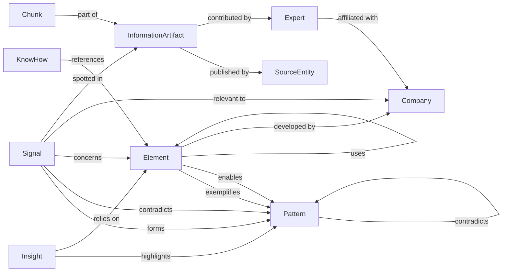

# Industry intelligence: signals, patterns and insights

Build a living intelligence record of an industry, and the agent workflows around it. It keeps signals, the patterns they support or contradict, and the insights drawn from them linked to the products, technologies and companies they concern, and to the sources they came from. Which patterns are gathering evidence, which are contested and which have gone quiet is worked out from the record each time you ask. Agents triage new evidence and propose links on branches that an analyst reviews before they are merged.

Market and competitor intelligence usually lives in a feed reader, a shared
document and a few people's heads. A new announcement is read, discussed and
forgotten, and nobody can say which of the team's beliefs it supports, which it
weakens or where it came from. This cookbook sets OmniGraph up as the one place
the evidence, the beliefs and the sources are held.

- **Beliefs tied to evidence.** Every pattern lists the signals that form it
  and the signals that contradict it.
- **Provenance on every signal.** You see the article, report or person a claim
  came from, and which claims have no source.
- **Review before the record changes.** An agent's triage waits on a branch for
  an analyst.

> If you are an agent: the commands, roles and workflows are in
> [AGENTS.md](AGENTS.md). Read that file before running anything.

## The data model



| Area | Types | Holds |
|---|---|---|
| Analysis | `Signal`, `Pattern`, `Insight` | Dated movements in the industry, the themes they add up to, and the conclusions an analyst draws |
| Domain map | `Element`, `Company` | Products, technologies, frameworks, concepts and practices, and who builds them |
| Practice | `KnowHow` | Guidance grounded in specific elements |
| Sources | `InformationArtifact`, `SourceEntity`, `Expert`, `Chunk` | Articles and reports, who published them, who wrote them, and their text in searchable pieces |

- **Signals support or contradict.** A signal either forms a pattern or
  contradicts it, so one pattern can carry evidence for and against.
- **Patterns have kinds.** A pattern is a challenge, a disruption or a dynamic,
  and an element is a product, technology, framework, concept or ops practice.
  These are properties, not separate types, and a signal or element also
  carries a domain such as security or inference.
- **Patterns relate to each other.** One pattern drives, relies on or
  contradicts another.
- **Search is optional.** Source text is cut into chunks with embeddings for
  search by meaning and by keyword. The sample data has no chunks.
- **Yours to change.** The model is one file, [`schema.pg`](schema.pg), with 10
  node types and 23 edge types. Change the domains and kinds to fit your
  industry.

## Branching and merging

A change is made on a branch, which is a version of the whole record. The
baseline moves only when the branch is merged.

- **Triage batches.** An agent attaches a day's new signals to patterns on its
  own branch. The analyst reads the diff, fixes a wrong link and merges.
- **Competing readings.** Two analysts read the same signal differently, one as
  forming a pattern and one as contradicting it. Each uses a branch, and the
  merge shows where they differ.
- **As the team saw it.** Ask the record any question as it stood at an earlier
  commit, such as the state behind last quarter's briefing.

## Agents and workflows

Agents bring evidence into the record, keep it organised and tell people what
changed. Analysts decide what a signal means.

| Kind | Workflow | What it does | Stored queries |
|---|---|---|---|
| Capture | Signal intake | Reads a new article, report or post and records it as a signal with its source, artifact and the elements and companies it concerns | `add_signal`, `add_artifact`, `add_source`, `link_signal_spotted_in`, `link_signal_sourced_from`, `link_signal_on_element`, `link_signal_relevant_company` |
| Maintain | Triage | Takes each signal that is not yet attached to a pattern and links it as forming or contradicting one | `orphan_signals`, `link_signal_forms_pattern`, `link_signal_contradicts_pattern` |
| Maintain | Evidence lookup | Before linking, searches the source text and earlier signals for what already bears on the claim | `hybrid_chunks`, `search_signals`, `search_patterns` |
| Maintain | Tension review | Finds patterns with contradicting signals and proposes an insight that weighs both sides | `contested_patterns`, `signal_contradictions`, `add_insight`, `link_insight_highlights_pattern` |
| Maintain | Momentum and staleness | Compares signal counts since a cutoff to show which patterns are gaining evidence and which have gone quiet | `pattern_momentum`, `stale_patterns`, `pattern_signals` |
| Maintain | Provenance audit | Finds signals with no artifact and no source, which nobody can check, and attaches the source or flags the signal | `unsourced_signals`, `link_signal_spotted_in` |
| Act | Weekly briefing | Drafts the briefing for the team: what came in, which patterns moved, which are contested | `recent_signals`, `pattern_momentum`, `contested_patterns` |
| Act | Research requests | For each pattern with no new signal since the cutoff, asks the analyst who follows it whether to research it or drop it | `stale_patterns` |

Every workflow has the same parts:

1. Something starts it: a new item in a source, a scheduled review, or a person
   asking.
2. The agent reads the state it needs through stored queries.
3. It acts. It writes to the record on its own branch, or it tells someone
   outside the record: a message, a ticket, a briefing.
4. A person decides. An analyst reviews the branch and merges it, or acts on
   what they were told.

- **Stored writes only add.** The cookbook has stored mutations that add nodes
  and links, and none that change or delete one. Retiring a stale pattern or
  correcting a signal is a person's edit.
- **The sample roles do not keep agents off the baseline.** The writer role can
  write on any branch and merge into `main`; this cookbook has no agent role
  that is limited to branches. Give an agent the writer credential only with
  the instruction to use its own branch, or add a role like the one in
  hardware-program.
- **Outside actions are not held back by the record.** A briefing or request
  goes out through the agent's own tools, and nothing here reviews it first.
  Keep these workflows to telling and drafting. The cookbook has no
  integrations for them, and the record does not note that a briefing was
  sent, so the agent has to keep track of that itself.
- **Bring your own agent.** It connects through OmniGraph's MCP server from
  Claude Code, Codex, Cursor or another MCP client.
  [`skill/SKILL.md`](skill/SKILL.md) is a ready skill for setting the cookbook
  up for your own industry.

## Data sources

The record connects what your team reads. Each source stays the authority for
its own content.

| Source | Examples | Feeds |
|---|---|---|
| News and analyst reports | Bloomberg, Forbes, Gartner, Forrester | `InformationArtifact`, `SourceEntity`, `Signal` |
| Research papers | arXiv | `InformationArtifact`, `Expert`, `Signal` |
| Code and open source | GitHub, Hugging Face | `Element`, `Signal` |
| Funding and company data | Crunchbase, PitchBook | `Company`, `Signal` |
| Social and community | X, Hacker News, Reddit | `Signal`, `Expert` |
| Documents and transcripts | Reports, podcasts, call notes | `Chunk`, `InformationArtifact` |

The cookbook does not include connectors for these. A sync is a script, or an
agent, that reads from the source and writes to the record through the stored
mutations, or a merge load for chunks.

## Questions you can ask

Nobody keeps a tally of evidence per theme or a list of unsourced claims by
hand for these.

| Question | Stored query |
|---|---|
| Which patterns are gathering signals fastest? | `pattern_momentum` |
| What came in most recently? | `recent_signals` |
| Which signals form this pattern? | `pattern_signals` |
| Which signals have no source? | `unsourced_signals` |

The cookbook has 42 stored reads and 31 stored writes. AGENTS.md lists them.

## Sample data

The cookbook comes with the AI industry in early 2026, from public sources:
five patterns, 15 signals, 24 elements, four insights and two know-hows, with
20 articles and reports from 16 sources. On a fresh load, the questions above
return:

- Since 1 March 2026, Context Graphs gathered three signals and New Cyber
  Threats two. The other three patterns gathered one each.
- The newest signal is the Mythos Preview exploit result, from 7 April 2026,
  then Forbes on context graphs from 3 April.
- Context Graphs is formed by three signals: Forbes, Gartner and Edra's Series A.
- One signal has no source: Gartner's forecast that half of agent systems will
  use context graphs by 2028.

No signal in the sample contradicts a pattern, so the tension review finds
nothing to review on a fresh load.

[seed.md](seed.md) describes the data and lists what it holds.

## Run it

Paste this prompt into a coding agent such as Claude Code or Codex:

```text
Read https://www.omnigraph.dev/onboarding.md and set up Omnigraph for me with the industry intelligence cookbook: https://github.com/ModernRelay/omnigraph-cookbooks/tree/main/industry-intel
```

The agent installs OmniGraph if needed, creates the graph, loads the sample and
runs the questions above.

To do it by hand, follow the shared [local setup](../README.md#local-setup)
using folder `industry-intel` and Graph ID `spike`. [AGENTS.md](AGENTS.md) has
the exact command for each question and workflow on this page.
