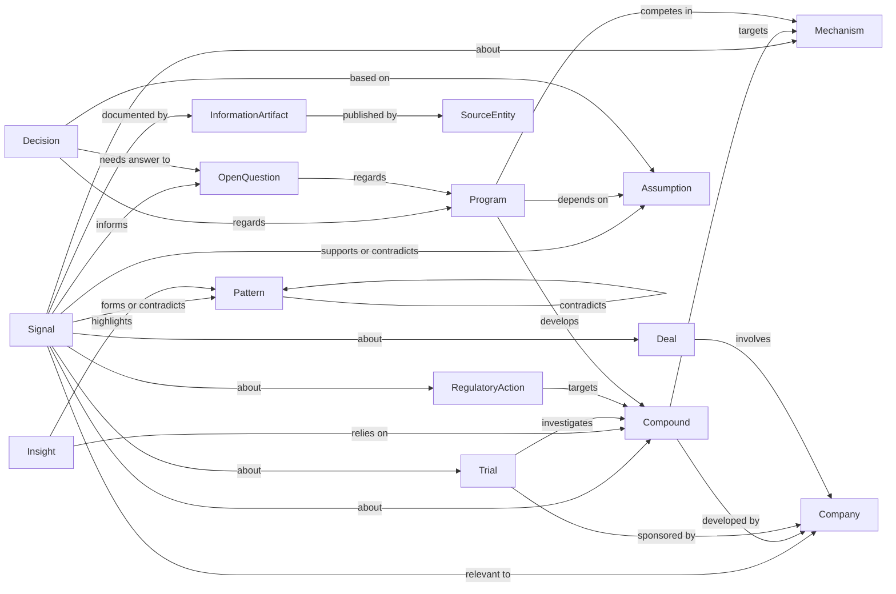

# Pharma intelligence: competitive pipeline to program decisions

Build a living competitive-intelligence record for a biotech program, and the agent workflows around it. It keeps the external pipeline (compounds, trials, deals and regulatory actions) linked to the program's own assumptions, decisions and open questions, so you can see which outside signals support or contradict which internal belief, and what still needs an answer before a decision. Agents map each new public signal to the record on a branch that an analyst reviews before it reaches the baseline.

Competitive intelligence usually lives in a slide deck, a tracker spreadsheet and a few analysts' heads, while the program's own assumptions sit in strategy documents. Nobody can say which new readout threatens which bet, so a committee meets without the evidence that matters. This cookbook sets OmniGraph up as the one place the pipeline, the signals and the program's beliefs are held together.

- **Evidence against each assumption.** Every signal is linked to the assumptions it supports or contradicts, so a bet and its counter-evidence are one question apart.
- **Decisions with their open items.** A decision points at the assumptions it rests on and the questions that must be answered first.
- **Sources behind every signal.** Each signal traces to the filing, registration or press release it came from.

> If you are an agent: the commands, roles and workflows are in
> [AGENTS.md](AGENTS.md). Read that file before running anything.

## The data model



| Area | Types | Holds |
|---|---|---|
| External pipeline | `Compound`, `Mechanism`, `Trial`, `Company`, `Deal`, `RegulatoryAction` | The assets, the biology they act on, the trials that test them, the companies behind them, and the deals and agency actions around them |
| Intelligence | `Signal`, `Pattern`, `Insight` | Dated observations, the recurring dynamics they add up to, and the conclusions an analyst draws |
| Provenance | `SourceEntity`, `InformationArtifact` | The publisher and the document each signal comes from, with its link |
| Internal context | `Program`, `Assumption`, `Decision`, `OpenQuestion` | The sponsor's own programs, the beliefs they rest on, the decisions ahead and the questions blocking them |

- **Three layers, one record.** Outside evidence and inside beliefs sit in one graph, so a Pfizer discontinuation reaches a strategy assumption in one step instead of through someone's memory.
- **Beliefs are records.** An assumption, a decision and an open question each have their own evidence chain, instead of being a line in a program's description.
- **A competitor is a mechanism away.** A program names the mechanisms it competes in, and every compound that targets one is its competitor, whoever sponsors it.
- **Yours to change.** The model is one file, [`schema.pg`](schema.pg). Add endpoints, indications, payers or whatever your program tracks.

## Branching and merging

A change is made on a branch, which is a version of the whole record. The baseline moves only when the branch is merged.

- **Signal intake.** An analyst or an agent adds a batch of new signals and their links on a branch. The reviewer reads the diff and merges it.
- **What-if on a belief.** On a branch, mark an assumption as contradicted and read the decisions that rest on it, without changing what the committee sees.
- **The committee's view.** Read the record at the commit a decision meeting reviewed, and ask any question of the evidence as it stood that day.

## Agents and workflows

Agents bring public signals into the record, work out what they mean for the program and tell people what needs them. Analysts decide what the record believes, and the committee decides.

| Kind | Workflow | What it does | Stored queries |
|---|---|---|---|
| Capture | Signal intake | Reads the day's filings, press releases and registrations; records each new one with its source document and the compound, trial or company it concerns | `add_source`, `add_artifact`, `add_signal`, `link_signal_artifact`, `link_artifact_source`, `link_about_compound`, `link_about_trial`, `link_relevant_company` |
| Capture | Pipeline update | Adds a new compound, trial, deal or agency action and ties it to its sponsor and mechanism | `add_compound`, `add_trial`, `add_deal`, `add_regulatory`, `link_compound_mechanism`, `link_compound_company`, `link_trial_compound` |
| Maintain | Signal triage | Maps each new signal to the assumptions it supports or contradicts, the questions it informs and the patterns it feeds | `signal_supports_assumptions`, `signal_contradicts_assumptions`, `link_signal_supports_assumption`, `link_signal_contradicts_assumption`, `link_signal_informs_question`, `link_forms_pattern`, `link_contradicts_pattern` |
| Maintain | Evidence review | Rebuilds the evidence for and against each assumption and flags any that now has more against than for | `assumption_supporting_signals`, `assumption_contradicting_signals`, `program_assumptions` |
| Maintain | Pattern synthesis | Looks at the signals on each pattern, proposes an insight where they add up, and links it | `pattern_signals`, `pattern_contradictions`, `add_insight`, `link_highlights_pattern` |
| Act | Decision brief | Before a decision date, sends the committee its assumptions with the evidence for and against, and its open questions | `decisions_upcoming`, `decision_assumptions`, `decision_questions`, `assumption_contradicting_signals` |
| Act | Competitor alert | When a signal lands on a compound in the program's mechanism, tells the program team what it is and which assumptions it touches | `program_landscape_signals`, `signal_contradicts_assumptions`, `signal_informs_questions` |
| Act | Question owner nudge | Tells whoever asked an open question when a new signal informs it | `questions_open`, `question_signals` |

Every workflow has the same parts:

1. Something starts it: a new document at a source, a new signal in the record, or a decision date coming up.
2. The agent reads the state it needs through stored queries.
3. It acts. It writes to the record on its own branch, or it tells someone outside the record: a message, a brief, a ticket.
4. A person decides. An analyst reviews the branch and merges it, or the committee acts on the brief.

- **Agents should not write the baseline.** An agent writes only on its own branch and an analyst merges it. This cookbook's access policy has no agent role, so a writer token can still write `main`; adding one, as the hardware-program cookbook has, is what enforces it.
- **Outside actions are not held back by the record.** A brief or a message goes out through the agent's own tools, and nothing here reviews it first. Keep those workflows to telling and drafting, and give the agent only the outside access it needs. The cookbook includes no integrations for them.
- **A repeat is not caught by the record.** A source document's link is unique, but the stored write that adds a document does not set it, so an agent has to search the signals for the event before it adds one. The record also has no place for a note that a brief or an alert was sent, so the agent has to keep track of that itself.
- **Judgements stay with analysts.** An agent proposes which assumption a signal bears on. Retiring an assumption, closing a question or recording a decision is an analyst's edit, and the cookbook has no stored write for those.
- **Bring your own agent.** It connects to the server over OmniGraph's MCP bridge from Claude Code, Codex, Cursor or another MCP client. This cookbook has no skill of its own.

## Data sources

The record holds the links between what your tools know. Each tool stays the authority for its own data.

| Source | Examples | Feeds |
|---|---|---|
| Company filings | SEC EDGAR 8-K, 10-K and 10-Q, investor presentations | `Signal`, `InformationArtifact`, `Company` |
| Trial registries | ClinicalTrials.gov, EU Clinical Trials Register | `Trial` |
| Regulators and payers | FDA, EMA, CMS, payer coverage policies | `RegulatoryAction`, `Signal` |
| News and press | Business Wire, PR Newswire, Endpoints, Fierce Biotech | `Signal`, `SourceEntity` |
| Earnings and conferences | Earnings call transcripts, ADA and ObesityWeek abstracts | `Signal`, `InformationArtifact` |
| Pipeline databases | Citeline Pharmaprojects, Evaluate Pharma, GlobalData | `Compound`, `Mechanism`, `Deal` |
| Strategy documents | Google Docs, Notion, Confluence, Excel | `Program`, `Assumption`, `Decision`, `OpenQuestion` |

The cookbook does not include connectors for these. A sync is a script, or an agent, that reads from the source and writes to the record through the stored mutations or a merge load.

## Questions you can ask

Nobody keeps a matrix of beliefs against evidence, or a list of what to answer before the meeting, for these.

| Question | Stored query |
|---|---|
| Which signals contradict an assumption the program relies on? | `assumption_contradicting_signals` |
| Which decisions are coming up? | `decisions_upcoming` |
| What does the committee still need answered before this decision? | `decision_questions` |
| Which compounds compete with the program? | `program_competitors` |
| What is happening around the program's mechanism? | `program_landscape_signals` |

The cookbook has 70 stored reads and 35 stored writes. AGENTS.md lists the commands for each workflow.

## Sample data

The cookbook comes with Viking Therapeutics' obesity programs as of April 2026, built from public filings, registrations and press releases: 12 compounds, 8 trials, 18 signals, 5 assumptions, 2 decisions and 4 open questions, 113 nodes in all. On a fresh load, the questions above return:

- Two signals contradict the belief that oral GLP-1 will displace injectables: Pfizer ending danuglipron and Structure's disappointing GSBR-209 Phase 2a.
- Two decisions are upcoming: the VANQUISH interim readout on 15 July 2026 and moving oral VK2735 to Phase 3 on 30 September 2026.
- The interim readout waits on one open question: whether payer coverage of GLP-1 is expanding or contracting.
- Three compounds target the program's GIP/GLP-1 mechanism: tirzepatide and the program's own subcutaneous and oral VK2735.
- Five signals surround that mechanism, newest first: Viking's VANQUISH start, Zepbound's sleep apnea approval, the SURMOUNT-5 head-to-head, the oral Phase 2 start and the VENTURE Phase 2.

[seed.md](seed.md) describes it and lists what every stored read returns.

## Run it

Paste this prompt into a coding agent such as Claude Code or Codex:

```text
Read https://www.omnigraph.dev/onboarding.md and set up Omnigraph for me with the pharma intel cookbook: https://github.com/ModernRelay/omnigraph-cookbooks/tree/main/pharma-intel
```

The agent installs OmniGraph if needed, creates the graph, loads the seed and runs the questions above.

To do it by hand, follow the shared [local setup](../README.md#local-setup)
using folder `pharma-intel` and Graph ID `pharma`. [AGENTS.md](AGENTS.md)
has the exact command for each question and workflow on this page.
