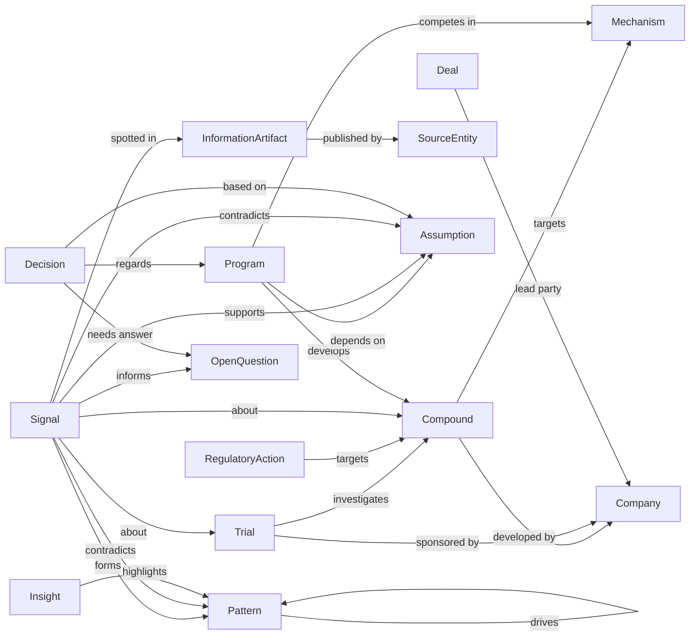

# Pharma intelligence: competitive pipeline to program decisions

Build a living competitive intelligence record for a biotech program, and the
agent workflows around it. It keeps the compounds, trials, deals and regulatory
actions around the program linked to the program's own assumptions, decisions
and open questions, so each outside signal shows what it supports or threatens.
New public signals are linked as they appear, so a decision briefing is a read
and not a rebuilt slide deck. Agents propose signals and links on branches for
an analyst to review.

Competitive intelligence usually sits in a pipeline database, a folder of
press-release clippings and a strategy deck, and nothing connects them. A
readout lands, and nobody can say which assumption it weakens or which decision
it touches. This cookbook sets Omnigraph up as the one place the outside
pipeline and the program's own beliefs are held together.

- **Evidence against each assumption.** See which signals support or contradict
  a belief the program rests on, from any team's reading of the market.
- **Briefing before a decision.** For a go/no-go date, list the assumptions it
  rests on and the open questions it still needs answered.
- **Sources you can check.** Each signal links to the filing, registry entry or
  press release it came from.

> If you are an agent: the commands, roles and workflows are in
> [AGENTS.md](AGENTS.md). Read that file before running anything.

## The data model



| Area | Types | Holds |
|---|---|---|
| Pipeline | `Compound`, `Mechanism`, `Trial`, `Company`, `Deal`, `RegulatoryAction` | The market around the program: drugs, how they work, who makes them, their trials, deals and agency actions |
| Intelligence | `Signal`, `Pattern`, `Insight` | Dated outside events, the themes they form or contradict, and the conclusions drawn from them |
| Provenance | `SourceEntity`, `InformationArtifact` | The publisher and the document each signal was spotted in |
| Program | `Program`, `Assumption`, `Decision`, `OpenQuestion` | The sponsor's own programs, the beliefs they rest on, upcoming decisions and what is still unanswered |

- **Beliefs are records.** An assumption, a decision and an open question are
  each their own entry with their own evidence, not a note on a program.
- **Outside events link inward.** A signal links to the assumption it supports
  or contradicts and the question it informs, so evidence crosses team
  boundaries: a safety event reaches a strategy bet.
- **Plain categories.** Phase, route, modality, assumption level and decision
  status are fixed lists, so counts and filters mean the same thing for
  everyone.
- **Yours to change.** The model is one file, [`schema.pg`](schema.pg), with 15
  node types and 34 edge types. Add forecasts, indications or patents.

## Branching and merging

A change is made on a branch, which is a version of the whole record. The
baseline moves when the branch is merged.

- **Signal intake.** An agent files a week's signals, their sources and their
  links on its own branch. An analyst reads the branch's diff and merges it.
- **Scenarios.** Add an imagined signal, such as a competitor approval, on a
  branch and read the assumptions and decisions as they would then stand.
  Discard the branch if the scenario does not happen.
- **Competing readings.** Two analysts who read the same readout differently
  each use a branch, and the record shows both before one is merged.

Review is a practice here. The writer role can change `main` and merge, so
nothing enforces that an agent's branch waits for a person.

## Agents and workflows

Agents bring public signals into the record, link them to what they affect and
tell people what changed. Analysts decide what a signal means for the program.

| Kind | Workflow | What it does | Stored queries |
|---|---|---|---|
| Capture | Signal intake | Records a press release, filing, registry entry or agency letter as a signal with its document and publisher | `add_signal`, `add_artifact`, `link_signal_artifact`, `link_artifact_source` |
| Capture | Pipeline tracking | Adds a new compound, trial, deal or agency action and links it to its mechanism and sponsor | `add_compound`, `add_trial`, `link_compound_mechanism`, `link_compound_company` |
| Capture | Signal mapping | Links a new signal to the compounds, companies and patterns it concerns | `link_about_compound`, `link_relevant_company`, `link_forms_pattern`, `link_contradicts_pattern` |
| Maintain | Assumption review | Links a signal to the assumptions it supports or contradicts, and re-reads the evidence for each | `link_signal_contradicts_assumption`, `link_signal_supports_assumption`, `assumption_contradicting_signals` |
| Maintain | Open question watch | Links signals that inform an open question and lists the questions still open | `link_signal_informs_question`, `questions_open`, `question_signals` |
| Maintain | Pattern synthesis | Reads the signals for and against a theme and writes an insight that sums them up | `pattern_signals`, `pattern_contradictions`, `add_insight`, `link_highlights_pattern` |
| Maintain | Landscape check | Lists recent signals about every compound that shares the program's mechanism | `program_landscape_signals`, `mechanism_signals_via_compound`, `recent_signals` |
| Act | Decision briefing | Before a decision date, sends its decider the assumptions, open questions and contradicting signals | `decisions_upcoming`, `decision_assumptions`, `decision_questions`, `assumption_contradicting_signals` |
| Act | Signal alert | When a signal informs an open question, tells the team that asked it; when it contradicts an assumption, flags the program team | `signal_informs_questions`, `questions_open`, `signal_contradicts_assumptions` |
| Act | Competitor digest | Sends the strategy team a periodic list of new signals, rival compounds and deals | `recent_signals`, `program_competitors`, `deals_all` |

Every workflow has the same parts:

1. Something starts it: a new public document, a change in the record, or a
   date such as a decision coming up.
2. The agent reads the state it needs through stored queries.
3. It acts. It writes to the record on its own branch, or it tells someone
   outside the record: a message or a briefing.
4. A person decides. An analyst reviews the branch and merges it, or acts on
   what they were told.

- **Agents are not held to branches.** No role here is limited to branches, so
  an agent that should not touch `main` has to be told to use its own branch.
- **Outside actions are not held back by the record.** A message or briefing
  goes out through the agent's own tools, and nothing here reviews it first.
  Keep those workflows to telling and drafting. The record has no place to note
  that an alert was sent, so the agent has to keep track of that itself.
- **Some changes have no stored write.** The cookbook only adds. It has no
  stored write to resolve a question, record a decision's outcome or change a
  compound's phase, so those changes are made by a person outside it.
- **Bring your own agent.** It connects through Omnigraph's MCP server from
  Claude Code, Codex, Cursor or another MCP client. The cookbook has no skill
  of its own.

## Data sources

The record holds the links between your sources. Each source stays the
authority for its own data.

| Source | Examples | Feeds |
|---|---|---|
| Trial registries | ClinicalTrials.gov, EU Clinical Trials Register | `Trial`, `Compound` |
| Regulators | FDA, EMA, CMS | `RegulatoryAction` |
| Company filings and releases | SEC EDGAR, PR Newswire, Business Wire | `Signal`, `InformationArtifact`, `Deal` |
| Earnings and conferences | Investor presentations, earnings call transcripts, ASCO, ADA | `Signal`, `InformationArtifact` |
| Commercial pipeline databases | Citeline Pharmaprojects and Trialtrove, Evaluate Pharma | `Compound`, `Mechanism`, `Company` |
| Internal planning | Strategy decks, portfolio reviews, meeting notes | `Program`, `Assumption`, `Decision`, `OpenQuestion` |

The cookbook does not include connectors for these. A sync is a script, or an
agent, that reads from the source and writes to the record through the stored
mutations or a merge load. Assumptions, decisions and questions come from
people, not from a feed.

## Questions you can ask

Nobody keeps a contradiction log or a competitor sheet up to date for these.

| Question | Stored query |
|---|---|
| Which signals contradict an assumption the program relies on? | `assumption_contradicting_signals` |
| Which decisions are coming up? | `decisions_upcoming` |
| Which compounds compete with the program? | `program_competitors` |
| Which compounds target a mechanism? | `compounds_by_mechanism` |

The cookbook has 70 stored reads and 35 stored writes. AGENTS.md lists the
commands.

## Sample data

The cookbook comes with Viking Therapeutics' obesity program in mid-2026, from
public filings, registries and press releases: 13 companies, 12 compounds,
8 trials, 18 signals, 5 assumptions, 2 decisions and 4 open questions. On a
fresh load, the questions above return:

- Two signals contradict the belief that oral GLP-1 displaces injectables:
  Pfizer ending danuglipron and Structure's disappointing Phase 2a.
- Two decisions are upcoming: the VANQUISH interim go/no-go on 2026-07-15 and
  the oral Phase 3 start on 2026-09-30.
- The program's subcutaneous compound shares its mechanism with tirzepatide
  and with Viking's own oral compound.
- The dual GLP-1/GIP mechanism has the same three compounds.

[seed.md](seed.md) describes the seed and its key links.

## Run it

Paste this prompt into a coding agent such as Claude Code or Codex:

```text
Read https://www.omnigraph.dev/onboarding.md and set up Omnigraph for me with the pharma intelligence cookbook: https://github.com/ModernRelay/omnigraph-cookbooks/tree/main/pharma-intel
```

The agent installs Omnigraph if needed, creates the graph, loads the sample
and runs the questions above.

To do it by hand, follow the shared [local setup](../docs/local-setup.md)
using folder `pharma-intel` and Graph ID `pharma`. [AGENTS.md](AGENTS.md) has
the exact command for each question and workflow on this page.
