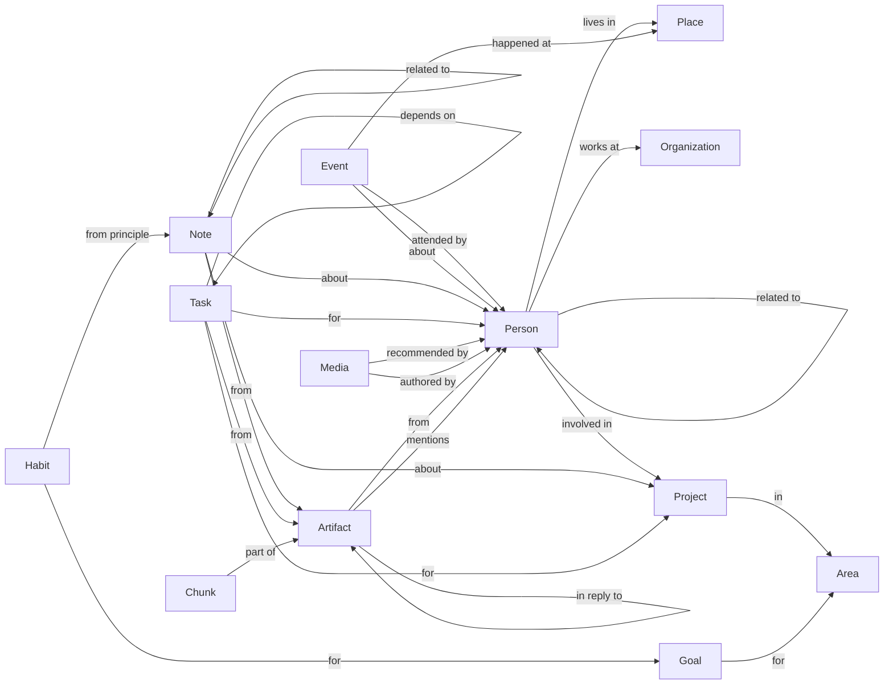

# Second brain: a memory of your life that you can check

A second brain your agents keep, where every note, task and promise links back
to the message it came from. It holds one person's people, projects, notes,
tasks, habits and reading, linked to each other. Agents capture what arrives
and tidy what is there, and you review their work on a branch before it joins
the record.

Your life is spread over messages, email, a calendar, a notes app and a task
list. Nothing connects "Theo loves Islay malts" to the text where you promised
him a book, so an agent that reads them answers from whichever it found. This
cookbook sets Omnigraph up as the one place your people, commitments and
thinking are held.

- **Every note has its source.** A note, task or fact links back to the
  message, email or voice memo it came from.
- **Debts are visible both ways.** What you owe a person and what they owe you
  are tasks with a direction, so neither is lost in a thread.
- **Agents capture, you decide.** An agent files what arrives and drafts the
  follow-ups. You review its work on a branch and merge it.

> If you are an agent: the commands, roles and workflows are in
> [AGENTS.md](AGENTS.md). Read that file before running anything.

## The data model



| Area | Types | Holds |
|---|---|---|
| People and places | `Person`, `Organization`, `Place` | Family, friends, colleagues and mentors, with how often you want to be in touch; where they work and live |
| Time | `Event` | Past and upcoming birthdays, trips, milestones and meetings, with who was there |
| Thinking | `Note` | Ideas, journal entries, principles, preferences, questions and decisions, one kind of note told apart by its `kind` |
| Doing | `Task`, `Project`, `Area`, `Goal`, `Habit` | Next actions and promises, efforts with an end, the parts of life they serve, goals and routines |
| Reading | `Media` | Books, articles, podcasts and shows, with who recommended them |
| Sources | `Artifact`, `Chunk` | The raw message, email, memo or clip, and its text split for semantic search |

- **You are a person in the graph.** The record holds you as `per-self`, so
  your links to everyone else read like any other.
- **A debt is a task with a direction.** `i-owe`, `they-owe` or `mutual`, linked
  to the person. "Waiting on" is a waiting task linked to that person.
- **Capture the raw thing first.** A message or memo is stored as an
  `Artifact`. A note or task derived from it links back, so the source can be
  checked.
- **Both sides of a friendship are stored.** If A knows B, the record also holds
  B knows A, and family links carry the inverse relation.
- **Health, money and hobbies are areas.** They are an `Area` with notes
  attached, not new types.
- **Yours to change.** The model is one file, [`schema.pg`](schema.pg), with 13
  node types and 43 edge types. Specialty cookbooks can extend it.

## Branching and merging

A change is made on a branch, and the baseline moves when the branch is
merged.

- **Agent captures.** An agent files a batch of messages, notes and tasks on
  its own branch. You read the branch and merge it, so a misread message does
  not become a fact.
- **Tidying.** Added links, such as the missing side of a friendship, wait on a
  branch, and you compare it with `main` before it lands.
- **Trying something.** A new way of organising projects or areas can be
  tried on a branch and dropped.
- **Review is a habit here.** The example access policy lets a writer change
  `main` directly, and has no separate agent role. Give an agent a token that
  can write only a branch, and treat a merge by it as your decision.

## Agents and workflows

Agents bring what arrives into the record, keep it connected and tell you what
needs you. You review what they wrote and decide what to do.

| Kind | Workflow | What it does | Stored queries |
|---|---|---|---|
| Capture | Message capture | Files an incoming message, email or voice memo as a source, linked to who sent it and who it names | `add_artifact`, `link_artifact_from_person`, `link_mentions_person`, `link_in_reply_to` |
| Capture | Commitment capture | Turns a promise made in a message into a task for the person it concerns, linked to the source | `add_task`, `link_task_for_person`, `link_task_from_artifact` |
| Capture | Note capture | Files an idea, a journal entry or a preference as a note linked to the people and projects it is about | `add_note`, `link_note_about_person`, `link_note_about_project`, `link_note_from_artifact` |
| Capture | Event and reading capture | Records a gathering with who was there, and a book someone recommended | `add_event`, `link_attended_by`, `add_media`, `link_media_recommended_by` |
| Maintain | Relationship upkeep | Checks that both sides of each friendship and family link are stored, and adds the missing one | `person_knows`, `person_family`, `link_knows`, `link_related` |
| Maintain | Weekly review | Reads active projects, their tasks and the goals above them, and drafts a reflection note | `projects_active`, `project_tasks`, `goal_tasks`, `add_note` |
| Maintain | Open questions | Gathers the questions and principles you have noted and drafts how recent notes bear on them | `open_questions`, `principles_all`, `notes_by_kind` |
| Act | Morning briefing | Tells you the next actions, what you are waiting on and the events coming up | `tasks_next`, `tasks_waiting`, `events_chronological` |
| Act | Stay in touch | Compares each close friend's wanted contact interval with their last event and suggests whom to reach | `close_friends`, `person_recent_events` |
| Act | Follow-up draft | Drafts a nudge to a person who owes you something, for you to send | `tasks_they_owe`, `tasks_waiting_on_person` |
| Act | Meeting prep | Before an event, lists who is coming, what they like and what you owe them | `event_attendees`, `preferences_for_person`, `person_tasks_i_owe` |

Every workflow has the same parts:

1. Something starts it: a message arriving, a date, or you asking.
2. The agent reads the state it needs through stored queries.
3. It acts. It writes to the record on a branch, or it tells you or drafts
   something outside the record.
4. You decide. You merge the branch, or you send the message yourself.

- **The cookbook has no stored write for every change.** Stored writes add
  records and links. None sets a task's direction, due date or status, marks a
  task done, logs a habit completion or merges two people, so those changes
  are not available as stored workflows and the list above leaves them out.
- **Nothing records that you were reminded.** The briefing, the nudge and the
  draft leave no mark, so the agent repeats them each time it is asked. Run
  them on a schedule you choose.
- **The record does not hold back outside actions.** A reminder or a message
  goes out through the agent's own tools, and nothing here reviews it first.
  Keep these workflows to telling and drafting, and send anything to another
  person yourself. The cookbook includes no integrations for them.
- **Bring your own agent.** Any agent that can run the `omnigraph` CLI can use
  the stored queries; the commands are in [AGENTS.md](AGENTS.md). This cookbook
  ships no skill of its own.

## Data sources

The record connects your tools, and each tool stays the authority for its own
data.

| Source | Examples | Feeds |
|---|---|---|
| Messaging | WhatsApp, iMessage, Telegram, Slack, SMS | `Artifact`, `Person`, `Task` |
| Email | Gmail, Apple Mail | `Artifact`, `Person`, `Task` |
| Calendar | Google Calendar, Apple Calendar | `Event`, `Person`, `Place` |
| Notes and journals | Apple Notes, Notion, Obsidian, voice memos | `Note`, `Artifact` |
| Reading | Readwise, Kindle, Pocket, Goodreads | `Media`, `Artifact` |
| Contacts and social | Apple Contacts, LinkedIn, Instagram, X | `Person`, `Organization` |

The cookbook includes no connectors. An agent reads a tool with its own access
and writes to the record through the stored writes, on a branch. The schema
names these sources in `Artifact.source`.

## Questions you can ask

Nobody has to keep these lists by hand.

| Question | Stored query |
|---|---|
| What do I still owe this person? | `person_tasks_i_owe` |
| What should I do next? | `tasks_next` |
| What is on my reading list? | `reading_queue` |
| Who recommended this book? | `media_recommended_by` |

## Sample data

The cookbook comes with Alex Chen, a made-up 36-year-old product designer in
Brooklyn: 121 records of 16 people, 12 events, 21 notes, 15 tasks, 12 media
items and 11 sources, with 228 links. On a fresh load, the questions above
return:

- Alex owes Theo one thing: sending a link to a book.
- Twelve tasks are next actions, the first of them replying to Marco's
  playdate text.
- Two books are on the reading list: Outlive and Pachinko.
- Maya recommended Pachinko.

[seed.md](seed.md) describes it and lists what the main stored reads return.

## Run it

Paste this prompt into a coding agent such as Claude Code or Codex:

```text
Read https://www.omnigraph.dev/onboarding.md and set up Omnigraph for me with the second-brain cookbook: https://github.com/ModernRelay/omnigraph-cookbooks/tree/main/second-brain
```

To do it by hand, follow the shared [local setup](../docs/local-setup.md)
using folder `second-brain` and Graph ID `brain`. [AGENTS.md](AGENTS.md) has
the exact command for each question and workflow on this page.
