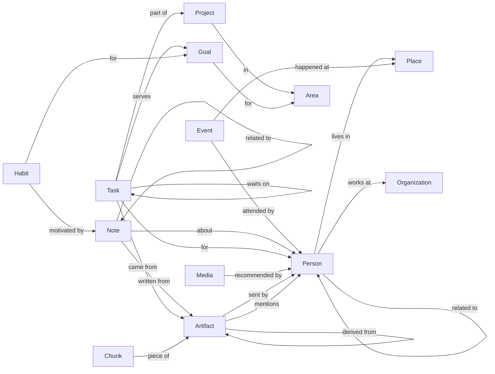

# Second brain: one record of a life, for you and your agents

Build a living second brain, and the agent workflows around it. It keeps the people, projects, notes, tasks, habits and reading of one life linked to the messages and events they came from, so what you owe someone and what to do next stay answerable as life changes. Agents capture each message and promise as it arrives, tidy the record and tell you what needs you. They write on a branch, and you merge what you accept.

Your life is spread over chat apps, email, a calendar, a task manager and a notes app. None of them knows who a message was from, which project it belongs to or what you promised in it, so an agent that reads one of them answers from that one alone. This cookbook sets OmniGraph up as the one place those links are held.

- **Everything has its source.** A note or a task links back to the message or event it came from.
- **Promises are tracked by person.** What you owe someone, and what they owe you, is one question per person.
- **Your agents share your context.** Principles, preferences and open questions are written once, and every agent reads them.

> If you are an agent: the commands, roles and workflows are in
> [AGENTS.md](AGENTS.md). Read that file before running anything.

## The data model



| Area | Types | Holds |
|---|---|---|
| People | `Person`, `Organization` | Family, friends, colleagues and mentors, with how often you want to be in touch, and the places they work |
| World and time | `Place`, `Event` | Where people live and meet, and what happened or is coming up |
| Capture | `Note` | Ideas, journal entries, principles, preferences, questions and decisions, told apart by a kind |
| Action | `Task`, `Project`, `Area`, `Goal`, `Habit` | What to do, the efforts it belongs to, the parts of life they sit in, and the routines |
| Media | `Media` | Books, podcasts, shows and papers, with who recommended them |
| Provenance | `Artifact`, `Chunk` | The raw message, email, voice memo or web clip, and the pieces of it cut for search |

- **One kind of note.** Principles, preferences, journal entries, questions and
  decisions are all notes. A preference such as "Theo loves Islay malts" is a
  note about Theo, so every agent finds it the same way.
- **Debts live on the task.** A task says whether you owe it, they owe it or it
  is mutual, and links to the person. There is no separate commitments list.
- **Every message is an artifact.** Email, chat and voice memos share one type,
  with a source and a thread, so a conversation across apps reads as one thread.
- **Family and friendship are stored both ways.** If Alex knows Theo, Theo knows
  Alex, so a question from either side finds the link.
- **Health, money and hobbies are areas.** They are notes and tasks under an
  area, not types of their own. A health record belongs in a sibling cookbook.
- **Yours to change.** The model is one file, [`schema.pg`](schema.pg), with 13
  node types and 43 edge types. `Chunk` is declared for semantic search; it
  holds nothing until you run an embedding pass.

## Branching and merging

A change is made on a branch, which is a version of the whole record. Your own
record moves only when the branch is merged.

- **One branch per agent run.** An agent that sorts a week of messages writes
  everything on its own branch. You read the diff and merge it, or throw it away.
- **Two agents, one merge.** Two agents that capture the same message on
  different branches meet at the merge, not in your record.
- **Trying a plan.** Branch to re-link tasks to a different project, or to draft
  a trip, and keep it only if it reads right.
- **The record as it was.** Ask any question of the record as it stood on an
  earlier commit, such as who you owed before a trip.

The example roles do not separate agents from you. A token that can write can
write on `main` and merge. Keeping an agent to its own branch is a habit, not a
rule the store enforces.

## Agents and workflows

Agents bring what happens into the record, keep it tidy and tell you what needs
you. You decide what the record keeps and what you do about it.

| Kind | Workflow | What it does | Stored queries |
|---|---|---|---|
| Capture | Message intake | Records a message, email or voice memo as an artifact, and links who sent it, who it names, its thread and its project | `add_artifact`, `link_artifact_from_person`, `link_mentions_person`, `link_in_reply_to`, `link_artifact_for_project`, `artifacts_by_thread` |
| Capture | Promise capture | Turns a promise in a message into a task for that person, linked to the message it came from | `add_task`, `link_task_for_person`, `link_task_from_artifact` |
| Capture | Notes and preferences | Records a thought, a preference or a decision, about a person or project, from the event or message that prompted it | `add_note`, `link_note_about_person`, `link_note_about_project`, `link_note_from_artifact`, `link_note_from_event` |
| Capture | Event log | Records a dinner, call or trip with who came and where | `add_event`, `link_attended_by`, `link_happened_at` |
| Maintain | Inbox review | Takes each new inbox task and links it to a project, area or goal | `tasks_inbox`, `projects_active`, `link_task_for_project`, `link_task_for_area`, `link_task_for_goal` |
| Maintain | Note linking | Links notes that say related things, and lists open questions that newer notes now answer | `notes_recent`, `note_related`, `link_related_note`, `open_questions` |
| Maintain | Stale review | Lists next actions and waiting items past their date, for you to finish, drop or move | `tasks_next`, `tasks_waiting` |
| Act | Owed and overdue | Reminds you of what you owe, by person and date | `tasks_i_owe`, `person_tasks_i_owe` |
| Act | Chase | Drafts a nudge to each person who owes you something you are waiting on | `tasks_they_owe`, `tasks_waiting_on_person` |
| Act | Stay in touch | Drafts a message to each close friend you have not seen or heard from within the gap you want | `close_friends`, `person_recent_events`, `person_artifacts_from` |
| Act | Briefing | Before an event, sends you who is coming, what they like, what you owe them and when you last met | `events_chronological`, `event_attendees`, `person_notes`, `preferences_for_person`, `person_tasks_i_owe` |

Every workflow has the same parts:

1. Something starts it: a message arrives, an event ends, a date passes or you
   ask.
2. The agent reads the state it needs through stored queries.
3. It acts. It writes to the record on its own branch, or it tells someone
   outside the record: you, or a person you owe a reply.
4. A person decides. You merge the branch, or you act on what you were told.

- **An agent does not decide what the record keeps.** It drafts and links. You
  merge, and you finish, drop or reschedule a task. The stored writes only add;
  nothing here changes or deletes a row, so a status change is an ad hoc
  mutation.
- **Outside actions are not held back by the record.** A reminder or a drafted
  message goes out through the agent's own tools, and nothing here reviews it
  first. Keep these workflows to telling you and drafting, and send nothing to
  another person without approving it. The cookbook has no integrations for
  them, and the record does not note that a reminder was sent, so the agent
  keeps track of that itself.
- **Some links are the agent's to compute.** No stored query lists a close friend
  who is overdue or a task past its date. The agent reads the cadence, the dates
  and the last contact, and compares them.
- **Bring your own agent.** It connects through OmniGraph's MCP server from
  Claude Code, Codex, Cursor or another MCP client. The cookbook has no skill
  of its own.

## Data sources

The record holds the links between your tools. Each tool stays the authority
for its own data.

| Source | Examples | Feeds |
|---|---|---|
| Chat | WhatsApp, iMessage, Telegram, Slack, LinkedIn messages | `Artifact`, `Person` |
| Email | Gmail, Outlook, Fastmail | `Artifact`, `Person` |
| Calendar | Google Calendar, Apple Calendar | `Event`, `Artifact` |
| Contacts | Apple Contacts, Google Contacts | `Person`, `Organization`, `Place` |
| Tasks | Things, Todoist, OmniFocus | `Task`, `Project`, `Goal` |
| Notes and journal | Obsidian, Apple Notes, Notion | `Note` |
| Voice | Apple Voice Memos, Whisper | `Artifact` |
| Reading | Readwise, Kindle, Goodreads, Pocket | `Media`, `Artifact` |
| Activity | Strava, Apple Health | `Habit` |

The cookbook does not include connectors for these. A sync is a script, or an
agent, that reads from the tool and writes to the record through the stored
mutations or a merge load. The source of an artifact is one of sixteen channels
in the schema, such as `whatsapp`, `email` and `calendar`.

## Questions you can ask

Nobody keeps a list of debts, a reading queue or a next-actions page by hand
for these.

| Question | Stored query |
|---|---|
| What do I still owe this person? | `person_tasks_i_owe` |
| What should I do next? | `tasks_next` |
| What is on my reading list? | `reading_queue` |
| Who recommended this book? | `media_recommended_by` |

The cookbook has 74 stored reads and 54 stored writes. AGENTS.md lists the
reads it uses.

## Sample data

The cookbook comes with Alex Chen, a made-up senior product designer in
Brooklyn with a partner, two kids, a side project and a kitchen renovation: 16
people, 15 tasks, 12 media, 12 events, 21 notes and 11 messages, 121 nodes and
228 edges in all. On a fresh load, the questions above return:

- One thing Alex owes Theo: send him the link to the book Alex promised.
- Twelve next actions, the earliest due first: reply to Marco's playdate text.
- Two books to read: Outlive and Pachinko.
- Kenji recommended Outlive.

[seed.md](seed.md) describes the person and lists what the main reads return.

## Run it

Paste this prompt into a coding agent such as Claude Code or Codex:

```text
Read https://www.omnigraph.dev/onboarding.md and set up Omnigraph for me with the second brain cookbook: https://github.com/ModernRelay/omnigraph-cookbooks/tree/main/second-brain
```

The agent installs OmniGraph if needed, creates the graph, loads Alex and runs
the questions above.

To do it by hand, follow the shared [local setup](../README.md#local-setup)
using folder `second-brain` and Graph ID `brain`. [AGENTS.md](AGENTS.md) has
the exact command for each question and workflow on this page.
