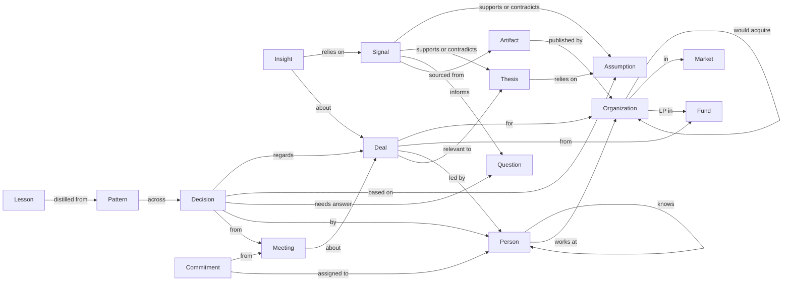

# Venture firm: from signal to decision

Build a living system of record for a venture firm, and the agent workflows around it. It keeps deals, investment theses and the assumptions under them, signals, meetings, decisions, commitments, and the people and organizations involved linked, so they stay aligned as evidence arrives. Which active theses are contradicted is worked out from the signals each time you ask, so no status drifts from the evidence. Agents capture calls and news and re-check beliefs on branches a partner reviews before anything reaches the baseline.

A firm's pipeline sits in a CRM, its theses in a wiki, its conversations in chat and call notes, and its numbers in spreadsheets. None of them knows which news weakens which assumption, so a deal reaches investment committee on evidence nobody lined up. This cookbook sets OmniGraph up as the one place those links are held.

- **Evidence tied to belief.** Every signal says which assumption or thesis it supports or contradicts, so you see what is under pressure.
- **A decision with its reasons.** Each decision links the deal, the assumptions it rests on, the questions still open and the person who made it.
- **Review before the baseline.** A partner reviews what an agent proposes on a branch, and merges it.

> If you are an agent: the commands, roles and workflows are in
> [AGENTS.md](AGENTS.md). Read that file before running anything.

## The data model



| Area | Types | Holds |
|---|---|---|
| Engagement | `Deal`, `Fund`, `Organization`, `Person`, `Market` | Funding rounds, the firm's funds, every company, investor, LP, acquirer and source, the people at them, and sectors |
| Belief | `Thesis`, `Assumption`, `Question` | What the firm bets on, what each bet relies on, and what is still open |
| Evidence | `Signal`, `Insight`, `Artifact`, `Chunk` | Dated events, the memos that interpret them, and the raw emails, transcripts and pages behind them |
| Action | `Decision`, `Commitment`, `Meeting` | One-time decisions, deferred actions with a deadline and an owner, and the meetings that produced them |
| Learning | `Pattern`, `Lesson` | Shapes that recur across deals, and the rules the firm draws from them |

- **One organization type.** Startups, LPs, acquirers, peer funds, customers and the firm itself are all `Organization`, told apart by kind.
- **Sources are organizations.** A publisher, a database and an expert network each carry a reliability rating, so when one drops you can walk to every signal that rests on it.
- **Decisions attach to deals.** A decision regards a round, not a company, and keeps its assumptions, open questions and decider, so the audit trail is in the record.
- **Intros and follow-ups are commitments.** A decision happens once. Scheduling a second meeting or flagging something at the next board has a due date and an assignee.
- **Raw content is kept apart from belief.** An `Artifact` holds the transcript, email or page, and can carry the file itself. A `Signal` or `Insight` derived from it links back.
- **Yours to change.** The model is one file, [`schema.pg`](schema.pg), with 17 node types. Keep it for a firm like yours and replace the seed.

## Branching and merging

A change is made on a branch, which is a version of the whole record. The baseline moves only when a partner merges the branch.

- **Tentative lessons.** An agent that sees a pattern across closed deals drafts a lesson on a branch. A partner reads the diff, then merges it or deletes it.
- **Ingest per meeting.** Each call's transcript, signals and commitments land together on one branch, so a failed step leaves no orphan signals.
- **IC debate.** Bull, bear and neutral agents each write an insight on a shared branch before a committee, so a partner can read the disagreement side by side.
- **Counterfactuals.** Branch from the commit of a decision, change one assumption, and run the pre-IC brief again to see what the firm would have concluded.

## Agents and workflows

Agents bring calls and news into the record, keep beliefs checked against evidence, and tell partners what needs them. Partners decide.

| Kind | Workflow | What it does | Stored queries |
|---|---|---|---|
| Capture | Call intake | Records a call as a meeting with its transcript, the signals it contains and the commitments it produced | `get_meeting`, `add_artifact`, `link_artifact_from_meeting`, `add_signal`, `add_commitment`, `link_commitment_from_meeting` |
| Capture | Signal intake | Turns news, scout notes and founder updates into signals tied to the organization, the source and the beliefs they bear on | `search_organizations`, `search_signals`, `add_signal`, `link_signal_about_organization`, `link_contradicts_assumption` |
| Capture | Wiki sync | Records the partners' markdown notes as artifacts linked to the thesis, pattern or lesson they document | `add_markdown_artifact`, `link_artifact_documents_thesis` |
| Maintain | Belief check | When a signal lands, finds the assumptions and theses it contradicts and the decisions that rest on them, and opens a question where one is needed | `signal_contradicts_assumptions`, `signal_portfolio_impact`, `contradicted_active_theses`, `add_question` |
| Maintain | Source reliability sweep | When a source's rating drops, lists the signals that rest on it so they can be re-read | `sources_by_reliability`, `source_downstream_signals` |
| Maintain | IC debate | Writes a bull, a bear and a neutral insight on a deal from the evidence already linked to it | `pre_ic_brief_evidence`, `debate_stances`, `add_insight_with_stance`, `link_insight_relies_on_signal` |
| Maintain | Learning sweep | Proposes a lesson where a pattern recurs across decisions with the same outcome and no active lesson covers it | `patterns_all`, `pattern_decisions`, `lessons_active`, `add_lesson`, `link_lesson_distilled_from` |
| Act | Pre-IC brief | Before a committee, sends the partners the thesis, the evidence for and against, open questions, earlier meetings and what is still owed | `meetings_upcoming`, `pre_ic_brief_thesis`, `pre_ic_brief_evidence`, `pre_ic_brief_questions`, `ic_prep_open_commitments` |
| Act | Board prep pack | Before a board meeting, sends the lead partner the portfolio company's recent signals, open questions and commitments | `upcoming_board_meetings_for_organization`, `board_prep_pack`, `board_prep_open_questions`, `board_prep_commitments` |
| Act | Commitment nudges | Reminds each owner of the commitments that are open and due | `commitments_open`, `commitment_assigned_to` |
| Act | Intro requests | Finds the shortest path from the team to a founder and drafts the ask to the person in between | `intro_path_to_founder`, `direct_team_knowers` |

Every workflow has the same parts:

1. Something starts it: a call that ends, a new article, a date such as a committee coming up, or a source losing its rating.
2. The agent reads the state it needs through stored queries.
3. It acts. It writes to the record on its own branch, or it tells someone outside the record: a message, a brief, a draft.
4. A person decides. A partner reviews the branch and merges it, or acts on what they were told.

- **Agents should not write to `main`.** The cookbook's access policy has admin, writer and reader roles and no agent role, so a token that can write can also write to `main` and merge. Give an agent the reader role or add a role like the one in [hardware-program](../hardware-program/policies/graph.policy.yaml) before you rely on review.
- **Outside actions are not held back by the record.** A message or a draft goes out through the agent's own tools, and nothing here reviews it first. Keep these workflows to telling and drafting, and give the agent only the outside access it needs. The record has no field for a reminder or brief already sent, so the agent has to keep track of that itself.
- **Do not fabricate.** An agent flags a person or organization it cannot resolve instead of inventing one.
- **Bring your own agent.** It connects through OmniGraph's MCP server from Claude Code, Codex, Cursor or another MCP client. The cookbook has no skill of its own; [AGENTS.md](AGENTS.md) holds the rules an agent follows.

## Data sources

The record holds the links that connect your tools. Each tool stays the authority for its own data.

| Source | Examples | Feeds |
|---|---|---|
| CRM | Affinity, Airtable | `Organization`, `Person`, `Deal` |
| Call recording | Granola | `Meeting`, `Artifact`, `Commitment` |
| Email and chat | Gmail, Slack | `Artifact`, `Signal` |
| Company and deal data | PitchBook | `Organization`, `Deal` |
| Expert networks | Tegus | `Artifact`, `Organization` |
| Founder and company enrichment | Harmonic | `Person`, `Organization` |
| Wiki and documents | Notion, GitHub, Google Drive | `Artifact`, `Thesis`, `Lesson` |
| Outbound | Lemlist | `Artifact` |

The cookbook does not include connectors for these. A sync is a script, or an agent, that reads from the tool and writes to the record through the stored mutations or a merge load.

## Questions you can ask

Nobody keeps a status field or a briefing document up to date for these.

| Question | Stored query |
|---|---|
| Which active theses has new evidence contradicted? | `contradicted_active_theses` |
| Before investment committee, what contradicts the assumptions behind this deal? | `pre_ic_brief_evidence` |
| Who on the team can get an introduction to this founder? | `intro_path_to_founder` |
| What recent signals bear on a portfolio company before its next board meeting? | `board_prep_pack` |

The cookbook has 12 query files; [AGENTS.md](AGENTS.md) lists the reads and writes behind each workflow.

## Sample data

The cookbook comes with Quito Capital, a made-up Berlin AI-infrastructure fund with two funds and a five-person team: 207 nodes and 460 edges, including 15 deals, 28 people, 8 theses and 29 signals. On a fresh load, the questions above return:

- Two active theses are contradicted: on-prem inference, by AWS launching an on-prem appliance, and agentic CRMs, by a failed fundraise at a company the fund passed on.
- Three findings weaken the assumptions behind the Helix Runtime round: the AWS appliance against two of them, and Microsoft's on-prem push against its margin assumption.
- CJ can reach Helix's founder Yuki through Jens Mueller, a founder CJ already knows.
- Aetherbrick has two recent signals ahead of its next board: a Q1 churn spike to 8.3% and early Series B talks.

[seed.md](seed.md) describes the firm and lists what every stored read returns.

## Run it

Paste this prompt into a coding agent such as Claude Code or Codex:

```text
Read https://www.omnigraph.dev/onboarding.md and set up Omnigraph for me with the VC OS cookbook: https://github.com/ModernRelay/omnigraph-cookbooks/tree/main/vc-os
```

The agent installs OmniGraph if needed, creates the graph, loads Quito Capital and runs the questions above.

To do it by hand, follow the shared [local setup](../README.md#local-setup)
using folder `vc-os` and Graph ID `vcos`. [AGENTS.md](AGENTS.md) has the
exact command for each question and workflow on this page.
