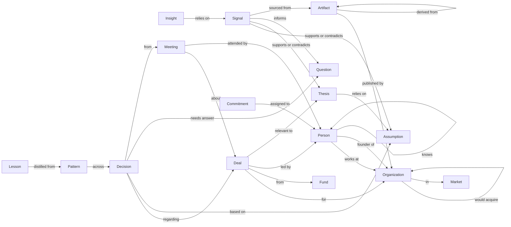

# Venture firm: deals, theses and portfolio in one record

Build a living operating record for a venture firm, and the agent workflows
around it. It keeps deals, portfolio companies, people, meetings, investment
theses and the evidence for and against them linked, so every decision traces
back to the beliefs it rests on. New evidence is tied to the assumptions it
supports or contradicts as it arrives. Agents prepare briefs, capture calls and
propose lessons, and a partner reviews what they write.

A firm's pipeline, notes, chat, call recordings, spreadsheets and portfolio
models sit in separate tools, and agents glue them together with brittle
integrations. Nobody can say which belief a decision rested on, or which news
has since weakened it. This cookbook sets OmniGraph up as the one place the
firm's deals, beliefs and evidence are held.

- **Every decision shows its basis.** A decision links to the deal, the
  assumptions it rests on, the open questions and the partner who made it.
- **Evidence moves beliefs.** A signal is linked to the assumption or thesis it
  supports or contradicts, so a weakened thesis is a query, not a memory.
- **Review before it counts.** An agent's tentative lesson or note waits on a
  branch for a partner to merge.

> If you are an agent: the commands, roles and workflows are in
> [AGENTS.md](AGENTS.md). Read that file before running anything.

## The data model



| Area | Types | Holds |
|---|---|---|
| Firm and network | `Organization`, `Person`, `Fund`, `Market` | Startups, LPs, acquirers, peer firms and the sources the firm reads; the people and how they know each other; the firm's funds; sectors |
| Engagement | `Deal`, `Meeting` | A funding round with its stage and outcome; IC meetings, board meetings and calls, with attendees and what they produced |
| Beliefs | `Thesis`, `Assumption`, `Question` | What the firm has bet on, the falsifiable beliefs under each bet, and what is still open |
| Evidence | `Signal`, `Insight`, `Artifact`, `Chunk` | Dated outside facts, the firm's memos and bull and bear cases, raw transcripts, decks and emails, and indexed slices of them for search |
| Action | `Decision`, `Commitment` | One-off decisions such as invest, pass or follow on; promises with an owner and a due date |
| Learning | `Pattern`, `Lesson` | Shapes that recur across decisions and signals; the rules and protocols the firm distils from them |

- **One entity for every organization.** Startups, LPs, acquirers, peer firms
  and customers are all organizations told apart by kind, so one company can be
  a portfolio company and an acquirer's target without a second record.
- **Sources are scored.** A publisher, database or expert network is an
  organization with a reliability rating. When a source's rating drops, the
  signals that came from its articles can be listed for a second look.
- **Roles live on links.** A person is a founder, a team member, an LP contact
  or an expert through links to organizations and deals, not a fixed label.
- **A decision keeps its provenance.** It links to the deal, the assumptions it
  rests on, the questions it still depends on and the person who made it.
- **Promises are not decisions.** An intro, a follow-up or "flag at the next
  board" is a commitment with an owner and a due date.
- **Files stay with the record.** An artifact can hold the deck or recording
  itself, which is why a firm can retire its drive for this content. The sample
  data holds none.
- **Yours to change.** The model is one file, [`schema.pg`](schema.pg), with 17
  node types and 67 edge types. Add what your firm tracks.

## Branching and merging

A change is made on a branch, which is a version of the whole record. The
baseline moves only when a partner merges the branch.

- **Tentative lessons.** An agent that spots a recurring pattern drafts a
  lesson on a branch. A partner reads the branch diff and merges it or deletes
  it.
- **One branch per call.** An agent that captures a call writes the meeting,
  transcript, signals and commitments on one branch, so a partial capture never
  reaches the baseline.
- **Debate branches.** Bull, bear and neutral agents write their cases on a
  shared branch before an IC, and the partner compares them.
- **Counterfactuals.** A decision sits at a commit. Branch from it, change one
  assumption and run the pre-IC brief again to see what the firm would have
  concluded.

Nothing here enforces that review. The access policy gives writers (`act-admin`
and `act-writer`) write and merge on every branch, `main` included, and gives
readers read only. There is no agent role limited to branches, so an agent run
as a writer can change the baseline. Review of its work is a practice, not a
rule the record enforces.

## Agents and workflows

Agents capture what happens, keep the beliefs consistent with the evidence and
prepare briefs. Partners decide.

| Kind | Workflow | What it does | Stored queries |
|---|---|---|---|
| Capture | Call intake | After a call or meeting, records the meeting, its transcript and the commitments made, with their owners and due dates | `add_meeting`, `add_artifact`, `link_artifact_from_meeting`, `add_commitment` |
| Capture | Signal intake | Records a funding round, launch, hire or regulatory move, and links it to the organizations and the assumptions it supports or contradicts | `add_signal`, `link_signal_about_organization`, `link_contradicts_assumption`, `link_supports_assumption` |
| Capture | Scout triage | Checks a new startup against the firm's records, then adds it as watched with its sector and the discovery signal | `search_organizations`, `add_organization`, `link_organization_in_market`, `add_signal` |
| Maintain | Evidence check | After a signal lands, lists the assumptions it contradicts and the decisions that rest on them | `recent_contradictions`, `signal_portfolio_impact`, `assumption_decisions` |
| Maintain | Thesis review | Finds active theses with contradicting evidence and shows which assumptions carry it | `contradicted_active_theses`, `thesis_contradictions_via_assumptions`, `thesis_assumptions` |
| Maintain | Source review | When a source is rated low, lists the signals that came from its articles | `sources_by_reliability`, `source_downstream_signals` |
| Maintain | Bull and bear cases | Writes a bull, a bear and a neutral memo on a deal, each citing the signals it relies on | `add_insight_with_stance`, `link_insight_relies_on_signal`, `link_insight_about_deal`, `debate_stances` |
| Maintain | Learning sweep | Finds patterns that recur across decisions and proposes a lesson where no active lesson covers them | `patterns_all`, `pattern_decisions`, `lessons_active`, `add_lesson` |
| Act | Pre-IC brief | Before an IC on the calendar, sends the partners the thesis, the contradicting evidence, the open questions and what is still owed | `pre_ic_brief_thesis`, `pre_ic_brief_evidence`, `pre_ic_brief_questions`, `ic_prep_open_commitments` |
| Act | Board prep | Before a board meeting, sends the lead partner a portfolio company's recent signals, open questions and commitments | `board_prep_pack`, `board_prep_open_questions`, `board_prep_commitments`, `board_meetings_for_organization` |
| Act | Founder call brief | Before a founder call, gives the partner the founder's profile, the firm's closest path to them and past conversations | `person_insights`, `intro_path_to_founder`, `direct_team_knowers`, `meetings_with_deal` |
| Act | Commitment reminders | Reminds each owner of the commitments that are open, with what they were for | `commitments_open`, `person_open_commitments` |

Every workflow has the same parts:

1. Something starts it: a call ends, a signal arrives, a meeting comes up on
   the calendar or a quarter closes.
2. The agent reads the state it needs through stored queries.
3. It acts. It writes to the record on its own branch, or it tells someone
   outside the record: a message, a brief, a reminder.
4. A person decides. A partner reviews the branch and merges it, or acts on
   what they were told.

- **Agents should not write `main`.** The policy allows it for writers, so
  point agents at a branch and keep merging with partners.
- **Outside actions are not held back by the record.** A brief or a reminder
  goes out through the agent's own tools, and nothing here reviews it first.
  Keep these workflows to telling and drafting, and give the agent only the
  access it needs. The cookbook includes no integrations for them.
- **Repeats are not tracked.** The record has no place to note that a brief or
  reminder was sent, and no stored write changes a commitment's status or a
  thesis's status or a source's rating. The agent has to keep track of what it
  sent, and a person changes those fields.
- **Bring your own agent.** It connects through OmniGraph's MCP server from
  Claude Code, Codex, Cursor or another MCP client. The cookbook has no skill
  of its own, so [AGENTS.md](AGENTS.md) is the brief.

## Data sources

The record connects the firm's tools. Each tool stays the authority for its own
data.

| Source | Examples | Feeds |
|---|---|---|
| CRM and relationship intelligence | Affinity, Attio, Airtable, HubSpot | `Organization`, `Person`, `Deal` |
| Email and calendar | Gmail, Outlook, Google Calendar | `Meeting`, `Artifact`, `Commitment` |
| Chat | Slack, Microsoft Teams | `Artifact`, `Signal` |
| Call recording | Granola, Fireflies, Otter | `Meeting`, `Artifact` |
| Wiki and drive | Notion, Google Drive, GitHub | `Artifact`, `Thesis`, `Lesson` |
| Market data and enrichment | PitchBook, Preqin, Harmonic, Crunchbase | `Organization`, `Deal`, `Person`, `Signal` |
| Expert networks and news | Tegus, TechCrunch | `Organization`, `Artifact`, `Signal` |
| Portfolio modelling and outreach | Tactyc, Carta, Lemlist | `Fund`, `Signal`, `Artifact` |

The cookbook does not include connectors for these. A sync is a script, or an
agent, that reads from the tool and writes to the record through the stored
mutations.

## Questions you can ask

Nobody keeps a thesis tracker or an evidence spreadsheet up to date for these.

| Question | Stored query |
|---|---|
| Which active theses has new evidence contradicted? | `contradicted_active_theses` |
| Before investment committee, what contradicts the assumptions behind this deal? | `pre_ic_brief_evidence` |
| Who on the team can get an introduction to this founder? | `intro_path_to_founder` |
| What have the portfolio companies reported recently? | `portfolio_updates_recent` |

The cookbook has 204 stored reads and 87 stored writes. AGENTS.md has the
command for each question and workflow.

## Sample data

The cookbook comes with Quito Capital, a made-up Berlin AI-infrastructure fund
with two funds, 34 organizations, 28 people, 16 deals, 8 theses, 12
assumptions, 29 signals and 8 meetings. On a fresh load, the questions above
return:

- Two active theses are contradicted. AWS launching an on-prem Bedrock appliance
  (March 2026) weakens the on-prem inference thesis, and PulseRate's
  undersubscribed Series A weakens the agentic CRM thesis.
- For the Helix Series A, three rows contradict its assumptions. The AWS
  appliance contradicts both the margin and the cost-parity assumption, and
  Microsoft's on-prem GPU offer contradicts the margin assumption.
- CJ Müller can reach Helix's founder Yuki through Jens Mueller, a founder CJ
  knows.
- Four portfolio companies reported recently, Bramble Data most recently with
  $2.8M ARR for the first quarter.

[seed.md](seed.md) describes the firm and its records.

## Run it

Paste this prompt into a coding agent such as Claude Code or Codex:

```text
Read https://www.omnigraph.dev/onboarding.md and set up Omnigraph for me with the venture firm cookbook: https://github.com/ModernRelay/omnigraph-cookbooks/tree/main/vc-os
```

To do it by hand, follow the shared [local setup](../README.md#local-setup)
using folder `vc-os` and Graph ID `vcos`. [AGENTS.md](AGENTS.md) has the exact
command for each question and workflow on this page.
